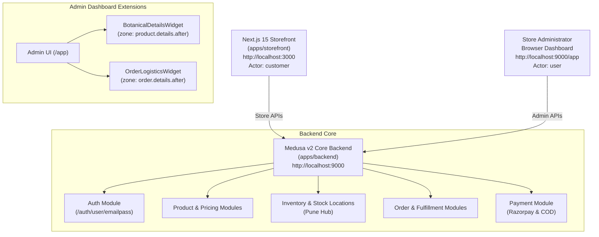
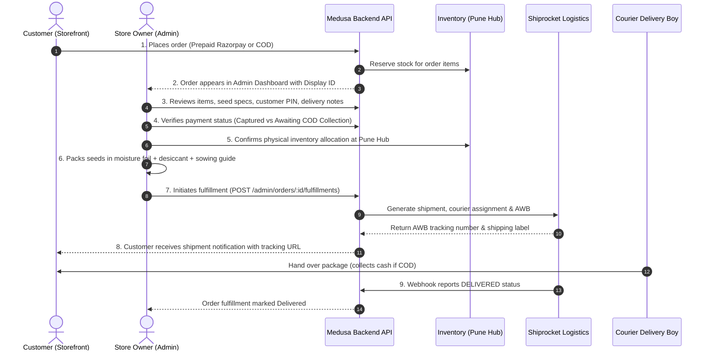
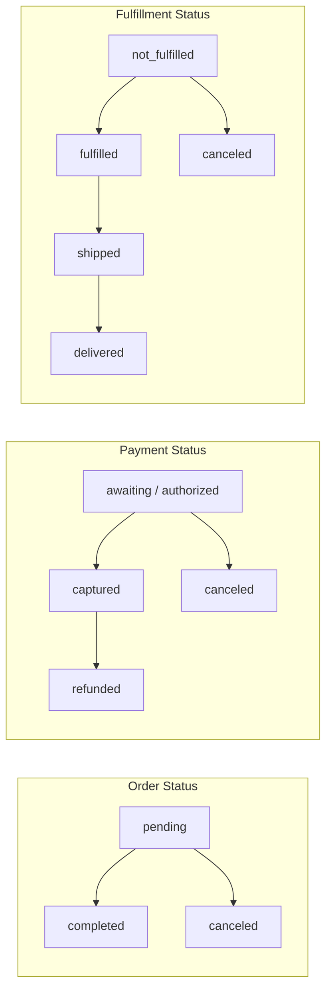

# GLOROV — Admin Operations and Order Management Guide

This document provides a comprehensive operational guide and architectural reference for store administrators managing **GLOROV** (`glorov.in`), an Indian e-commerce platform specializing in heirloom seeds, nursery supplies, and live plants.

It details the native Medusa v2 administrative dashboard workflows, custom Indian logistics widgets, multi-location inventory controls, customer account management, and the complete 9-step order lifecycle.

---

## 1. Administrative Architecture & Setup

GLOROV leverages the native **Medusa v2 Admin Dashboard**, built directly into the Medusa backend server as a single-page React application powered by Vite, Tailwind CSS, and `@medusajs/ui`.



### Dashboard Access & Authentication
- **Admin Dashboard URL**: `http://localhost:9000/app`
- **Authentication Endpoint**: `POST /auth/user/emailpass`
- **Default Seed Admin**: `admin@glorov.in` (Password configured via local environment)
- **Token Type**: Bearer JWT with `actor_type: "user"`.
- **Security Boundary**: The backend enforces strict actor isolation. A token with `actor_type: "customer"` attempting to access `/admin/*` routes is rejected immediately with `401 Unauthorized`.

---

## 2. Administrative Capability Matrix

The following matrix categorizes all operational requirements into native Medusa v2 features, verified GLOROV configurations, custom admin extensions, and future roadmap items:

| Operational Area | Capability / Feature | Status | Implementation Details |
| :--- | :--- | :--- | :--- |
| **Catalog** | Product CRUD & Publishing | **Native Medusa v2** | Standard Medusa Admin product pages (`/app/products`). Supports Draft and Published statuses. |
| **Catalog** | Seed Categories & Collections | **Native Medusa v2** | Native categories (`Vegetable Seeds`, `Herb Seeds`, `Flower Seeds`) and collections (`Kitchen Garden Essentials`). |
| **Catalog** | Botanical & Cultivation Metadata | **Custom Admin Extension** | Custom `BotanicalDetailsWidget.tsx` registered in `product.details.after` displaying Indian botanical names, sowing depth, sunlight, season (Kharif/Rabi/Zaid), and shelf viability. |
| **Catalog** | Seed Packet Variants (20, 50, 100 Seeds) | **Native Medusa v2** | Product variant options (`Packet Size`) with independent SKUs (`GLR-SD-TOM-020`, `GLR-SD-TOM-050`, `GLR-SD-TOM-100`). |
| **Pricing** | Variant-Specific INR Pricing | **Native Medusa v2** | Independent prices per variant stored in major units/paise (`₹49.00`, `₹99.00`, `₹179.00`). |
| **Inventory** | Multi-Location Stock Allocation | **Native Medusa v2** | `Pune Central Nursery Hub` stock location linked to sales channels and Indian delivery zones. |
| **Inventory** | Stock Level Adjustments | **Native Medusa v2** | Real-time stock quantity adjustment via `/app/inventory` or `POST /admin/inventory-items/:id/location-levels/:loc_id`. |
| **Customer** | Customer Accounts & Profiles | **Native Medusa v2** | View registered customer accounts, order history, and contact details via `/app/customers`. |
| **Customer** | Indian Address Inspection | **Native Medusa v2** | Native address book inspection with validated 6-digit Indian PIN codes and phone numbers. |
| **Orders** | Order Visibility & Search | **Native Medusa v2** | Search by display ID (e.g. `#10`), customer email, or filter by Order, Payment, and Fulfillment status. |
| **Logistics** | Shiprocket Fulfillment & AWB Tracking | **Custom Extension** | Modular Shiprocket provider (`shiprocket_shiprocket`) and custom `OrderLogisticsWidget.tsx` displaying AWB, courier partner, and tracking link. |
| **Logistics** | Seed Dispatch Quality Checklist | **Custom Admin Extension** | Built-in packaging verification checklist in `OrderLogisticsWidget.tsx` (moisture seal, desiccant, planting guide insert, lot date). |
| **Payments** | Payment Status & Reconciliation | **Native & Custom** | Decoupled payment inspection. Distinct alerts for Prepaid (Razorpay online) vs Cash on Delivery (courier cash collection required). |
| **Orders** | Cancellations & Stock Release | **Native Medusa v2** | Native `cancelOrderWorkflow` via `POST /store/orders/:id/cancel` and `POST /admin/orders/:id/cancel`. Immediately cancels payment collection, coordinates active Shiprocket shipment cancellation, and releases reserved inventory. |
| **Returns** | Customer Return Requests & Review | **Custom Workflow** | Customers submit claims via `POST /store/orders/:id/return-request` with botanical return reasons; store managers review and approve/reject via `POST /admin/orders/:id/return-requests/:request_id/review` and `OrderLogisticsWidget.tsx`. |
| **Refunds** | Prepaid Gateway Refunds (Razorpay) | **Native Medusa v2** | `POST /admin/orders/:id/refund` executes `refundPaymentWorkflow` after verifying captured status, amount ceiling, and idempotency. |
| **Refunds** | COD Direct Bank Transfer Payouts | **Custom Workflow** | `POST /admin/payments/cod/refund` rejects automated card/UPI gateway rails for COD, enforcing verified Indian bank details and confirmed bank UTR. |
| **Inventory** | Botanical Return Inventory Triage | **Custom Workflow** | `POST /admin/orders/:id/return-inventory-triage` ensures only unopened sealed seeds are restocked to Pune Hub, while perishable live plants are quarantined or written off. |
| **Staff & Security** | User Management & Staff Invites | **Native Medusa v2** | Add staff members via `/app/settings/users` and `/admin/invites`. |
| **Staff & Security** | Granular RBAC Permissions | **Future Work** | Role-based permission policies (e.g. Nursery Packing staff vs Finance/Admin managers) planned for v2.1. |

> See [Order Operations & Return Workflows](file:///Users/sourav/Developer/WEB/top-projects/glorov/docs/order-operations.md) for full operational procedures, state matrices, and botanical triage rules.

---

## 3. The 9-Step Practical Order Processing Lifecycle

The diagram and steps below define the standard operational procedure for processing customer orders from placement to final delivery:



### Detailed Operational Steps

1. **Customer Places Order**:
   - Customer completes checkout on `https://glorov.in` choosing standard or express shipping and selecting Razorpay or Cash on Delivery.
   - Medusa creates the order with high-level status `pending`, payment status (`authorized` or `awaiting`), and fulfillment status `not_fulfilled`.
2. **Order Appears in Admin Dashboard**:
   - The order is instantly visible at `http://localhost:9000/app/orders` with an incremental Display ID (e.g. `#104`), customer email, and total INR amount.
3. **Store Owner Reviews Order**:
   - The owner opens the order details page to inspect:
     - Line items and packet sizes (e.g. `Tomato Seeds (Desi / Pusa Ruby) - 50 Seeds`).
     - Delivery address: 6-digit Indian PIN code (e.g., `411001`), state, city, and customer phone number.
     - Custom order notes or delivery instructions.
4. **Payment Status Verification**:
   - **Prepaid Orders (Razorpay)**:
     - Payment status shows `authorized` or `captured`.
     - `OrderLogisticsWidget` displays a green badge: `✅ Prepaid via Razorpay: Total amount paid online. No cash collection required from customer.`
   - **Cash on Delivery Orders (COD)**:
     - Payment status shows `awaiting` or `authorized`.
     - `OrderLogisticsWidget` displays an amber advisory: `⚠️ Cash on Delivery Collection Required: Collect ₹XX.XX in cash before releasing package.`
5. **Inventory Allocation**:
   - Medusa's Inventory Module has automatically reserved the ordered quantities at the `Pune Central Nursery Hub`. Stock levels prevent accidental overselling.
6. **Seed Packet Packing & Viability Checklist**:
   - Nursery staff pack the order following GLOROV's quality standard:
     - [x] High-barrier aluminium foil pouch heat-sealed with food-grade silica gel desiccant.
     - [x] Regional vernacular sowing and germination guide inserted.
     - [x] Seed lot number, germination percentage, and test date stamped.
     - [x] Cushioned packaging used to prevent seed crushing during courier transit.
7. **Fulfillment Creation via Shiprocket**:
   - Store owner clicks **Create Fulfillment** in the Admin UI (`POST /admin/orders/:id/fulfillments`).
   - Medusa delegates to the Shiprocket fulfillment provider (`shiprocket_shiprocket`), which generates the courier shipment, assigns the best courier partner (e.g. Delhivery Botanical Express), generates the AWB code, and creates the shipping label.
8. **Customer Notification & Tracking**:
   - The order fulfillment status transitions to `fulfilled` or `shipped`.
   - The customer can view live shipment updates on the storefront (`/order/confirmed/[id]` or `/account/orders/[id]`) with a direct link to the Shiprocket tracking portal.
9. **Delivery Confirmation & Exception Handling**:
   - **Successful Delivery**: The Shiprocket tracking webhook (`POST /api/hooks/shiprocket`) receives status `DELIVERED`, automatically updating order fulfillment status to `delivered`. For COD orders, financial remittance is recorded.
   - **Cancellation & Refunds**: If the customer or merchant cancels prior to dispatch, clicking **Cancel Order** (`POST /admin/orders/:id/cancel`) sets order status to `canceled`, cancels the payment collection, and automatically releases reserved stock back to the Pune Hub inventory.

---

## 4. Decoupled Order Status Architecture

Medusa v2 strictly decouples high-level order state from financial and logistics lifecycles. Administrators must never treat payment or fulfillment as a single combined status:



### Decoupled State Transition Matrix

| Action / Event | Order Status | Payment Status | Fulfillment Status | Inventory Impact |
| :--- | :--- | :--- | :--- | :--- |
| **Order Placed (Prepaid)** | `pending` | `authorized` | `not_fulfilled` | Stock reserved at Pune Hub |
| **Order Placed (COD)** | `pending` | `awaiting` | `not_fulfilled` | Stock reserved at Pune Hub |
| **Payment Captured (Razorpay)** | `pending` | `captured` | `not_fulfilled` | Reserved stock unchanged |
| **Fulfillment Created** | `pending` | Unchanged | `fulfilled` | Reserved stock deducted from inventory |
| **Shipment Handed to Courier** | `pending` | Unchanged | `shipped` | Stock in transit |
| **Shiprocket reports DELIVERED (Prepaid)** | `completed` | `captured` | `delivered` | Delivery completed |
| **Shiprocket reports DELIVERED (COD)** | `completed` | `captured` (after remittance) | `delivered` | Delivery completed & cash reconciled |
| **Admin Cancels Order Before Dispatch** | `canceled` | `canceled` | `canceled` | Reserved stock released back to Pune Hub |
| **Admin Processes Refund After Delivery** | `completed` | `refunded` | `delivered` | Return/exchange inventory flow initiated |

---

## 5. Day-to-Day Administrative Workflows

### 5.1 Catalog & Botanical Specifications Management
1. Navigate to **Products** in the admin sidebar.
2. Select any seed product (e.g., `Tomato Seeds (Desi / Pusa Ruby)`).
3. The top section allows editing general commerce attributes: Title, Handle, Description, Product Category, and Product Collection.
4. The **Botanical & Cultivation Specifications** widget immediately displays:
   - Common & Botanical Name
   - Seed Variety & Type (e.g. *Heirloom / Open-Pollinated*)
   - Recommended Season (*Kharif*, *Rabi*, *Zaid*, or *All Season*)
   - Sowing depth, plant spacing, watering, and sunlight requirements
   - Live plant vs shelf-stable seed viability badge
5. To update botanical specifications, scroll to the native **Metadata** section, add or modify key-value pairs (e.g. `sowing_depth: "0.5 cm"`, `difficulty: "beginner"`), and click **Save**.

### 5.2 Managing Packet-Size Variants & Pricing
1. In the product view, scroll to the **Variants** table.
2. GLOROV standardizes three packet variants for seed products:
   - `20 Seeds` (SKU: `GLR-SD-TOM-020`, Price: `₹49.00`)
   - `50 Seeds` (SKU: `GLR-SD-TOM-050`, Price: `₹99.00`)
   - `100 Seeds` (SKU: `GLR-SD-TOM-100`, Price: `₹179.00`)
3. Administrators can edit variant pricing in Indian Rupees (`INR`), upload packet-specific imagery, or adjust barcode/HSN codes natively.

### 5.3 Inventory Level Adjustments & Stock Audits
1. Navigate to **Inventory** in the sidebar.
2. Each seed packet variant links to an inventory item.
3. Select an item (e.g., `GLR-SD-TOM-050`) to inspect stock levels across locations:
   - **Location**: `Pune Central Nursery Hub` (Haveli, Pune, PIN: 411001)
   - **Stocked Quantity**: Physical packets present in the nursery warehouse.
   - **Reserved Quantity**: Packets locked by active pending orders.
   - **Available Quantity**: Calculated automatically as $\text{Stocked} - \text{Reserved}$.
4. To record a new harvest or batch restock, click **Adjust Stock**, enter the updated count, and save. The storefront reflects new availability instantly.

### 5.4 Customer Inquiries & Order History
1. Navigate to **Customers** in the sidebar.
2. Search by customer email, name, or phone number.
3. Open a customer record to view:
   - All lifetime orders placed by the customer.
   - Saved shipping addresses with verified 6-digit Indian PIN codes.
   - Account status (registered account vs guest checkout).
4. For customer support inquiries regarding order status, administrators can copy the Shiprocket AWB number from the `OrderLogisticsWidget` and share the tracking link directly.

---

## 6. Security, Authorization & Token Scoping

GLOROV enforces a strict security perimeter around all administrative operations:

1. **Authentication Scoping**:
   - Administrative login takes place via `POST /auth/user/emailpass`.
   - The returned JWT contains `actor_type: "user"`.
   - All `/admin/*` routes reject tokens lacking `actor_type: "user"` with `401 Unauthorized`.
   - Customer authentication tokens (`actor_type: "customer"`) cannot access the administrative dashboard or APIs.
2. **CORS Isolation**:
   - Administrative origins (`http://localhost:5173`, `http://localhost:9000`) are strictly segregated from storefront origins (`http://localhost:3000`).
   - Wildcard origins (`*`) are disallowed in production and development.
3. **Secret Isolation**:
   - Admin credentials, database URLs, Redis URLs, Razorpay Key Secrets, and Shiprocket credentials reside exclusively in server-side environment variables and are never bundled into the storefront client.

---

## 7. Verification & Automated Test Suite

GLOROV's administrative operations and order management capabilities are verified by automated test suites spanning unit and live HTTP integration levels:

### 1. Backend Unit Tests (`apps/backend/src/__tests__/`)
- **`admin-operations.unit.spec.ts`**: Verifies widget zone registrations (`product.details.after`, `order.details.after`), decoupled status invariants, COD vs Prepaid financial verification rules, and actor scope isolation.
- **`admin-access-control.unit.spec.ts`**: Verifies CORS boundaries, JWT secret complexity, and database connection pool settings.
- **`razorpay-provider.unit.spec.ts`**, **`cod-provider.unit.spec.ts`**, **`shiprocket-provider.unit.spec.ts`**: Verify payment and fulfillment provider contracts.

### 2. Backend HTTP Integration Tests (`apps/backend/integration-tests/http/`)
- **`admin-operations.spec.ts`**:
  - Tests admin login and profile retrieval (`POST /auth/user/emailpass`, `GET /admin/users/me`).
  - Tests authorization barriers: unauthenticated calls and customer token calls are rejected with `401 Unauthorized`.
  - Tests product catalog and botanical metadata persistence (`POST /admin/products/:id`).
  - Tests stock location and real-time inventory level adjustments at Pune Hub.
  - Tests customer retrieval and address inspection (`GET /admin/customers/:id`).
  - Tests the complete 9-step order lifecycle: checkout placement $\rightarrow$ admin review $\rightarrow$ status decoupling verification $\rightarrow$ fulfillment creation with Shiprocket tracking $\rightarrow$ order search.
  - Tests administrative order cancellation (`POST /admin/orders/:id/cancel`) verifying immediate status transition and stock reservation release.

### Test Execution Summary
```bash
# Run all monorepo unit tests
pnpm turbo test

# Run backend HTTP integration tests against live server
pnpm --filter @glorov/backend test:integration:http
```

Current Test Status: **245 tests passing** (104 storefront unit tests, 62 backend unit tests, 79 backend HTTP integration tests) with 0 regressions.
