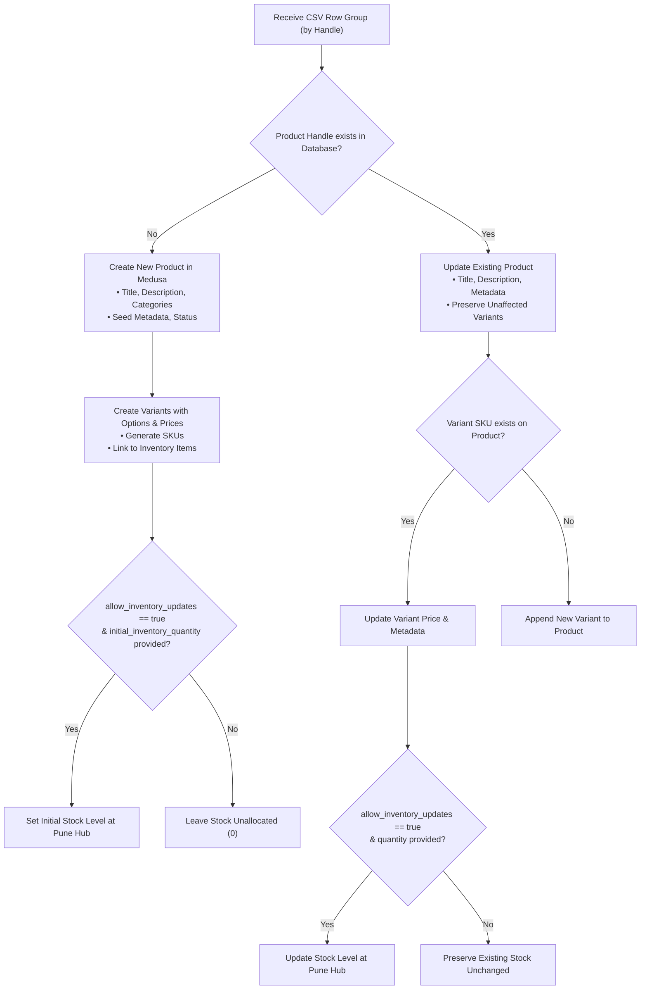

# GLOROV — Product CSV Import and Inventory Reconciliation Guide

This document details the architectural foundation, schema definitions, validation rules, administrative endpoints, and operational workflows for bulk-importing product catalogs and reconciling inventory from CSV files into **GLOROV** (`glorov.in`).

---

## 1. Executive Summary & Design Principles

The CSV Import and Inventory Reconciliation system provides a reliable, safe, and controlled mechanism for store administrators to manage large botanical seed and plant catalogs without manual row-by-row data entry or dependence on third-party marketplace APIs (such as Flipkart).

### Key Architectural Safeguards
1. **No Duplicate Catalog or Parallel Database**: Reuses Medusa v2 native entities (`product`, `product_variant`, `price`, `inventory_item`, `inventory_level`, `product_category`) and core workflows (`createProductsWorkflow`, `updateProductsWorkflow`, `createInventoryItemsWorkflow`, `updateInventoryLevelsWorkflow`).
2. **Controlled Two-Phase Import (Preview $\rightarrow$ Confirm)**: Administrators must preview proposed changes and inspect validation errors/warnings before any database mutations are applied.
3. **Strict Stock Separation Policy**: Catalog updates (titles, descriptions, categories, pricing, metadata) are decoupled from inventory stock adjustments. Production inventory levels at `Pune Central Nursery Hub` are never silently overwritten unless `allow_inventory_updates: true` or `confirm_adjustment: true` is explicitly passed.
4. **Formula Injection & Security Sanitization**: Cell values starting with spreadsheet formula triggers (`=, +, -, @, \t, \r`) are automatically escaped with leading single quotes to protect administrators opening export reports in Microsoft Excel or Google Sheets. Image URLs are strictly validated to prevent `javascript:` and `data:` protocol injection.
5. **Multi-Variant Product Grouping**: A single product with multiple packet sizes (e.g. 20, 50, and 100 seeds) is defined across multiple CSV rows sharing the same `handle`.

---

## 2. CSV Schema Specification

The table below defines all supported standard and botanical columns:

| Column Header | Required? | Type | Allowed Values / Format | Description & Example |
| :--- | :--- | :--- | :--- | :--- |
| `product_title` | **Yes** | String | Text (1–255 chars) | Product display name (e.g., `Tomato Seeds (Desi / Pusa Ruby)`). |
| `handle` | **Yes** | String | Lowercase slug (`[a-z0-9_-]`) | Unique product handle (e.g., `tomato-seeds-desi`). Links multiple variant rows. |
| `description` | No | String | Text (multiline allowed) | Full product description and garden care overview. |
| `category` | No | String | Category handle / name | Target category (e.g., `vegetable-seeds`, `herb-seeds`, `flower-seeds`). |
| `status` | No | String | `published` \| `draft` | Publication status (defaults to `published`). |
| `variant_title` | **Yes** | String | Text | Variant title (e.g., `20 Seeds`, `50 Seeds`, `100 Seeds`). |
| `sku` | **Yes** | String | Uppercase slug | Unique variant SKU (e.g., `GLR-SD-TOM-020`, `GLR-SD-TOM-050`). |
| `packet_size` | No | String | Text | Packet size label (e.g., `20 Seeds`, `50 Seeds`). |
| `price` | **Yes** | Number | Positive decimal ($> 0$) | Retail unit price in Indian Rupees (e.g. `49.00`, `99.00`). Converted to paise in backend. |
| `currency` | No | String | `inr` (case-insensitive) | Currency code (defaults to `inr`). Other currencies rejected. |
| `initial_inventory_quantity` | No | Integer | Non-negative integer ($\ge 0$) | Stock count for reconciliation or initial stock creation. |
| `image_url` / `thumbnail` | No | URL | `http://` or `https://` | Image asset URL. Insecure protocols (`javascript:`, `data:`) rejected. |
| **Botanical Metadata** | | | | |
| `common_name` | No | String | Text | Vernacular / common plant name (e.g., `Desi Tomato / Tamatar`). |
| `botanical_name` | No | String | Text | Latin botanical name (e.g., `Solanum lycopersicum`). |
| `variety` | No | String | Text | Cultivar / variety name (e.g., `Pusa Ruby`). |
| `seed_type` | No | String | Text | Type (e.g., `Heirloom / Open-Pollinated`, `Hybrid F1`). |
| `approx_seeds_per_packet`| No | Integer | Positive integer | Estimated seed count per packet (e.g., `50`). |
| `germination_time_range` | No | String | Text | Expected days to sprout (e.g., `6-10 days`). |
| `sowing_depth` | No | String | Text | Recommended depth (e.g., `0.5 cm`). |
| `spacing` | No | String | Text | Plant spacing (e.g., `45-60 cm plant-to-plant`). |
| `sunlight` | No | String | `full_sun` \| `partial_shade` | Sunlight requirement enum. |
| `watering` | No | String | `daily` \| `alternate_days` | Watering frequency. |
| `season` | No | String | `kharif` \| `rabi` \| `zaid` | Indian agricultural growing season. |
| `difficulty` | No | String | `beginner` \| `intermediate` | Cultivation difficulty level. |
| `is_perishable` | No | Boolean | `true` \| `false` | Distinguishes live plant plugs from shelf-stable dry seeds. |

---

## 3. Duplicate and Update Handling Rules



### Comprehensive Rule Set

1. **New Products**:
   - If `handle` does not exist in the Medusa catalog, a new product is created with all defined variant rows, category links, pricing in INR, and botanical metadata.
2. **Existing Products**:
   - If `handle` already exists, product metadata, description, title, and status are updated without deleting existing orders or unaffected variants.
3. **Existing Variants**:
   - If a variant SKU matches an existing variant under that product, its prices and metadata are updated. Existing line-item order history remains intact.
4. **Duplicate SKUs Within a File**:
   - The same SKU appearing in more than one row is flagged as a fatal validation error (`DUPLICATE_SKU_IN_FILE`). Each variant in the catalog must have a globally unique SKU.
5. **Conflicting Product Data Across Rows**:
   - If rows sharing the same `handle` contain conflicting `product_title` values, the import is blocked (`CONFLICTING_PRODUCT_DATA`) to prevent ambiguous product naming.
6. **Missing Required Fields**:
   - Rows lacking `product_title`, `handle`, `sku`, or `price` are flagged with `MISSING_REQUIRED_FIELD` indicating the exact row number.
7. **Invalid Prices & Quantities**:
   - Negative, non-numeric, or zero prices trigger `INVALID_PRICE`.
   - Negative or non-integer inventory counts trigger `INVALID_QUANTITY`.
8. **Inventory Change Policy**:
   - By default (`allow_inventory_updates: false`), the import modifies only catalog data. Inventory levels remain untouched.
   - To update stock levels during import, the administrator must explicitly set `allow_inventory_updates: true`.

---

## 4. Administrative API Entry Points

All CSV import endpoints require administrative authentication (`Authorization: Bearer <ADMIN_JWT>` with `actor_type: "user"`).

### 4.1 Preview & Validation
- **Endpoint**: `POST /admin/products/csv-import/preview`
- **Purpose**: Parses and validates CSV content without mutating the database.
- **Request Body**:
  ```json
  {
    "csv_content": "product_title,handle,sku,price\n..."
  }
  ```
- **Response**:
  ```json
  {
    "preview": {
      "validation": {
        "is_valid": true,
        "total_rows": 3,
        "valid_rows_count": 3,
        "error_rows_count": 0,
        "warning_rows_count": 0,
        "errors": [],
        "warnings": [],
        "summary": {
          "products_to_create": 1,
          "products_to_update": 0,
          "variants_to_create": 3,
          "variants_to_update": 0
        }
      },
      "products_preview": [
        {
          "handle": "tomato-seeds-desi",
          "title": "Tomato Seeds (Desi / Pusa Ruby)",
          "action": "create",
          "variants": [
            { "title": "20 Seeds", "sku": "GLR-SD-TOM-020", "price_inr": "₹49.00", "action": "create" },
            { "title": "50 Seeds", "sku": "GLR-SD-TOM-050", "price_inr": "₹99.00", "action": "create" },
            { "title": "100 Seeds", "sku": "GLR-SD-TOM-100", "price_inr": "₹179.00", "action": "create" }
          ]
        }
      ]
    }
  }
  ```

### 4.2 Confirm & Execute Import
- **Endpoint**: `POST /admin/products/csv-import/confirm`
- **Purpose**: Applies validated changes to the Medusa database, with optional dry-run mode.
- **Request Body**:
  ```json
  {
    "csv_content": "...",
    "dry_run": false,
    "allow_inventory_updates": true
  }
  ```
- **Response**:
  ```json
  {
    "result": {
      "success": true,
      "dry_run": false,
      "imported_products_count": 1,
      "updated_products_count": 0,
      "imported_variants_count": 3,
      "updated_variants_count": 0,
      "skipped_count": 0,
      "failed_count": 0,
      "details": [
        {
          "handle": "tomato-seeds-desi",
          "product_id": "prod_01M5...",
          "title": "Tomato Seeds (Desi / Pusa Ruby)",
          "action": "created",
          "variants": [
            { "sku": "GLR-SD-TOM-020", "variant_id": "variant_01...", "action": "created" }
          ]
        }
      ]
    }
  }
  ```

### 4.3 Inventory Reconciliation
- **Endpoint**: `POST /admin/products/csv-import/reconcile`
- **Purpose**: Generates a variance report comparing physical inventory counts in CSV against current stocked/reserved quantities at a stock location (e.g., `Pune Central Nursery Hub`).
- **Request Body**:
  ```json
  {
    "csv_content": "sku,initial_inventory_quantity\nGLR-SD-TOM-050,95\n...",
    "confirm_adjustment": false
  }
  ```
- **Response**:
  ```json
  {
    "reconciliation": {
      "total_skus": 1,
      "matched_skus": 1,
      "unmatched_skus": 0,
      "items_with_variance": 1,
      "items_in_sync": 0,
      "location_id": "sloc_01M5TBWRM7FY3DHCYFA8ER21F1",
      "location_name": "Pune Central Nursery Hub",
      "adjustments_confirmed": false,
      "applied_adjustments_count": 0,
      "reconciliation_items": [
        {
          "sku": "GLR-SD-TOM-050",
          "variant_title": "50 Seeds",
          "product_handle": "tomato-seeds-desi",
          "product_title": "Tomato Seeds (Desi / Pusa Ruby)",
          "current_stocked_quantity": 80,
          "current_reserved_quantity": 0,
          "current_available_quantity": 80,
          "imported_quantity": 95,
          "variance": 15,
          "action_required": "surplus"
        }
      ]
    }
  }
  ```
- If `confirm_adjustment: true` is passed, `stocked_quantity` is updated to match physical inventory, and `applied_adjustments_count` is returned.

---

## 5. Security & Safe Execution Controls

1. **Authentication Guard**:
   - Enforced by `authenticate('user', ['session', 'bearer'])` middleware on `/admin/products/csv-import*`.
   - Customer tokens and unauthenticated callers are rejected with `401 Unauthorized`.
2. **Payload Size Limitation**:
   - Payloads larger than 5 MB are rejected with `413 Payload Too Large` to prevent denial-of-service from runaway file sizes.
3. **CSV Formula Injection Neutralization**:
   - Any cell value beginning with `=`, `+`, `-`, `@`, `\t`, or `\r` is escaped with a leading single quote (`'`), ensuring that downloaded CSV reconciliation reports cannot execute arbitrary commands in spreadsheet applications.
4. **Image Protocol Validation**:
   - Only `http://`, `https://`, and root-relative (`/`) image URLs are permitted. Potentially malicious schemes (`javascript:`, `data:`, `file:`) are rejected.
5. **Atomic Product Group Processing & Partial Failure Recovery**:
   - Each product handle group is executed in an isolated try-catch block.
   - If an unexpected error occurs on one product group, other valid products continue processing.
   - The final execution response details exactly which handles succeeded (`created` / `updated`) and which failed with specific error messages.
   - Retries are safe and idempotent: re-submitting a corrected CSV will update successfully created products rather than duplicating them.

---

## 6. Example CSV: Tomato Seeds with 3 Packet Variants

Save the following content as `tomato-seeds-import.csv` to import or update heirloom Desi Tomato seeds:

```csv
product_title,handle,description,category,status,variant_title,sku,packet_size,price,currency,initial_inventory_quantity,image_url,common_name,botanical_name,variety,seed_type,approx_seeds_per_packet,germination_time_range,sowing_depth,spacing,sunlight,watering,season,difficulty,planting_instructions,packaging_notes,is_perishable
"Tomato Seeds (Desi / Pusa Ruby)",tomato-seeds-desi,"High-viability heirloom Desi Tomato seeds suited for Indian climatic conditions. Produces high-yielding plants with juicy, aromatic, and tangy fruits rich in Lycopene and Vitamin C.",vegetable-seeds,published,20 Seeds,GLR-SD-TOM-020,20 Seeds,49.00,inr,150,https://images.unsplash.com/photo-1592841200221-a6898f307baa?auto=format&fit=crop&w=600&q=80,Desi Tomato / Tamatar,Solanum lycopersicum,Pusa Ruby,Heirloom / Open-Pollinated,20,6-10 days,0.5 cm,45-60 cm plant-to-plant,full_sun,daily,kharif,beginner,"Sow seeds 0.5 cm deep in seedling trays or loose, well-draining organic soil mix. Water gently with a fine spray to keep soil moist until germination. Transplant seedlings to garden beds or 12-inch pots when they develop 4-6 true leaves.","Sealed in moisture-barrier aluminum foil pouches with food-grade desiccant to ensure maximum viability up to 18 months.",false
"Tomato Seeds (Desi / Pusa Ruby)",tomato-seeds-desi,"High-viability heirloom Desi Tomato seeds suited for Indian climatic conditions. Produces high-yielding plants with juicy, aromatic, and tangy fruits rich in Lycopene and Vitamin C.",vegetable-seeds,published,50 Seeds,GLR-SD-TOM-050,50 Seeds,99.00,inr,80,https://images.unsplash.com/photo-1592841200221-a6898f307baa?auto=format&fit=crop&w=600&q=80,Desi Tomato / Tamatar,Solanum lycopersicum,Pusa Ruby,Heirloom / Open-Pollinated,50,6-10 days,0.5 cm,45-60 cm plant-to-plant,full_sun,daily,kharif,beginner,"Sow seeds 0.5 cm deep in seedling trays or loose, well-draining organic soil mix. Water gently with a fine spray to keep soil moist until germination. Transplant seedlings to garden beds or 12-inch pots when they develop 4-6 true leaves.","Sealed in moisture-barrier aluminum foil pouches with food-grade desiccant to ensure maximum viability up to 18 months.",false
"Tomato Seeds (Desi / Pusa Ruby)",tomato-seeds-desi,"High-viability heirloom Desi Tomato seeds suited for Indian climatic conditions. Produces high-yielding plants with juicy, aromatic, and tangy fruits rich in Lycopene and Vitamin C.",vegetable-seeds,published,100 Seeds,GLR-SD-TOM-100,100 Seeds,179.00,inr,50,https://images.unsplash.com/photo-1592841200221-a6898f307baa?auto=format&fit=crop&w=600&q=80,Desi Tomato / Tamatar,Solanum lycopersicum,Pusa Ruby,Heirloom / Open-Pollinated,100,6-10 days,0.5 cm,45-60 cm plant-to-plant,full_sun,daily,kharif,beginner,"Sow seeds 0.5 cm deep in seedling trays or loose, well-draining organic soil mix. Water gently with a fine spray to keep soil moist until germination. Transplant seedlings to garden beds or 12-inch pots when they develop 4-6 true leaves.","Sealed in moisture-barrier aluminum foil pouches with food-grade desiccant to ensure maximum viability up to 18 months.",false
```

---

## 7. Verification & Automated Test Suite

The CSV import and inventory reconciliation features are covered by automated unit and HTTP integration tests:

### 1. Backend Unit Tests (`apps/backend/src/__tests__/csv-import.unit.spec.ts`)
- RFC 4180 parsing with quotes, escaped quotes (`""`), commas, multiline values, and CRLF line endings.
- Formula injection detection and neutralization (`=`, `+`, `-`, `@`).
- Validation of complete 3-variant seed product.
- Detection of missing required fields (`MISSING_REQUIRED_FIELD`).
- Detection of invalid and negative prices (`INVALID_PRICE`).
- Detection of unsupported currencies (`INVALID_CURRENCY`).
- Detection of invalid stock quantities (`INVALID_QUANTITY`).
- Detection of unsafe image URLs (`INVALID_URL`).
- Detection of duplicate SKUs within file (`DUPLICATE_SKU_IN_FILE`).
- Detection of conflicting product titles under same handle (`CONFLICTING_PRODUCT_DATA`).

### 2. Backend HTTP Integration Tests (`apps/backend/integration-tests/http/product-csv-import.spec.ts`)
- Rejection of unauthenticated requests and customer bearer tokens on all endpoints (`401 Unauthorized`).
- Rejection of empty payloads (`400 Bad Request`).
- Validation and preview report generation (`POST /admin/products/csv-import/preview`).
- Simulation mode with zero database mutations (`dry_run: true`).
- Live import execution creating new products, variants, and stock allocations in Medusa v2 (`dry_run: false`).
- Re-import update verification ensuring no duplicate products are created.
- Inventory reconciliation variance reporting without stock changes (`confirm_adjustment: false`).
- Confirmed inventory reconciliation updating physical stock at `Pune Central Nursery Hub` (`confirm_adjustment: true`).

### Monorepo Test Summary
```bash
# Run all unit tests
pnpm turbo test

# Run backend HTTP integration tests
pnpm --filter @glorov/backend test:integration:http
```

Current Test Status: **273 tests passing** (104 storefront unit tests, 76 backend unit tests, 93 backend HTTP integration tests) with 0 regressions.
