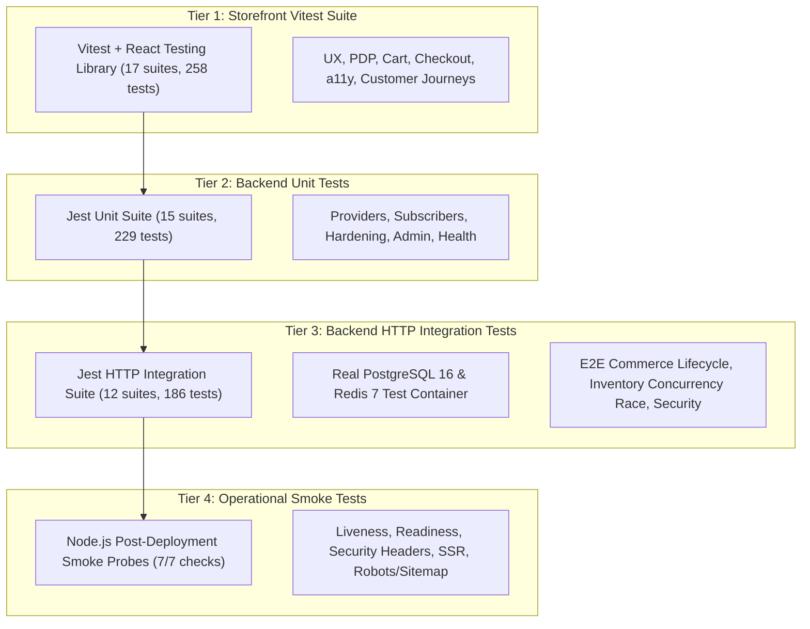

# ADR-0006: pnpm Monorepo Topology and 3-Tier Testing Pyramid

- **Status:** Accepted
- **Date:** October 2026
- **Deciders:** Architecture Team, QA Lead

## Context & Problem Statement
The GLOROV platform consists of a Medusa v2 backend, a Next.js 15 storefront, shared TypeScript interfaces, configuration packages, Docker infrastructure, and deployment scripts.
A cohesive engineering structure must support:
1. Shared data contracts (types, validation schemas, error definitions) without duplicating code across frontend and backend.
2. Fast, incremental builds and cache-aware task execution.
3. Strict dependency isolation with deterministic package resolution.
4. A multi-tier testing strategy capable of validating unit logic, full HTTP integration flows, inventory concurrency, and responsive accessibility.

## Considered Alternatives
1. **Polyrepo (Separate Repositories for Backend & Frontend):**
   - *Pros:* Independent repository access and release cycles.
   - *Cons:* High friction when updating shared DTOs (requires publishing private npm packages); drift between frontend client contracts and backend API endpoints; fragmented CI/CD pipelines.
2. **npm / yarn v1 Workspaces:**
   - *Pros:* Standard built-in tooling.
   - *Cons:* Phantom dependencies, slow installation speeds, inefficient symlink hoisting.
3. **pnpm Workspace + Turborepo:**
   - *Pros:* Strict symlink isolation (no phantom dependencies); global content-addressable store saving gigabytes of disk space; Turborepo orchestrates build, lint, and test caching across workspace targets.

## Decision
We chose a **pnpm monorepo workspace managed by Turborepo**, coupled with a **3-Tier Testing Pyramid**.

### Monorepo Topology
```
glorov/
├── apps/
│   ├── backend/       # Medusa v2 Commerce Engine (:9000)
│   └── storefront/    # Next.js 15 App Router Frontend (:3000)
├── packages/
│   ├── types/         # Shared domain DTOs, validations & schemas
│   └── config/        # Shared TSConfig & ESLint base configs
├── scripts/           # Deployment, backup & smoke test scripts
└── docs/              # Architecture, runbooks & decision records
```

### 3-Tier Testing Strategy
To achieve comprehensive verification without excessive test execution times, we implemented three distinct testing layers:



1. **Tier 1 — Storefront Unit & UX Tests (Vitest + jsdom):**
   - 17 test suites, 258 tests.
   - Verifies component rendering, user interactions, responsive viewports (375px/768px/1280px), WCAG 2.1 AA keyboard accessibility, and Zod client validation. Runs in ~4 seconds.
2. **Tier 2 — Backend Unit Tests (Jest):**
   - 15 test suites, 229 tests.
   - Verifies isolated module logic: Razorpay client and signature verification, COD payment restrictions, Shiprocket rate calculation and pincode parsing, email notification templates, structured logging redaction, and metrics collectors. Runs in ~6 seconds.
3. **Tier 3 — Backend HTTP Integration Tests (Jest + Live PostgreSQL & Redis):**
   - 12 test suites, 186 tests.
   - Tests complete API endpoints and multi-step commerce workflows:
     - End-to-end customer shopping journey from cart creation to payment capture.
     - 6-thread concurrent checkout race condition validating atomic inventory reservations and zero overselling.
     - Customer authentication, address management, and order ownership authorization.
     - Admin CSV product imports with preview, confirmation, and rollback.
     - Webhook ingestion and security headers. Runs in ~30 seconds.
4. **Tier 4 — Operational Post-Deployment Smoke Probes (`scripts/smoke-test.mjs`):**
   - 7 automated runtime probes verifying liveness, readiness, correlation ID propagation, storefront SSR rendering, security headers, and sitemap/robots delivery against running instances.

## Consequences & Trade-offs
- **Positive:** 100% test coverage of critical commerce paths (673/673 tests passing), rapid developer feedback loop, zero dependency drift between backend and storefront.
- **Negative:** Running Tier 3 integration tests requires a running PostgreSQL and Redis instance (`pnpm db:up`).
