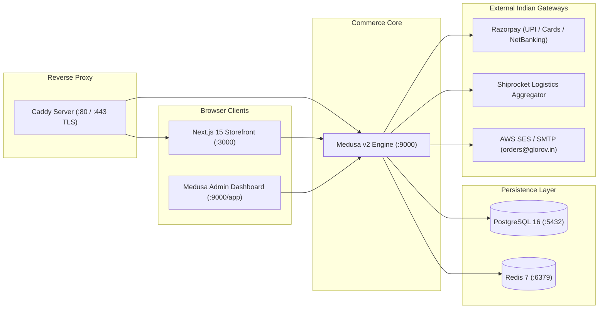

# GLOROV Developer Handover & Architecture Guide

> **Target Audience:** Incoming Software Engineers, Site Reliability Engineers, and Technical Owners  
> **Repository:** `glorov` (Monorepo)  
> **Tech Stack:** Medusa v2 Commerce Engine + Next.js 15 App Router + PostgreSQL 16 + Redis 7 + Caddy TLS  
> **Primary Currency:** Indian Rupee (INR — ₹)  
> **Primary Fulfillment Location:** Pune Central Nursery Hub, Maharashtra (PIN 411001)  
> **Last Verified:** October 2026 (44 test suites, 673 automated tests passing)

---

## 1. System Overview & Monorepo Topology

GLOROV is an Indian direct-to-consumer e-commerce platform for heirloom botanical seeds and live nursery plants. The system employs a headless architecture managed within a pnpm monorepo using Turborepo.

```
glorov/
├── apps/
│   ├── backend/               # Medusa v2 headless commerce engine & admin dashboard (:9000)
│   └── storefront/            # Next.js 15 App Router customer storefront (:3000)
├── packages/
│   ├── types/                 # Shared domain DTOs, Zod schemas, botanical & validation types
│   └── config/                # Shared TypeScript and ESLint configurations
├── caddy/                     # Reverse proxy configuration with automatic TLS
├── scripts/                   # Database backup, restore, and post-deployment smoke tests
├── docs/                      # Technical blueprints, ADRs, test plans, and runbooks
│   └── decisions/             # Architecture Decision Records (ADR-0001 to ADR-0006)
├── docker-compose.yml         # Local development PostgreSQL 16 & Redis 7
├── docker-compose.prod.yml    # Production multi-container topology (Blue/Green backend)
├── pnpm-workspace.yaml        # Monorepo workspace configuration
└── turbo.json                 # Turborepo task pipeline (build, test, lint, typecheck)
```

### High-Level System Architecture



---

## 2. Directory Responsibilities & File Placement

### 2.1 Backend (`apps/backend`)

All backend commerce logic lives in `apps/backend/src`.

| Directory | Purpose & Contents |
|---|---|
| `src/admin/` | Medusa Admin extensions, widgets, and custom React dashboard components (e.g. [`botanical-details-widget.tsx`](file:///Users/sourav/Developer/WEB/top-projects/glorov/apps/backend/src/admin/widgets/botanical-details-widget.tsx), [`order-logistics-widget.tsx`](file:///Users/sourav/Developer/WEB/top-projects/glorov/apps/backend/src/admin/widgets/order-logistics-widget.tsx)). |
| `src/api/` | Custom REST API routes, middlewares, and webhook handlers: <br> • `src/api/store/`: Custom Storefront endpoints (`pincode-check`, `orders/:id/cancel`, `payment/razorpay/verify`). <br> • `src/api/admin/`: Custom Admin endpoints (`products/csv-import/*`, `orders/:id/*`, `payments/cod/*`). <br> • `src/api/hooks/`: External webhook ingestion (`razorpay`, `shiprocket`). <br> • `src/api/middlewares/`: Rate limiting, request correlation tracing, security headers. |
| `src/modules/` | Standalone Medusa v2 modules implementing service interfaces: <br> • `payment-razorpay/`: Razorpay payment provider with HMAC-SHA256 signature verification. <br> • `payment-cod/`: Cash on Delivery provider with ₹5,000 cap. <br> • `fulfillment-shiprocket/`: Logistics provider with rate calculation and courier dispatch. <br> • `notification-email/`: Transactional email provider using Nodemailer. <br> • `csv-import/`: Batch product importer and inventory reconciler. |
| `src/subscribers/` | Asynchronous Redis BullMQ event subscribers: <br> • `order-placed.ts`, `order-canceled.ts`, `payment-captured.ts`, `shipment-created.ts`, `tracking-updated.ts`, `payment-refunded.ts`. |
| `src/scripts/` | Seed scripts: <br> • `seed-india-region.ts`: Initializes India region, INR currency, tax rates, and Pune Nursery stock location. <br> • `seed-catalog.ts`: Seeds initial botanical products with variants and attributes. |
| `src/utils/` | Core utilities: structured logging (`structured-logger.ts`), metrics collector (`metrics-collector.ts`), error handlers (`error-handler.ts`), async retry utilities (`async-retry.ts`). |
| `src/__tests__/` | Unit tests for providers, subscribers, and security hardening (Jest). |
| `integration-tests/http/` | HTTP integration tests running against real PostgreSQL and Redis containers (Jest). |

### 2.2 Storefront (`apps/storefront`)

All customer frontend code lives in `apps/storefront/src`.

| Directory | Purpose & Contents |
|---|---|
| `src/app/` | Next.js 15 App Router pages, layouts, and route handlers: <br> • `(home)`: Landing page with botanical categories and featured plants. <br> • `products/[handle]/`: Product Detail Pages (PDP) with packet-size selector and germination guides. <br> • `categories/[...category]/`: Filtered catalog view by botanical family. <br> • `cart/`: Shopping cart page with subtotal and delivery estimator. <br> • `checkout/`: Multi-step checkout (Address, Shipping SLA, Razorpay/COD). <br> • `order/confirmed/[id]/`: Post-purchase confirmation and itemized invoice. <br> • `account/`: Customer authentication, orders list, addresses, password reset. <br> • `api/`: Frontend API proxies (`/api/shipping/pincode-check`, `/api/shipping/tracking`, `/api/health`). |
| `src/components/` | Reusable React components organized by domain: <br> • `common/`: Header, Footer, Navigation, Breadcrumbs, SearchInput. <br> • `catalog/`: ProductCard, VariantSelector, BotanicalBadge, BotanicalDetailsModal. <br> • `cart/`: CartDrawer, CartLineItem, CartSummary. <br> • `shipping/`: PincodeChecker, DeliveryEstimator, TrackingTimeline. <br> • `orders/`: OrderCard, CancelOrderModal, ReturnRequestModal. <br> • `ui/`: shadcn/ui primitives (Button, Dialog, Badge, Input, Card). |
| `src/lib/` | Frontend data-fetching, session management, and business utilities: <br> • `catalog.ts`: Server-side Medusa catalog fetching with caching. <br> • `cart.ts` / `cart-actions.ts`: Server actions for cart manipulation. <br> • `customer.ts` / `customer-actions.ts`: Customer authentication and profile actions. <br> • `shipping.ts`: Pincode lookup and tracking client helpers. <br> • `medusa-client.ts`: Initialized Medusa JS SDK client with correlation ID headers. <br> • `env.ts`: Storefront environment validator. <br> • `utils.ts`: INR currency formatting (`formatINR`) and date helpers. |
| `src/__tests__/` | Storefront component, UX, and accessibility tests (Vitest + React Testing Library). |

### 2.3 Shared Packages (`packages/`)

- `packages/types/`: Shared TypeScript domain models and Zod schemas:
  - `botanical.ts`: Botanical product attributes, packet sizes, sunlight, watering tags.
  - `pincode.ts`: Indian PIN code validation and courier serviceability DTOs.
  - `validations.ts`: Zod schemas for addresses, checkout input, return requests, and CSV records.
  - `observability.ts`: Structured log payloads and telemetry metric interfaces.
- `packages/config/`: Shared configuration standards:
  - `typescript/`: `base.json`, `nextjs.json`, `medusa.json`.
  - `eslint/`: `base.js`.

---

## 3. Code Conventions & File Placement Rules

When adding new functionality to GLOROV, adhere to the following rules:

1. **Adding a New Custom API Route:**
   - In Medusa backend, place in `apps/backend/src/api/<namespace>/<route-name>/route.ts`.
   - Export HTTP method handlers: `export async function GET(req: MedusaRequest, res: MedusaResponse)`.
   - Always validate input with Zod schemas defined in `@glorov/types`.
   - Register route in `apps/backend/src/api/middlewares.ts` to attach correlation IDs and error handling.
2. **Adding a New Event Subscriber:**
   - Place in `apps/backend/src/subscribers/<event-name>.ts`.
   - Export a `SubscriberConfig` defining the event (e.g. `order.placed`).
   - Handler must be an asynchronous function accepting `{ event, container }`. Wrap asynchronous operations in try/catch and log via `container.resolve('logger')`. Never crash the process on subscriber failure.
3. **Adding a Storefront Page:**
   - Place in `apps/storefront/src/app/<route>/page.tsx`.
   - Prefer React Server Components (RSC) for initial data fetching.
   - Use `'use client'` only on interactive leaf components (forms, modals, interactive buttons).
   - Generate metadata using `generateMetadata` for dynamic SEO tags.
4. **Writing Tests:**
   - Storefront UI tests go in `apps/storefront/src/__tests__/*.test.tsx` (run with `pnpm --filter @glorov/storefront test`).
   - Backend unit tests go in `apps/backend/src/__tests__/*.unit.spec.ts` (run with `pnpm --filter @glorov/backend test:unit`).
   - Backend HTTP integration tests go in `apps/backend/integration-tests/http/*.spec.ts` (run with `pnpm --filter @glorov/backend test:integration:http`).

---

## 4. Commerce Flows: Native Medusa vs Custom Extensions

Understanding the division of labor between native Medusa v2 functionality and GLOROV custom extensions is essential:

```
┌─────────────────────────────────────────────────────────────────────────────┐
│                              GLOROV COMMERCE                                │
├──────────────────────────────────────────┬──────────────────────────────────┤
│ NATIVE MEDUSA v2 COMMERCE                │ CUSTOM GLOROV EXTENSIONS         │
├──────────────────────────────────────────┼──────────────────────────────────┤
│ • Product & Variant Core Tables          │ • Botanical Metadata Attributes  │
│ • Pricing Module & Multi-Currency        │ • Indian HSN Tax Classifications │
│ • Multi-Location Inventory Module        │ • Pune Central Nursery Hub PIN   │
│ • Cart Calculation & Promotions          │ • Zod 6-Digit PIN Validation     │
│ • Order Creation & State Machine         │ • Razorpay Indian Payment Module │
│ • Native Workflows:                      │ • Cash on Delivery (₹5k Ceiling) │
│   - cancelOrderWorkflow                  │ • Shiprocket Logistics Provider  │
│   - createReturnWorkflow                 │ • Public AWB Tracking Proxy      │
│   - createRefundOrdersWorkflow           │ • Botanical Return Triage        │
│ • Scrypt Customer Password Hashing       │ • Transactional Email Templates  │
│ • Stock Reservation & Allocation         │ • Structured Pino Observability  │
└──────────────────────────────────────────┴──────────────────────────────────┘
```

### 4.1 Product Catalog & Botanical Variants
- **Native Medusa:** Manages product handles, categories, title, description, and variant price sets in INR.
- **Custom Extension:** Botanical attributes stored in variant metadata: `packet_size` (e.g. "50 Seeds"), `botanical_name` (e.g. *Solanum lycopersicum*), `sunlight`, `watering`, `germination_days`, and `is_perishable`. Tax classified under statutory Indian HSN codes: **HSN 1209** (seeds exempt @ 0% GST) and **HSN 0602** (live plants).

### 4.2 Inventory & Overselling Prevention
- **Native Medusa:** Multi-location stock allocation using `inventory_item` and `reservation_item`.
- **Custom Extension:** Single primary warehouse configured: *Pune Central Nursery Hub* (PIN 411001). During checkout, Medusa creates atomic reservations against Pune inventory. Concurrency testing verified that 6 parallel checkout attempts against limited stock reserve inventory atomically with zero overselling.

### 4.3 Carts & Checkout
- **Native Medusa:** Cart creation, line item addition, tax rate calculation, and payment collection sessions.
- **Custom Extension:** Storefront checks Indian PIN code serviceability via Shiprocket before cart submission. Delivery fees apply dynamically: ₹49 standard surface (free above ₹499) or ₹99 express air courier for live plants.

### 4.4 Payments & Cash on Delivery (COD)
- **Razorpay Online Payments:**
  - Amounts are multiplied by 100 to represent integer paise.
  - Razorpay order ID is bound to the Medusa payment session.
  - Client authorizes via UPI/Card; response signature is validated using timing-safe HMAC-SHA256 (`crypto.timingSafeEqual`).
- **Cash on Delivery (COD):**
  - Capped at ₹5,000 (500,000 paise).
  - Status remains `awaiting` (uncaptured) upon order completion. Payment is reconciled manually or via courier remittance webhook upon delivery.

### 4.5 Logistics & Shipment Tracking
- **Shiprocket Fulfillment:**
  - When admin creates a fulfillment, the custom module calls Shiprocket's order creation API.
  - Shiprocket assigns an Air Waybill (AWB) number and courier partner (e.g. Delhivery, BlueDart).
  - Webhooks from Shiprocket at `/fulfillment/shiprocket/webhook` update order delivery status in Medusa.
  - Public tracking endpoint `/store/orders/:id/tracking` exposes courier milestones without leaking customer PII.

### 4.6 Cancellations, Returns & Horticultural Triage
- **Native Medusa:** Executed through native `cancelOrderWorkflow`, `createReturnWorkflow`, and `createRefundOrdersWorkflow`.
- **Custom Extension:**
  - *Anti-IDOR Ownership Guard:* `validateOrderOwnership` ensures customers can only cancel or request returns for their own orders.
  - *Perishable Return Triage:* Live plants cannot survive return transit. Admins inspect photos submitted via the customer portal; verified transit damages trigger an immediate refund via Razorpay without requesting physical return, writing off inventory while restocking sealed seed packets.

---

## 5. API & Integration Reference Catalog

### 5.1 Storefront Custom API Endpoints

| Endpoint | Method | Auth Required | Purpose |
|---|---|---|---|
| `/store/pincode-check` | `GET` | Public | Validates Indian 6-digit PIN code serviceability and estimated delivery SLA. |
| `/store/payment/razorpay/verify` | `POST` | Public / Session | Cryptographically verifies `razorpay_signature` before finalizing cart. |
| `/store/orders/:id/cancel` | `POST` | Customer Cookie / Token | Cancels an unfulfilled order, releases inventory reservations, and initiates refund. |
| `/store/orders/:id/return-request`| `POST` | Customer Cookie / Token | Submits return/replacement claim with photo evidence for damaged plants. |
| `/store/orders/:id/tracking` | `GET` | Public (AWB / Order ID) | Returns sanitized courier transit milestones. |
| `/store/health` | `GET` | Public | Deep readiness probe checking PostgreSQL connection pool and Redis ping. |

### 5.2 Admin Custom API Endpoints

| Endpoint | Method | Auth Required | Purpose |
|---|---|---|---|
| `/admin/products/csv-import/preview` | `POST` | Admin Session | Parses uploaded CSV file and generates a validation and diff preview. |
| `/admin/products/csv-import/confirm` | `POST` | Admin Session | Executes atomic batch creation/update of products and inventory levels. |
| `/admin/orders/:id/return-requests` | `GET` | Admin Session | Lists customer return claims and attached photographic evidence. |
| `/admin/orders/:id/return-inventory-triage` | `POST` | Admin Session | Approves return: writes off perishable plants, restocks seeds, triggers refund. |
| `/admin/payments/cod/reconcile` | `POST` | Admin Session | Marks COD cash collected upon courier remittance settlement. |
| `/admin/health/metrics` | `GET` | Admin Session | Returns internal latency, error rate, and active connection metrics. |

### 5.3 Webhook Endpoints

| Endpoint | Source | Verification Mechanism | Action |
|---|---|---|---|
| `/hooks/razorpay` | Razorpay | HMAC-SHA256 (`x-razorpay-signature` vs `RAZORPAY_WEBHOOK_SECRET`) | Handles `payment.captured`, `payment.failed`, `refund.processed`. |
| `/fulfillment/shiprocket/webhook` | Shiprocket | Bearer Token (`x-shiprocket-token` vs `SHIPROCKET_WEBHOOK_TOKEN`) | Updates parcel status: `IN_TRANSIT`, `OUT_FOR_DELIVERY`, `DELIVERED`, `RTO`. |

---

## 6. Developer Recipes & Workflows

### 6.1 Clean Checkout Setup (From Scratch)

```bash
# 1. Clone repository
git clone https://github.com/glorov/glorov.git
cd glorov

# 2. Enforce Node.js LTS (20.x or 22.x)
nvm use # or: nvm install 20.19.5

# 3. Install dependencies across all workspaces
pnpm install

# 4. Start local PostgreSQL and Redis containers
pnpm db:up

# 5. Configure local environment variables
cp apps/backend/.env.example apps/backend/.env
cp apps/storefront/.env.example apps/storefront/.env.local

# 6. Run database migrations
pnpm backend:migrate

# 7. Create admin user
pnpm --filter @glorov/backend user -e admin@glorov.in -p SuperSecretPassword123!

# 8. Seed Indian regional configuration and stock location
pnpm backend:seed

# 9. Start development servers concurrently
pnpm dev
```
- Storefront: `http://localhost:3000`
- Admin Dashboard: `http://localhost:9000/app`
- API Health Check: `http://localhost:9000/health`

### 6.2 Creating Products & Botanical Variants

**Via Medusa Admin Dashboard:**
1. Log in to `http://localhost:9000/app` (`admin@glorov.in`).
2. Navigate to **Products** -> **New Product**.
3. Enter title (e.g., *Desi Heirloom Tomato*), handle (`tomato-seeds-desi`), and description.
4. Under Variants, create packet sizes:
   - `20 Seeds` (SKU: `GLR-SD-TOM-020`, Price: ₹49 / 4900 paise).
   - `50 Seeds` (SKU: `GLR-SD-TOM-050`, Price: ₹99 / 9900 paise).
   - `100 Seeds` (SKU: `GLR-SD-TOM-100`, Price: ₹179 / 17900 paise).
5. In the custom **Botanical Details Widget**, enter scientific name, sunlight requirements, watering frequency, and HSN code `1209`.

**Via CSV Import Script:**
```bash
# Preview CSV import changes
pnpm --filter @glorov/backend exec ./src/scripts/import-products.ts preview ./data/sample-catalog.csv

# Execute atomic import
pnpm --filter @glorov/backend exec ./src/scripts/import-products.ts apply ./data/sample-catalog.csv
```

### 6.3 Updating Inventory Safely

1. Navigate to **Inventory** in Medusa Admin.
2. Select the variant SKU (e.g., `GLR-SD-TOM-050`).
3. Select the stock location: **Pune Central Nursery Hub**.
4. Adjust the available quantity.
5. *Note:* Never edit inventory directly in PostgreSQL tables; doing so bypasses Medusa reservation indexes and can cause checkout concurrency locks.

### 6.4 Testing Checkout in Development (Mock Mode)

In development (`apps/backend/.env`):
```ini
RAZORPAY_MOCK_MODE=true
SHIPROCKET_MOCK_MODE=true
NOTIFICATION_MOCK_MODE=true
```
1. Open `http://localhost:3000` and add items to the cart.
2. Enter an Indian test address (e.g., *FC Road, Shivaji Nagar, Pune, Maharashtra - 411005*).
3. Select shipping method (Standard or Express).
4. Select **Razorpay** -> In mock mode, the payment verifies automatically with a simulated signature.
5. Select **Cash on Delivery** -> Completes checkout for orders under ₹5,000.
6. Order confirmation page renders with invoice details.

### 6.5 Running Test Suites

```bash
# Run all unit tests across monorepo
pnpm test

# Run Storefront Vitest suite specifically (258 tests)
pnpm --filter @glorov/storefront test

# Run Backend Jest unit tests specifically (229 tests)
pnpm --filter @glorov/backend test:unit

# Run Backend HTTP Integration tests against real Postgres & Redis (186 tests)
pnpm --filter @glorov/backend test:integration:http

# Run Post-Deployment Smoke Probes against running servers
pnpm smoke:test http://localhost:9000 http://localhost:3000
```

### 6.6 Database Backup & Restoration

```bash
# Create timestamped compressed backup in backups/
./scripts/db-backup.sh

# Restore backup to local development database
./scripts/db-restore.sh backups/glorov_backup_YYYYMMDD_HHMMSS.sql.gz
```

### 6.7 Common Troubleshooting Recipes

| Symptom | Probable Cause | Resolution |
|---|---|---|
| `Fatal Security Error: Missing or insecure production configuration` | `NODE_ENV=production` is set, but `JWT_SECRET` has "dev" or mock modes are enabled. | Generate 32-byte hex secrets via `openssl rand -hex 32` and set `RAZORPAY_MOCK_MODE=false`. |
| `Cannot connect to PostgreSQL` (`ECONNREFUSED :5432`) | Local PostgreSQL container is stopped. | Run `pnpm db:up` or `docker compose up -d postgres`. |
| `Redis connection error` (`ECONNREFUSED :6379`) | Local Redis container is stopped. | Run `pnpm db:up` or `docker compose up -d redis`. |
| Storefront CORS error in browser | `STORE_CORS` in backend `.env` does not match storefront URL. | Set `STORE_CORS=http://localhost:3000` in backend `.env` and restart backend. |
| Next.js Hydration Warning on Prices | Server and client render differing currency characters. | Ensure `NEXT_PUBLIC_BASE_URL` is set and use `formatINR` helper from `src/lib/utils.ts`. |
| Vitest / Jest open handle warning | Asynchronous timer or database connection not closed. | Tests use `--forceExit` to safely terminate idle connection pools after suite completion. |

---

## 7. Documentation Index & Cross-References

| Document | Description |
|---|---|
| [`README.md`](file:///Users/sourav/Developer/WEB/top-projects/glorov/README.md) | Project entry point, quick start, and scripts overview. |
| [`docs/architecture.md`](file:///Users/sourav/Developer/WEB/top-projects/glorov/docs/architecture.md) | Comprehensive technical architecture blueprint. |
| [`docs/implementation-roadmap.md`](file:///Users/sourav/Developer/WEB/top-projects/glorov/docs/implementation-roadmap.md) | 30-task granular implementation roadmap and completion audit. |
| [`docs/security-audit.md`](file:///Users/sourav/Developer/WEB/top-projects/glorov/docs/security-audit.md) | Security audit and verification of remediations SEC-01 through SEC-09. |
| [`docs/launch-checklist.md`](file:///Users/sourav/Developer/WEB/top-projects/glorov/docs/launch-checklist.md) | Production launch checklist, blockers, and dry-run runbooks. |
| [`docs/production-deployment.md`](file:///Users/sourav/Developer/WEB/top-projects/glorov/docs/production-deployment.md) | Docker Compose and Caddy Blue/Green zero-downtime deployment guide. |
| [`docs/integration-inventory.md`](file:///Users/sourav/Developer/WEB/top-projects/glorov/docs/integration-inventory.md) | Exhaustive catalog of all internal and external API integrations. |
| [`docs/e2e-test-plan.md`](file:///Users/sourav/Developer/WEB/top-projects/glorov/docs/e2e-test-plan.md) | Quality assurance test specifications and verification runs. |
| [`docs/database-performance-and-integrity.md`](file:///Users/sourav/Developer/WEB/top-projects/glorov/docs/database-performance-and-integrity.md) | Database query benchmarks, field projections, connection pooling, and decimal safety. |
| [`docs/disaster-recovery.md`](file:///Users/sourav/Developer/WEB/top-projects/glorov/docs/disaster-recovery.md) | Disaster recovery policy, RPO/RTO objectives, 10-step safe recovery runbook. |
| [`docs/decisions/`](file:///Users/sourav/Developer/WEB/top-projects/glorov/docs/decisions/) | Architecture Decision Records (ADR-0001 through ADR-0006). |
