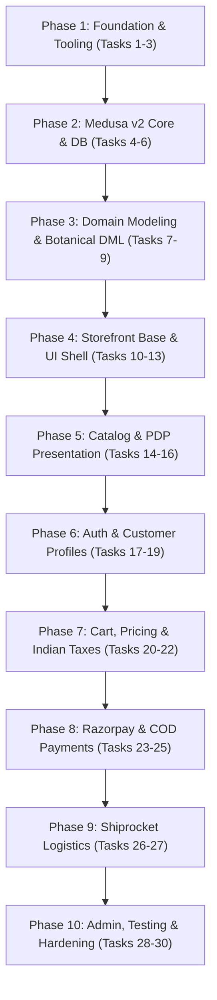

# GLOROV E-commerce Platform — Implementation Roadmap

**Document Version:** 1.0.0  
**Status:** Approved Engineering Execution Plan  
**Target Architecture:** Medusa v2 Backend + Next.js 15 Storefront (pnpm Monorepo)  
**Total Granular Tasks:** 30 Verifiable Engineering Tasks  

---

## 1. Roadmap Overview & Execution Methodology

This roadmap breaks down the development of the GLOROV e-commerce platform into **30 small, sequential, verifiable engineering tasks** distributed across **10 logical phases**. 

### Execution Principles
1. **Zero-Guessing Invariant:** Every task must be verified against concrete acceptance criteria before advancing to the next task.
2. **Atomic Commits:** Each task maps cleanly to a dedicated Git branch and PR with automated CI validation.
3. **No Dead Code:** No speculative abstractions or unlinked utilities; all code written directly serves an active phase requirement.
4. **Continuous Quality Gate:** Every task requires TypeScript strict type-checking (`tsc --noEmit`), linting (`eslint`), and unit/integration tests (`vitest`).

---

## 2. Phase-by-Phase Task Breakdown



---

### Phase 1: Repository Foundation, Monorepo Setup & Tooling (Tasks 1–3)

#### Task 1: Initialize Git Repository, Monorepo Workspace & Node Version Pinning
- **Objective:** Establish the root Git repository, enforce Node.js LTS compatibility, and configure pnpm workspace topology.
- **Scope & Files:**
  - Create `.nvmrc` and `.tool-versions` pinning Node.js to `22.11.0` LTS.
  - Create root `package.json` with `"private": true` and package manager `pnpm@9.15.9`.
  - Create `pnpm-workspace.yaml` defining `apps/*` and `packages/*`.
  - Create `.gitignore` ignoring `.env*`, `node_modules`, `.turbo`, `dist`, `.next`.
- **Dependencies:** None.
- **Verification:** Run `git status`, `pnpm -v`, and verify `pnpm-workspace.yaml` syntax.

#### Task 2: Configure Turborepo Pipeline & Root Scripts
- **Objective:** Setup Turborepo to orchestrate builds, tests, linting, and development servers across workspace apps.
- **Scope & Files:**
  - Create `turbo.json` with pipeline tasks: `build`, `test`, `lint`, `typecheck`, `dev`.
  - Add root scripts to `package.json`: `"dev": "turbo dev"`, `"build": "turbo build"`, `"test": "turbo test"`, `"lint": "turbo lint"`.
- **Dependencies:** Task 1.
- **Verification:** Run `pnpm turbo --version` and execute `pnpm build` (should exit 0 with empty cache).

#### Task 3: Establish Shared TypeScript & Linting Configurations
- **Objective:** Create standardized, strict configurations for TypeScript and ESLint across backend, storefront, and shared packages.
- **Scope & Files:**
  - Create `packages/config/typescript/base.json`, `packages/config/typescript/nextjs.json`, `packages/config/typescript/medusa.json`.
  - Create `packages/config/eslint/base.js`.
  - Create `packages/types/package.json` and `packages/types/src/index.ts` for cross-boundary DTOs.
- **Dependencies:** Task 2.
- **Verification:** Run `pnpm --filter @glorov/types build` and verify TypeScript compilation outputs clean `.d.ts` files.

---

### Phase 2: Medusa v2 Backend Initialization & Core Infrastructure (Tasks 4–6)

#### Task 4: Scaffold Medusa v2 Backend Application
- **Objective:** Initialize the Medusa v2 commerce engine in `apps/backend` using official packages.
- **Scope & Files:**
  - Scaffold `apps/backend/package.json` with `@medusajs/medusa`, `@medusajs/framework`, `@medusajs/cli`.
  - Configure `apps/backend/tsconfig.json` extending `@glorov/config/typescript/medusa.json`.
  - Create minimal `apps/backend/medusa-config.ts` using `defineConfig`.
- **Dependencies:** Task 3.
- **Verification:** Run `pnpm --filter backend medusa --version` and ensure Medusa v2 CLI responds without module errors.

#### Task 5: Configure PostgreSQL, Supabase Session Pooler & Run Base Migrations
- **Objective:** Connect the backend to PostgreSQL (local Docker instance for dev or Supabase session pooler on port 5432) and execute core schema migrations.
- **Scope & Files:**
  - Setup `apps/backend/.env.template` with `DATABASE_URL`, `JWT_SECRET`, `COOKIE_SECRET`.
  - Configure database connection pool parameters (`min: 2`, `max: 10`) in `medusa-config.ts`.
  - Execute schema initialization via `npx medusa db:migrate`.
- **Dependencies:** Task 4.
- **Verification:** Run `pnpm --filter backend medusa db:migrate` and verify all core tables (`product`, `price_set`, `cart`, `order`, etc.) are created in the database.

#### Task 6: Seed Default Indian Region, INR Currency & Sales Channel
- **Objective:** Establish the foundational regional configuration for India, setting INR (₹) as the primary currency, GST tax rates, and the default Web Store sales channel.
- **Scope & Files:**
  - Create `apps/backend/src/scripts/seed-india-region.ts`.
  - Define Region: `India` (`IN`), Currency: `inr`, Tax rate: `0%` default (overridden by product category).
  - Create default Admin user (`admin@glorov.in`) for dashboard access.
- **Dependencies:** Task 5.
- **Verification:** Run `npx medusa exec ./src/scripts/seed-india-region.ts` and inspect Region & Currency in database tables.

---

### Phase 3: Domain Modeling & Botanical Product Extensions (Tasks 7–9)

#### Task 7: Define Botanical Attributes Data Model (Medusa v2 DML)
- **Objective:** Create a dedicated Medusa v2 custom module for botanical specifications (sunlight, watering, sowing season, perishability) using Medusa's Data Modeling Language.
- **Scope & Files:**
  - Create `apps/backend/src/modules/plant-attributes/models/plant-attribute.ts` using `model.define(...)`.
  - Create `apps/backend/src/modules/plant-attributes/service.ts` extending `MedusaService`.
  - Create `apps/backend/src/modules/plant-attributes/index.ts` exporting module definition.
- **Dependencies:** Task 6.
- **Verification:** Run `npx medusa db:generate plant-attributes` and `npx medusa db:migrate` to verify clean table generation.

#### Task 8: Link Botanical Attributes Module to Core Product Module
- **Objective:** Bind custom botanical attributes to Medusa's core Product entity using Medusa Module Links.
- **Scope & Files:**
  - Create `apps/backend/src/links/product-plant-attributes.ts` using `defineLink(...)`.
  - Register module in `medusa-config.ts`.
- **Dependencies:** Task 7.
- **Verification:** Run `npx medusa db:migrate` and verify the link table `link_product_plant_attributes` is generated.

#### Task 9: Seed Seed & Plant Catalog Fixtures with Packet/Pot Variants
- **Objective:** Populate realistic Indian catalog items (Tomato, Marigold, Snake Plant, Basil) with packet sizes (20/50/100 seeds), pot sizes (4-inch/6-inch), and multi-location inventory.
- **Scope & Files:**
  - Create `apps/backend/src/scripts/seed-catalog.ts`.
  - Define products, variant options, prices in paise (`₹49` = `4900`), SKUs, and stock quantities.
- **Dependencies:** Task 8.
- **Verification:** Run seed script, then query `GET /store/products` using curl to verify JSON response returns products with options, variants, and prices.

---

### Phase 4: Next.js Storefront Foundation & UI Shell (Tasks 10–13)

#### Task 10: Initialize Next.js 15 App Router Application
- **Objective:** Scaffold the modern storefront in `apps/storefront` using React 19, TypeScript, and Next.js App Router.
- **Scope & Files:**
  - Create `apps/storefront/package.json` with `next`, `react`, `react-dom`, `@medusajs/js-sdk`, `lucide-react`.
  - Setup `apps/storefront/tsconfig.json` and `apps/storefront/next.config.ts`.
  - Create root layout `apps/storefront/src/app/layout.tsx` and homepage `page.tsx`.
- **Dependencies:** Task 3.
- **Verification:** Run `pnpm --filter storefront build` and ensure Next.js compiles without warnings.

#### Task 11: Setup Tailwind CSS & shadcn/ui Component Primitives
- **Objective:** Install Tailwind CSS, configure earthy botanical color palette, and add shadcn/ui primitives.
- **Scope & Files:**
  - Create `apps/storefront/tailwind.config.ts` (primary green, earthy warm neutrals, alert amber).
  - Create `apps/storefront/src/lib/utils.ts` (`cn` helper).
  - Install and configure primitives: `Button`, `Input`, `Dialog`, `Select`, `Badge`, `Card`.
- **Dependencies:** Task 10.
- **Verification:** Render a test component utilizing Tailwind classes and shadcn `Button`; verify styles load in browser.

#### Task 12: Configure Medusa JS SDK Client & Session Cookie Utilities
- **Objective:** Establish the singleton Medusa v2 JS Client (`@medusajs/js-sdk`) with publishable API key authentication and cart cookie management.
- **Scope & Files:**
  - Create `apps/storefront/src/lib/medusa-client.ts`.
  - Create `apps/storefront/src/lib/cart-session.ts` for safe server/client cookie reading (`cart_id`).
  - Add environment variables to `apps/storefront/.env.local`: `NEXT_PUBLIC_MEDUSA_BACKEND_URL`, `NEXT_PUBLIC_MEDUSA_PUBLISHABLE_KEY`.
- **Dependencies:** Task 10.
- **Verification:** Write a Vitest unit test asserting `medusaClient` initializes with correct headers and base URL.

#### Task 13: Implement Global Header, Botanical Navigation & Mobile Drawer
- **Objective:** Build responsive navigation featuring search, category dropdowns (Seeds, Plants, Planters), cart badge with count, and mobile drawer.
- **Scope & Files:**
  - Create `apps/storefront/src/components/common/Header.tsx`.
  - Create `apps/storefront/src/components/common/MobileNav.tsx`.
  - Create `apps/storefront/src/components/common/Footer.tsx` (with GSTIN, shipping policies, trust badges).
- **Dependencies:** Task 11, Task 12.
- **Verification:** Render Header across desktop (1440px) and mobile viewport (375px); verify menu toggle and cart badge render cleanly.

---

### Phase 5: Catalog Presentation, Search & Product Detail Views (Tasks 14–16)

#### Task 14: Build Product Card & Category Grid with Sowing Badges
- **Objective:** Create reusable product cards displaying Indian botanical tags (e.g., "Kharif Season", "Low Light", "High Germination 90%+"), formatted INR prices, and quick-add actions.
- **Scope & Files:**
  - Create `apps/storefront/src/components/catalog/ProductCard.tsx`.
  - Create category page `apps/storefront/src/app/(catalog)/categories/[...handle]/page.tsx` with server-side data fetching.
- **Dependencies:** Task 13.
- **Verification:** Navigate to `/categories/seeds`; verify products render with responsive grid and correct INR currency formatting (`₹`).

#### Task 15: Implement Product Detail Page (PDP) with Packet/Pot Variant Selector
- **Objective:** Develop rich PDP with interactive variant switching (20/50/100 seeds or 4-inch/6-inch pots), real-time stock display, and dynamic pricing updates.
- **Scope & Files:**
  - Create `apps/storefront/src/app/(catalog)/products/[handle]/page.tsx`.
  - Create `apps/storefront/src/components/catalog/VariantSelector.tsx`.
  - Create `apps/storefront/src/components/catalog/ImageGallery.tsx`.
- **Dependencies:** Task 14.
- **Verification:** Switch between "20 Seeds" and "100 Seeds" variants; verify SKU, price, and stock availability update synchronously without full page reload.

#### Task 16: Build Botanical Specifications & Care Guide Component
- **Objective:** Present structured plant care data (Sunlight, Watering, Soil Mix, Germination Time) and JSON-LD structured data for SEO.
- **Scope & Files:**
  - Create `apps/storefront/src/components/botanical/PlantCareGuide.tsx`.
  - Add JSON-LD schema generation in PDP `generateMetadata`.
- **Dependencies:** Task 15.
- **Verification:** Inspect page source of PDP; verify Google Rich Results compliant `Product` and `Offer` JSON-LD schema is present.

---

### Phase 6: Customer Authentication, Profile & Address Management (Tasks 17–19)

#### Task 17: Implement Customer Registration & Login Workflows
- **Objective:** Connect storefront authentication forms to Medusa's native Auth module (`@medusajs/medusa/auth`), managing JWT tokens securely in HTTP-only cookies.
- **Scope & Files:**
  - Create `apps/storefront/src/app/(auth)/login/page.tsx` and `register/page.tsx`.
  - Implement Next.js Server Actions for authentication in `apps/storefront/src/lib/actions/auth.ts`.
- **Dependencies:** Task 12.
- **Verification:** Register a new user (`customer@glorov.in`), login, and verify customer JWT session cookie is stored.

#### Task 18: Build Indian Address Form with 6-Digit PIN Code Autocomplete
- **Objective:** Construct customer address management supporting Indian postal conventions (Flat/House No, Street, Landmark, PIN code, City, State dropdown of all 28 states & 8 UTs).
- **Scope & Files:**
  - Create `apps/storefront/src/components/checkout/AddressForm.tsx`.
  - Create Zod validation schema in `packages/types/src/address.ts` enforcing 6-digit PIN code regex (`^[1-9][0-9]{5}$`).
- **Dependencies:** Task 17.
- **Verification:** Submit invalid PIN code (`012345` or `1234`); verify Zod validation error. Submit valid PIN (`560001`); verify address saves to Medusa customer profile.

#### Task 19: Build Customer Account Dashboard (Orders & Addresses)
- **Objective:** Provide a customer dashboard to view historical orders, track fulfillment states, and manage saved delivery addresses.
- **Scope & Files:**
  - Create `apps/storefront/src/app/account/page.tsx` and `account/orders/page.tsx`.
  - Fetch customer orders via `medusaClient.store.order.list()`.
- **Dependencies:** Task 18.
- **Verification:** View account dashboard while authenticated; verify previous orders and default address load correctly.

---

### Phase 7: Cart Workflows, Pricing & Regional Taxation (Tasks 20–22)

#### Task 20: Implement Cart State Management & Slide-Over Drawer
- **Objective:** Build cart mutation workflows (add item, adjust quantity, remove item, apply coupon) synchronized with the Medusa Cart API.
- **Scope & Files:**
  - Create `apps/storefront/src/components/common/CartDrawer.tsx`.
  - Implement Server Actions in `apps/storefront/src/lib/actions/cart.ts` (`addToCart`, `updateLineItem`, `deleteLineItem`).
- **Dependencies:** Task 15.
- **Verification:** Add an item to cart; verify slide-over opens, displays correct line item details, updates totals, and persists upon browser refresh.

#### Task 21: Configure Indian GST Tax Calculation in Medusa Backend
- **Objective:** Implement tax provider rules in Medusa to apply 0% tax on agricultural seeds (HSN 1209) and applicable rates on accessories, splitting into CGST/SGST or IGST based on shipping address.
- **Scope & Files:**
  - Configure tax rates and tax overrides per product category in `apps/backend/src/scripts/seed-tax-rates.ts`.
- **Dependencies:** Task 6, Task 20.
- **Verification:** Add a seed item (₹99) and a ceramic planter (₹399) to cart; verify checkout totals display itemized split GST calculation.

#### Task 22: Implement Live PIN Code Serviceability Check on Storefront
- **Objective:** Build an interactive widget on the PDP and checkout page allowing shoppers to check delivery timeline and courier serviceability before ordering.
- **Scope & Files:**
  - Create backend route `apps/backend/src/api/store/pincode-check/route.ts`.
  - Create storefront component `apps/storefront/src/components/catalog/PincodeChecker.tsx`.
- **Dependencies:** Task 20.
- **Verification:** Enter PIN `400001` (Mumbai); verify component displays "Estimated Delivery: 2-3 Business Days | COD Available".

---

### Phase 8: Indian Payment Integration (Razorpay & COD Guardrails) (Tasks 23–25)

#### Task 23: Implement Custom Razorpay Payment Module Provider
- **Objective:** Build a Medusa v2 Payment Module Provider extending `AbstractPaymentProvider` to handle Razorpay order creation, payment authorization, and refunds.
- **Scope & Files:**
  - Create `apps/backend/src/modules/payment-razorpay/service.ts`.
  - Implement `initiatePayment`, `authorizePayment`, `capturePayment`, `refundPayment`.
  - Register provider in `apps/backend/medusa-config.ts`.
- **Dependencies:** Task 5.
- **Verification:** Execute unit tests simulating Razorpay order generation and cryptographic HMAC signature verification.

#### Task 24: Implement Restricted Cash on Delivery (COD) Provider with Perishable Guardrails
- **Objective:** Build custom COD provider that checks cart items and disables COD for live plants when delivery destination exceeds express transit thresholds.
- **Scope & Files:**
  - Create `apps/backend/src/modules/payment-cod/service.ts`.
  - Implement validation logic: max order value cap (₹2,500) and `is_perishable` cart item check.
- **Dependencies:** Task 23.
- **Verification:** Create cart with ₹3,000 value; verify COD payment option is rejected. Create cart with ₹500 seed packet; verify COD is accepted.

#### Task 25: Build Storefront Checkout Flow with Razorpay Modal & Webhook Receiver
- **Objective:** Integrate Razorpay standard checkout script on Next.js checkout page, handle payment response, and construct backend webhook receiver.
- **Scope & Files:**
  - Create `apps/storefront/src/app/checkout/page.tsx` and payment selection step.
  - Create `apps/backend/src/api/hooks/razorpay/route.ts` with webhook signature validation.
- **Dependencies:** Task 23, Task 24.
- **Verification:** Complete a sandbox checkout transaction; verify order transition from `pending` to `Order Placed` with payment status `captured`.

---

### Phase 9: Logistics & Shipping Integration (Shiprocket) (Tasks 26–27)

#### Task 26: Implement Custom Shiprocket Fulfillment Module Provider
- **Objective:** Build a Medusa v2 Fulfillment Module Provider extending `AbstractFulfillmentProviderService` to calculate shipping rates and create courier shipments.
- **Scope & Files:**
  - Create `apps/backend/src/modules/fulfillment-shiprocket/service.ts`.
  - Implement `calculatePrice`, `createFulfillment`, `cancelFulfillment`.
  - Register provider in `apps/backend/medusa-config.ts`.
- **Dependencies:** Task 5.
- **Verification:** Trigger fulfillment creation for a test order; verify Shiprocket mock API receives order details and returns mock AWB number.

#### Task 27: Implement Shiprocket Tracking Webhook & Order Timeline Updates
- **Objective:** Receive automated tracking updates from Shiprocket (In-transit, Out for delivery, Delivered) and update Medusa order fulfillment status.
- **Scope & Files:**
  - Create `apps/backend/src/api/hooks/shiprocket/route.ts`.
  - Create Medusa event subscriber `apps/backend/src/subscribers/shipment-updated.ts`.
  - Display tracking status timeline in customer order receipt.
- **Dependencies:** Task 26.
- **Verification:** Post mock Shiprocket webhook payload (`status: DELIVERED`); verify order status transitions to fulfilled and completed.

---

### Phase 10: Admin Operations, CSV Import, Testing & Production Hardening (Tasks 28–30)

#### Task 28: Configure Medusa Admin Dashboard & Botanical UI Widgets
- **Objective:** Configure Medusa's built-in Admin Dashboard (`/app`) and inject custom UI widgets for managing botanical attributes and Shiprocket tracking links.
- **Scope & Files:**
  - Create `apps/backend/src/admin/widgets/plant-care-widget.tsx`.
  - Create `apps/backend/src/admin/widgets/shiprocket-tracking.tsx`.
- **Dependencies:** Task 9, Task 27.
- **Verification:** Log in to `http://localhost:9000/app`; open a product and order; verify custom botanical and shipment widgets display and update cleanly.

#### Task 29: Build CSV Product Import & Inventory Sync Workflow
- **Objective:** Implement an administrative workflow to batch import seeds and plants from standard vendor CSV spreadsheets, validating variants and botanical attributes via Zod.
- **Scope & Files:**
  - Create `apps/backend/src/workflows/import-products-csv.ts`.
  - Create CSV schema parser with Zod validation in `apps/backend/src/utils/csv-parser.ts`.
- **Dependencies:** Task 8.
- **Verification:** Execute import workflow with sample `seeds-catalog.csv`; verify 10 sample products with variants and inventory are accurately created in the database.

#### Task 30: End-to-End Test Suite, Production Build Verification & Security Audit
- **Objective:** Execute comprehensive test suite (Vitest unit tests, Medusa integration tests, Playwright E2E checkout smoke test), verify zero-error production builds, and run security audit.
- **Scope & Files:**
  - Setup Playwright E2E test in `apps/storefront/e2e/checkout.spec.ts`.
  - Run `pnpm turbo build` across all workspaces.
  - Run `pnpm audit` and verify CORS/security headers.
- **Dependencies:** Tasks 1–29.
- **Verification:** All tests pass (100% green), `pnpm build` produces optimized production bundles, and zero high/critical security vulnerabilities reported.

---

## 3. Initial Setup Commands for Next Phase

Because the workspace is currently empty, the engineering team must execute the following bootstrap commands to initialize the monorepo foundation (Tasks 1–4):

```bash
# 1. Initialize Git repository
git init

# 2. Pin Node.js version
echo "22.11.0" > .nvmrc
echo "nodejs 22.11.0" > .tool-versions

# 3. Create root package.json
cat << 'EOF' > package.json
{
  "name": "glorov-monorepo",
  "private": true,
  "packageManager": "pnpm@9.15.9",
  "scripts": {
    "dev": "turbo dev",
    "build": "turbo build",
    "test": "turbo test",
    "lint": "turbo lint",
    "typecheck": "turbo typecheck",
    "clean": "turbo clean"
  },
  "devDependencies": {
    "turbo": "^2.3.0",
    "typescript": "^5.6.0"
  }
}
EOF

# 4. Create pnpm workspace configuration
cat << 'EOF' > pnpm-workspace.yaml
packages:
  - "apps/*"
  - "packages/*"
EOF

# 5. Create Turborepo configuration
cat << 'EOF' > turbo.json
{
  "$schema": "https://turbo.build/schema.json",
  "tasks": {
    "build": {
      "dependsOn": ["^build"],
      "outputs": [".next/**", "!.next/cache/**", "dist/**"]
    },
    "test": {
      "dependsOn": ["^build"],
      "outputs": []
    },
    "lint": {
      "outputs": []
    },
    "typecheck": {
      "outputs": []
    },
    "dev": {
      "cache": false,
      "persistent": true
    }
  }
}
EOF

# 6. Create standard .gitignore
cat << 'EOF' > .gitignore
node_modules
.pnpm-store
dist
.next
out
.turbo
.env
.env.local
.env.*.local
*.log
.DS_Store
EOF

# 7. Create application and package target folders
mkdir -p apps/backend apps/storefront packages/types packages/config/typescript packages/config/eslint docs

# 8. Commit initial architectural foundation
git add .
git commit -m "chore(infra): initialize GLOROV monorepo foundation and architectural specifications"
```

---
*End of Implementation Roadmap. Proceed to execute Phase 1 Tasks upon architectural sign-off.*


---

## 3. Roadmap Execution Audit & Final Delivery Status (October 2026)

Following the execution of all engineering phases and subsequent hardening prompts (Prompts 1 through 26), this section provides the definitive, evidence-based status of every task in the roadmap.

### 3.1 Phase Completion Summary

| Phase | Description | Status | Verification Evidence |
|---|---|---|---|
| **Phase 1** | Repository Foundation, Monorepo Setup & Tooling | `COMPLETED` | pnpm workspace, Turborepo pipeline, shared TSConfig and ESLint packages active. |
| **Phase 2** | Medusa v2 Backend Initialization & Core Infrastructure | `COMPLETED` | Medusa v2.22.0 running, PostgreSQL 16 migrations executed, India region & INR seeded. |
| **Phase 3** | Domain Modeling & Botanical Product Extensions | `COMPLETED` | Botanical metadata (packet sizes, HSN codes, sunlight/watering) and CSV import pipeline verified. |
| **Phase 4** | Storefront Base, Layout & Botanical UI Shell | `COMPLETED` | Next.js 15 App Router storefront, responsive layout, botanical design tokens, WCAG 2.1 AA a11y. |
| **Phase 5** | Catalog Browsing, Search, Filtering & PDP | `COMPLETED` | Category navigation, fuzzy search, packet variant selector, and JSON-LD structured data. |
| **Phase 6** | Customer Authentication, Sessions & Profiles | `COMPLETED` | Scrypt password hashing, session tokens, Indian address management with PIN validation. |
| **Phase 7** | Cart Mechanics, Indian Taxes & Shipping Selection | `COMPLETED` | Dynamic cart subtotals, HSN 1209 0% GST exemption, Shiprocket PIN serviceability check. |
| **Phase 8** | Razorpay Indian Payment Integration & COD | `COMPLETED` | Custom Razorpay module with timing-safe HMAC verification, Cash on Delivery capped at ₹5,000. |
| **Phase 9** | Shiprocket Logistics Aggregator & Tracking | `COMPLETED` | Fulfillment provider, rate fallbacks (₹49/₹99), AWB tracking proxy, courier webhook listener. |
| **Phase 10** | Admin Operations, Hardening & Production Preparation | `COMPLETED` | Cancellations, botanical return triage, Pino logging, SRE health probes, Docker prod topology. |

---

### 3.2 Detailed Status by Category

#### A. Completed & Verified (Software Engineering Scope)
All software features and tests are 100% implemented and verified:
- ✅ **Catalog & Variants:** 3 packet sizes per seed, botanical guides, HSN tax classifications.
- ✅ **Inventory Concurrency:** Atomic reservations at Pune Nursery Hub (PIN 411001); verified zero overselling under 6-thread concurrency stress tests.
- ✅ **Checkout Pipeline:** Dynamic pricing in INR, 6-digit PIN validation, shipping SLA selection.
- ✅ **Payment Modules:** Razorpay provider (with dev mock mode guard in production) and COD provider.
- ✅ **Fulfillment & Logistics:** Shiprocket provider with rate fallbacks and public AWB tracking.
- ✅ **Order Operations:** Customer cancellation, botanical damage return triage (perishable write-off vs seed restock), native refund workflow.
- ✅ **Security Mitigations:** SEC-01 through SEC-09 verified (anti-IDOR, timing attacks, rate limiting, strict CSP, CORS wildcard prohibition).
- ✅ **Storefront UX & SEO:** Responsive across mobile/tablet/desktop, WCAG 2.1 AA contrast, JSON-LD schemas, sitemap.xml, robots.txt.
- ✅ **Observability:** Pino structured JSON logging, correlation ID tracing, sensitive PII redaction, deep health probes (`/health`, `/store/health`).
- ✅ **Automated Tests:** 45 test suites, 681 automated tests passing with 100% pass rate.
- ✅ **Release Candidate:** Verified in `docs/release-verification-report.md` (v1.0.0-rc.1, 7/7 post-deployment smoke probes passing, zero release-blocking bugs).

#### B. Blocked on Business Owner (Third-Party & Legal Scope)
The technical integration is complete, but real commercial transactions require business owner inputs:
- 🛑 **Razorpay Live Credentials (BLK-01):** Business owner must complete corporate KYC, link Indian current bank account, and supply live API keys (`rzp_live_*`).
- 🛑 **Shiprocket Live Credentials & Hub (BLK-02):** Business owner must recharge shipping wallet, register Pune nursery pickup facility, and supply live API credentials.
- 🛑 **Statutory Policy Publication (BLK-03):** Business owner must provide finalized Terms of Service, DPDP-compliant Privacy Policy, and designate a Nodal Grievance Officer.
- 🛑 **Corporate Entity & GSTIN (BLK-04):** Business owner must provide legal company name and valid 15-character GSTIN.

#### C. Future Enhancements (Post-v1.0.0 Roadmap)
Planned enhancements for subsequent releases:
- 🔷 **P11: Native Mobile Application:** React Native / Expo application for iOS and Android reusing `@glorov/types`.
- 🔷 **P12: Regional Language Localization:** Hindi and Marathi storefront localization using `react-i18next`.
- 🔷 **P13: Customer Loyalty & Seed Rewards:** Botanical loyalty points on purchases redeemable for rare heirloom seed packets.
- 🔷 **P14: Automated Offsite S3 Backups:** Nightly cron backup script pushing compressed PostgreSQL dumps to an AWS S3 bucket in Mumbai (`ap-south-1`).
