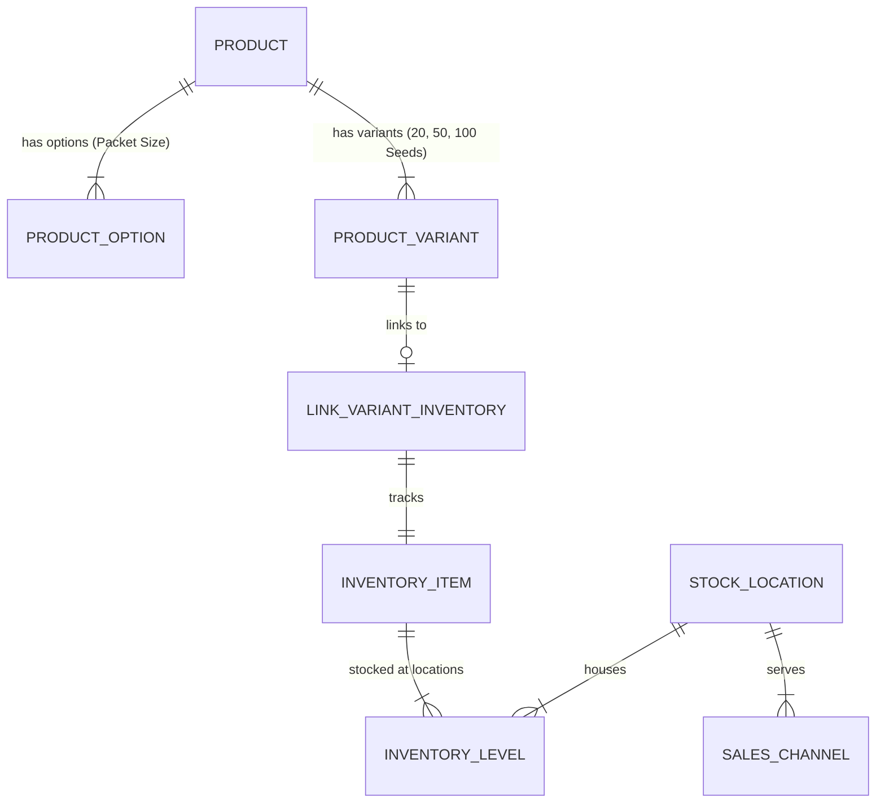
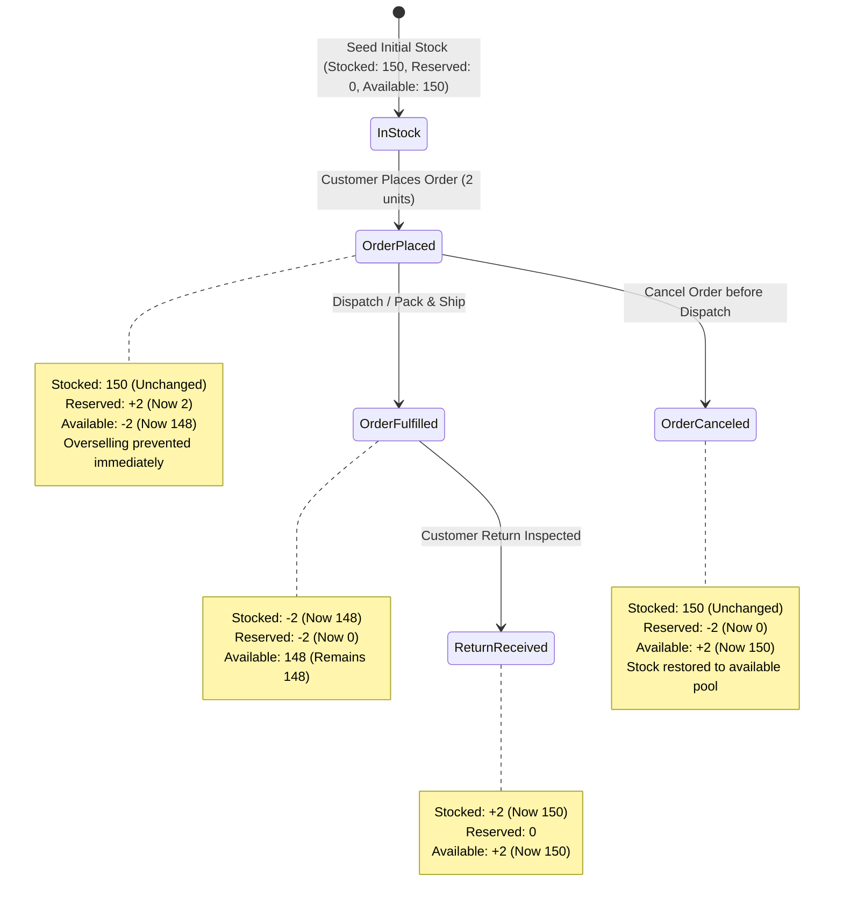

# GLOROV E-commerce Platform — Product Catalog & Inventory Management Foundation

**Document Version:** 1.0.0  
**Target Platform:** Medusa v2 Modular Commerce Engine (`@medusajs/medusa@2.22.0`)  
**Status:** Architecture Specification & Operational Runbook  

---

## 1. Architectural Overview

GLOROV's product catalog and inventory architecture utilizes Medusa v2's native commerce modules (`@medusajs/medusa/product`, `@medusajs/medusa/inventory`, `@medusajs/medusa/stock-location`, and `@medusajs/medusa/pricing`).

### 1.1 Decoupled Data Model

In Medusa v2, catalog presentation is cleanly decoupled from physical inventory tracking:



1. **`Product`**: Represents the canonical botanical entity (e.g., *Tomato Seeds (Desi / Pusa Ruby)*). Owns title, handle, description, images, categories, collection, and botanical metadata.
2. **`ProductVariant`**: Represents selectable purchasing options (e.g., *20 Seeds*, *50 Seeds*, *100 Seeds*). Owns distinct SKU, prices in paise (INR), and inventory flags (`manage_inventory: true`, `allow_backorder: false`).
3. **`InventoryItem`**: Physical inventory unit with SKU and shipping attributes.
4. **`InventoryLevel`**: Multi-location inventory record holding physical stock levels at physical locations (e.g., *Pune Central Nursery Hub*).
5. **`StockLocation`**: Physical warehouse or nursery linked to the sales channel (`GLOROV Web Store`).

---

## 2. Seed-Specific Metadata Architecture: Native Metadata vs. Custom Module

### 2.1 Evaluation & Design Decision

Under Medusa v2, catalog metadata can either be modeled as:
1. **Custom Medusa Module (DML with Link Table)**: Creates custom PostgreSQL tables (e.g. `plant_attribute`) joined via Medusa Module Links.
2. **Structured Product Metadata (`metadata: Record<string, unknown>`)**: Uses Medusa's native JSONB `metadata` column on the `Product` entity with strict application-tier schema validation via Zod.

| Evaluation Dimension | Custom DML Module | Native Structured Metadata (Selected) |
| :--- | :--- | :--- |
| **Database Migrations** | Requires separate MikroORM migrations and link tables (`link_product_plant_attributes`). | Uses core table JSONB column; zero custom database schema modifications or migrations. |
| **Admin Dashboard** | Requires custom Admin UI extensions and custom resolvers to edit/save fields. | Natively viewable and editable in the Medusa Admin Dashboard out of the box; rendered with GLOROV's Admin widget (`BotanicalDetailsWidget`). |
| **Store API Retrieval** | Requires module graph join (`query.graph`) or custom API route overrides. | Retrievable directly via native `GET /store/products?fields=+metadata`. |
| **Optional / Sparse Fields** | Requires nullable foreign columns or EAV tables for unknown botanical data. | Sparse, optional attributes are stored cleanly without schema changes or column bloat. |
| **Type Safety** | MikroORM model definitions. | End-to-end typed TypeScript interface (`SeedMetadata`) and strict Zod validation schema (`seedMetadataSchema`) in `@glorov/types`. |

**Decision**: Native Structured Product Metadata with Zod schema validation was selected for optimal performance, native Store API compatibility, and operational simplicity.

### 2.2 Supported Botanical Fields

All botanical fields are strictly optional to cleanly handle unknown data without inventing scientific claims:

- `common_name` (string): Regional or everyday name (e.g. "Desi Tomato / Tamatar").
- `botanical_name` (string): Latin scientific classification (e.g. *Solanum lycopersicum*).
- `seed_type` (string): Cultivar classification (e.g. "Heirloom", "Hybrid", "Open-Pollinated", "Organic").
- `variety` (string): Specific strain (e.g. "Pusa Ruby", "Pusa Narangi").
- `approx_seeds_per_packet` (number | string): Count of seeds (e.g. `50`).
- `germination_time_range` (string): Expected days to sprout (e.g. "6-10 days").
- `sowing_depth` (string): Planting depth (e.g. "0.5 cm").
- `spacing` (string): Plant-to-plant distance (e.g. "45-60 cm").
- `sunlight` (enum): `"full_sun" | "partial_shade" | "low_light"`.
- `watering` (enum): `"daily" | "alternate_days" | "weekly" | "dry"`.
- `season` (enum): `"kharif" | "rabi" | "zaid" | "all_season"`.
- `difficulty` (enum): `"beginner" | "intermediate" | "expert"`.
- `planting_instructions` (string): Sowing, watering, and transplanting directions.
- `packaging_notes` (string): Moisture protection, barrier pouch, and shelf life specs.
- `is_perishable` (boolean): Flags live potted plants vs shelf-stable seeds.

---

## 3. Inventory Quantity Metrics & Workflow Transitions

### 3.1 Inventory Metrics Explained

For each `InventoryItem` at each `StockLocation`, Medusa v2 tracks three quantities:

$$\text{Available to Sell} = \text{Stocked Quantity} - \text{Reserved Quantity}$$

1. **`stocked_quantity`**: Total physical count of packets currently on warehouse shelves.
2. **`reserved_quantity`**: Count committed to active customer orders awaiting fulfillment.
3. **`available_quantity`**: Units currently available for new customers to purchase.

### 3.2 State Transitions Across Order Lifecycle



#### 1. Order Placed (`createOrderWorkflow` / `reserveInventoryStep`)
- **Action**: When a customer completes checkout, Medusa creates an `inventory_reservation`.
- **`stocked_quantity`**: **Unchanged**. Physical inventory remains in the warehouse.
- **`reserved_quantity`**: **Increased** by ordered quantity.
- **`available_quantity`**: **Decreased** by ordered quantity.
- **Result**: Other shoppers attempting to add or checkout the remaining units are evaluated against the reduced available quantity.

#### 2. Order Fulfilled / Dispatched (`createFulfillmentWorkflow`)
- **Action**: Warehouse operations pack and ship the parcel.
- **`stocked_quantity`**: **Decreased** by fulfilled quantity (goods physically left).
- **`reserved_quantity`**: **Decreased** by fulfilled quantity (reservation consumed).
- **`available_quantity`**: **Unchanged** (already reduced at reservation time).

#### 3. Order Canceled before Dispatch (`cancelOrderWorkflow`)
- **Action**: Customer or admin cancels the order prior to packing.
- **`stocked_quantity`**: **Unchanged**.
- **`reserved_quantity`**: **Decreased** (reservation deleted).
- **`available_quantity`**: **Increased** back to original count. Units are immediately available for sale again.

#### 4. Order Returned & Restocked (`receiveReturnWorkflow`)
- **Action**: Undelivered parcel (or approved return) is inspected and restocked.
- **`stocked_quantity`**: **Increased** by restocked quantity.
- **`reserved_quantity`**: **Unchanged**.
- **`available_quantity`**: **Increased** correspondingly.

#### 5. Manual Inventory Adjustment (`updateInventoryLevelsWorkflow`)
- **Action**: Periodic physical cycle count or stock replenishment.
- **`stocked_quantity`**: Updated directly to verified physical count.
- **`available_quantity`**: Automatically recomputed as $\text{stocked\_quantity} - \text{reserved\_quantity}$.

---

## 4. Prevention of Overselling & Out-of-Stock Handling

Overselling is strictly prevented through Medusa's native inventory controls configured on every variant:
- `manage_inventory: true`
- `allow_backorder: false`

### 4.1 Store API Behavior
When a customer attempts to add an item to their cart:
- If `quantity <= available_quantity`: Request returns `200 OK`, cart line item added.
- If item is completely out of stock (`available_quantity === 0`): Request returns `400 Bad Request`:
  ```json
  {
    "type": "not_allowed",
    "code": "insufficient_inventory",
    "message": "Variant [variant_id] does not have the required inventory"
  }
  ```
- If customer requests more than available stock (e.g. requesting 200 units when only 150 are stocked): Request returns `400 Bad Request` with `code: "insufficient_inventory"`.

---

## 5. Instructions for Creating a Sample Tomato Seeds Product

### Method 1: Using the Automated Seed Script (Recommended)
Run the verified idempotent seed script from `apps/backend`:
```bash
cd apps/backend
npx medusa exec ./src/scripts/seed-catalog.ts
```
This automatically creates:
- Collection: *Kitchen Garden Essentials*
- Category: *Vegetable Seeds* (under *Seeds*)
- Product: *Tomato Seeds (Desi / Pusa Ruby)* (`tomato-seeds-desi`)
- 3 Variants:
  - **20 Seeds**: SKU `GLR-SD-TOM-020`, Price ₹49 (`4900` paise), Stock: 150
  - **50 Seeds**: SKU `GLR-SD-TOM-050`, Price ₹99 (`9900` paise), Stock: 80
  - **100 Seeds**: SKU `GLR-SD-TOM-100`, Price ₹179 (`17900` paise), Stock: 0 (Out of stock)
- Stock location: *Pune Central Nursery Hub* (linked to sales channel)
- Botanical metadata: Desi Tomato, Solanum lycopersicum, Pusa Ruby, Kharif, 6-10 days germination.

---

### Method 2: Via Medusa Admin REST API

#### Step 1: Authenticate as Admin
```bash
TOKEN=$(curl -s -X POST http://localhost:9000/auth/user/emailpass \
  -H "Content-Type: application/json" \
  -d '{"email":"admin@glorov.in","password":"SuperSecretPassword123!"}' | jq -r .token)
```

#### Step 2: Create Product with Packet-Size Variants
```bash
curl -X POST http://localhost:9000/admin/products \
  -H "Authorization: Bearer $TOKEN" \
  -H "Content-Type: application/json" \
  -d '{
    "title": "Tomato Seeds (Desi / Pusa Ruby)",
    "handle": "tomato-seeds-desi",
    "description": "High-viability heirloom Desi Tomato seeds suited for Indian climatic conditions. Produces high-yielding plants with juicy, aromatic, and tangy fruits.",
    "status": "published",
    "thumbnail": "https://images.unsplash.com/photo-1592841200221-a6898f307baa",
    "images": [
      { "url": "https://images.unsplash.com/photo-1592841200221-a6898f307baa" }
    ],
    "options": [
      {
        "title": "Packet Size",
        "values": ["20 Seeds", "50 Seeds", "100 Seeds"]
      }
    ],
    "variants": [
      {
        "title": "20 Seeds",
        "sku": "GLR-SD-TOM-020",
        "manage_inventory": true,
        "allow_backorder": false,
        "options": { "Packet Size": "20 Seeds" },
        "prices": [{ "currency_code": "inr", "amount": 4900 }],
        "metadata": { "packet_size_label": "20 Seeds", "approx_seeds_per_packet": 20 }
      },
      {
        "title": "50 Seeds",
        "sku": "GLR-SD-TOM-050",
        "manage_inventory": true,
        "allow_backorder": false,
        "options": { "Packet Size": "50 Seeds" },
        "prices": [{ "currency_code": "inr", "amount": 9900 }],
        "metadata": { "packet_size_label": "50 Seeds", "approx_seeds_per_packet": 50 }
      },
      {
        "title": "100 Seeds",
        "sku": "GLR-SD-TOM-100",
        "manage_inventory": true,
        "allow_backorder": false,
        "options": { "Packet Size": "100 Seeds" },
        "prices": [{ "currency_code": "inr", "amount": 17900 }],
        "metadata": { "packet_size_label": "100 Seeds", "approx_seeds_per_packet": 100 }
      }
    ],
    "metadata": {
      "common_name": "Desi Tomato / Tamatar",
      "botanical_name": "Solanum lycopersicum",
      "seed_type": "Heirloom / Open-Pollinated",
      "variety": "Pusa Ruby",
      "approx_seeds_per_packet": 50,
      "germination_time_range": "6-10 days",
      "sowing_depth": "0.5 cm",
      "spacing": "45-60 cm plant-to-plant",
      "sunlight": "full_sun",
      "watering": "daily",
      "season": "kharif",
      "difficulty": "beginner",
      "planting_instructions": "Sow seeds 0.5 cm deep in seedling trays. Transplant at 4-6 true leaves.",
      "packaging_notes": "Airtight moisture-barrier foil packet.",
      "is_perishable": false
    }
  }'
```

#### Step 3: Create Inventory Items & Set Stock Levels
For each variant SKU (`GLR-SD-TOM-020`, `GLR-SD-TOM-050`, `GLR-SD-TOM-100`):
1. Create inventory item via `POST /admin/inventory-items`:
   ```bash
   curl -X POST http://localhost:9000/admin/inventory-items \
     -H "Authorization: Bearer $TOKEN" \
     -H "Content-Type: application/json" \
     -d '{"sku":"GLR-SD-TOM-020","title":"Tomato Seeds - 20 Seeds"}'
   ```
2. Create inventory level at Pune Central Nursery Hub location via `POST /admin/inventory-items/:id/location-levels`:
   ```bash
   curl -X POST http://localhost:9000/admin/inventory-items/{inventory_item_id}/location-levels \
     -H "Authorization: Bearer $TOKEN" \
     -H "Content-Type: application/json" \
     -d '{"location_id":"{pune_location_id}","stocked_quantity":150}'
   ```

---

### Method 3: Via Medusa Admin Dashboard UI

1. Log into the Medusa Admin at `http://localhost:9000/app` using `admin@glorov.in` and password `SuperSecretPassword123!`.
2. Navigate to **Products** $\rightarrow$ Click **New Product**.
3. Enter General Details:
   - **Title**: `Tomato Seeds (Desi / Pusa Ruby)`
   - **Handle**: `tomato-seeds-desi`
   - **Description**: Heirloom seeds description.
4. Upload Thumbnail and Product Images.
5. In **Product Options**, add Option Title: `Packet Size` with values `20 Seeds`, `50 Seeds`, and `100 Seeds`.
6. In **Variants & Pricing**:
   - Variant 1: `20 Seeds` $\rightarrow$ SKU: `GLR-SD-TOM-020`, Price (INR): `₹49`.
   - Variant 2: `50 Seeds` $\rightarrow$ SKU: `GLR-SD-TOM-050`, Price (INR): `₹99`.
   - Variant 3: `100 Seeds` $\rightarrow$ SKU: `GLR-SD-TOM-100`, Price (INR): `₹179`.
7. In **Inventory**, toggle **Manage Inventory** ON, toggle **Allow Backorders** OFF. Set stock to `150` for 20 Seeds, `80` for 50 Seeds, and `0` for 100 Seeds at *Pune Central Nursery Hub*.
8. Under **Metadata**, enter the key-value pairs for `common_name`, `botanical_name`, `variety`, `season`, `sunlight`, `watering`, `germination_time_range`, `sowing_depth`, `spacing`, and `planting_instructions`.
9. Click **Publish Product**.
10. The product page will immediately render GLOROV's **🌿 Botanical & Cultivation Specifications** widget displaying all agricultural specs.
