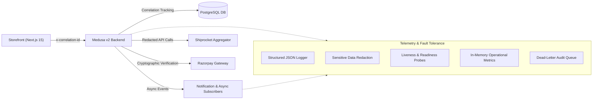

# GLOROV E-commerce Platform — Observability, Logging, and Error Handling

**Document Version:** 1.0.0  
**Status:** Implemented & Verified in CI/CD  
**Scope:** `@glorov/backend` & `@glorov/storefront`  

---

## 1. Observability Architecture Overview

The GLOROV platform implements an end-to-end telemetry and resilience architecture designed for Indian botanical commerce. It guarantees fast failure detection and root-cause diagnosis without ever leaking customer PII, payment secrets, or internal infrastructure details.



---

## 2. Structured Logging Conventions

All custom application logs in GLOROV adhere to a standardized JSON schema:

```typescript
export interface StructuredLogEntry {
  timestamp: string               // ISO-8601 UTC (e.g. '2026-10-26T21:45:00.000Z')
  severity: LogLevel              // 'debug' | 'info' | 'warn' | 'error'
  service: string                 // 'glorov-backend' | 'glorov-storefront'
  environment: string             // 'production' | 'staging' | 'test' | 'development'
  correlation_id?: string         // Validated correlation ID (e.g. 'glr_req_1729979100_abc')
  operation: string               // Canonical operation (e.g. 'POST /store/orders/:id/cancel')
  duration_ms?: number            // Processing duration in milliseconds
  error_code?: SafeErrorClassification // Standardized error code
  message: string                 // Human-readable summary
  metadata?: Record<string, unknown> // Recursively sanitized key-value context
}
```

### Sensitive Data Redaction Rules
1. **Credentials & Tokens:** Any key matching `/password/i`, `/secret/i`, `/token/i`, `/api[_-]?key/i`, `/cvv/i`, or `/signature/i` is immediately replaced with `[REDACTED]`.
2. **Payment Card Numbers:** Values matching credit/debit card numbers are masked as `************4444` (retaining only the final 4 digits).
3. **Bearer & JWT Tokens:** Raw JWT strings or `Authorization: Bearer ...` headers are replaced with `[REDACTED_JWT]` or `Bearer [REDACTED_TOKEN]`.
4. **Customer Addresses:** Street lines (`address_1`, `address_2`, `street`) are masked as `[REDACTED_ADDRESS_LINE]`, protecting customer homes while preserving city, state, and pincode for delivery diagnosis.
5. **Customer Emails & Phones:**
   - Emails: `aarav.patel@glorov.in` -> `a***l@g***.in`
   - Mobile: `+91 98765 43210` -> `******3210`
   - Bank Accounts: `123456789012` -> `XXXXXX9012`

---

## 3. Request Correlation (`x-correlation-id`)

Request correlation links user actions in the browser with backend API requests, database queries, and external provider interactions:
1. **Header Resolution:** Inspects `x-correlation-id` and `x-request-id`. If missing or invalid, generates a trusted ID `glr_${crypto.randomUUID()}` or timestamp-prefixed ID.
2. **Validation Invariant:** Enforces regex `^[a-zA-Z0-9_\-]+$` with length between 8 and 64 characters to prevent HTTP response splitting or log injection attacks.
3. **Propagation:** Forwarded automatically in storefront proxy routes (`/api/shipping/pincode-check`, `/api/shipping/tracking/[id]`, `/api/search`) to the Medusa backend.
4. **Header Echo:** Returned on every HTTP response as `x-correlation-id` for client-side support tickets.
5. **Strict Separation:** Never derived from or bundled into customer JWT tokens or session cookies.

---

## 4. Error Handling & Sanitization Matrix

The error handling middleware intercepts all exceptions and maps them to safe HTTP status codes and customer-friendly messages:

| Failure Mode | Internal Cause | HTTP Status | Client Safe Message | Classification Code |
| :--- | :--- | :--- | :--- | :--- |
| **Database Outage** | Connection refused / pool exhausted | `503` | "Database service is temporarily unavailable. Please retry your request shortly." | `DATABASE_UNAVAILABLE` |
| **Constraint Violation** | Duplicate key / unique constraint | `500` | "A database transaction could not be completed. Please try again." | `DATABASE_QUERY_ERROR` |
| **Payment Timeout** | Razorpay gateway network timeout | `504` | "Payment service took too long to respond. Please verify your payment status before retrying." | `PAYMENT_GATEWAY_TIMEOUT` |
| **Payment Declined** | Insufficient balance / card failure | `400` | "Payment authorization could not be completed. Please check your payment details or try an alternate method." | `PAYMENT_AUTHORIZATION_FAILED` |
| **Tampered Signature** | Razorpay HMAC signature mismatch | `401` | "Invalid cryptographic verification signature. Request rejected." | `INVALID_SIGNATURE` |
| **Courier Outage** | Shiprocket API 500 / down | `502` | "Logistics provider service is temporarily unavailable. Your request could not be completed." | `LOGISTICS_PROVIDER_ERROR` |
| **Rate Limit** | Exceeded request limit | `429` | "Too many requests. Please wait a moment before trying again." | `RATE_LIMIT_EXCEEDED` |
| **Input Validation** | Malformed Indian PIN code / phone | `400` | Specific field message (e.g. "PIN code must be 6 digits and cannot start with 0") | `VALIDATION_ERROR` |

**Security Guarantee:** Database queries, table names, file paths, secrets, and raw stack traces are NEVER serialized in HTTP responses.

---

## 5. Operational Health Checks

### Storefront Health Probe (`GET /api/health`)
- **Liveness:** Returns 200 with process uptime and memory usage (RSS & Heap in MB).
- **Dependency Status:** Evaluates connectivity to the Medusa backend.
- **Resilience Invariant:** Returns `status: "degraded"` (with HTTP 200) if the backend is down, avoiding container restart loops.

### Medusa Backend Health Probe (`GET /store/health`)
- **Process Liveness:** Node.js event loop latency.
- **Database Readiness:** Lightweight `query.graph({ entity: 'region', pagination: { take: 1 } })` verifying pool connectivity. Returns `503` if database is down.
- **External Dependencies:** Inspects Razorpay and Shiprocket configuration / mock mode. External provider downtime sets `status: "degraded"` but maintains `ready: true`, preventing unnecessary container restarts.

### Admin Metrics Endpoint (`GET /admin/health/metrics`)
- Requires authenticated admin token.
- Returns uptime, request error rates, P95 latency, payment failure counts, shipment failure counts, webhook failure counts, and active alert conditions.

---

## 6. Background Jobs, Subscribers, and Retries

All asynchronous subscribers (`order.placed`, `payment.captured`, `shipment.created`, etc.) utilize the `withBoundedRetry` wrapper:
1. **Bounded Exponential Backoff:** Configured via `ASYNC_JOB_MAX_RETRIES` (default: 3 in production, 1 in test) with exponential backoff and randomized jitter to prevent thundering herds.
2. **Fatal vs. Transient Failure Separation:** `NonRetryableError` or schema validation errors halt retries immediately.
3. **Dead-Letter Audit:** Permanently failing jobs are recorded in `DeadLetterRecord` and attached to order metadata (`failed_async_jobs`) for customer support triage.
4. **Idempotency:** Email notifications use deterministic idempotency keys (`notif:order-placed:${order.id}`) preventing duplicate messages.

---

## 7. Monitoring & Alerting Recommendations for Indian SMB

For a growing e-commerce brand operating on a pragmatic budget, we recommend:

### Tier 1: Zero-Cost / Self-Hosted Baseline
1. **Uptime Monitoring:** UptimeRobot / Better Uptime (free tier) monitoring `https://glorov.in/api/health` and `https://api.glorov.in/store/health` with 1-minute ping intervals.
2. **Error Tracking:** GlitchTip (open-source Sentry alternative) or Sentry Free Tier (5,000 events/month) configured with DSN in Next.js and Medusa.
3. **Alert Webhook Notifications:** Free Telegram bot or Discord channel receiving alerts when error rate exceeds threshold.

### Configurable Alert Thresholds (Environment Variables)
```bash
# Alert Thresholds (configured per deployment environment)
ALERT_LATENCY_P95_MS=2000
ALERT_ERROR_RATE_PERCENT=5
ALERT_PAYMENT_FAILURE_THRESHOLD_HOURLY=5
ALERT_SHIPMENT_FAILURE_THRESHOLD_HOURLY=3
ALERT_WEBHOOK_FAILURE_THRESHOLD_HOURLY=5
ALERT_NOTIFICATION_FAILURE_THRESHOLD_HOURLY=5
ALERT_CHECKOUT_RETRY_THRESHOLD=3
```

---

## 8. Runbook: Diagnosing Common Production Failures

### A. Diagnosing Checkout Failures
1. **Filter Logs by Correlation ID:** Search backend logs for `correlation_id` from the customer's support request.
2. **Check Pincode Serviceability:** Verify whether `/store/pincode-check` returned `serviceable: false` or `cod_restriction_reason`.
3. **Stock Contention:** Inspect whether `INSUFFICIENT_STOCK` was triggered due to concurrent checkout of live plant units.

### B. Diagnosing Payment Failures
1. **Signature Verification Mismatch:** Look for `INVALID_SIGNATURE` in logs. Cause: mismatch between `RAZORPAY_KEY_SECRET` in environment and Razorpay dashboard webhook secret.
2. **Payment Timeout:** Look for `PAYMENT_GATEWAY_TIMEOUT`. Check if customer was debited via Razorpay Merchant Dashboard before re-attempting capture.
3. **COD Rejection:** Check order subtotal against `MAX_COD_ORDER_PAISE` (₹5,000 limit) or perishable plant rules.

### C. Diagnosing Shipment & Courier Failures
1. **AWB Assignment Failure:** Check if Shiprocket token expired. Inspect `ShiprocketProvider` error logs for HTTP 401 or token refresh issues.
2. **Pickup Warehouse Unreachable:** Verify `pune_main_nursery` pickup pincode (`411001`) matches configured Shiprocket warehouse location.
3. **Dead-Letter Subscriber Failure:** Query `GET /admin/orders/:id` and inspect `metadata.failed_async_jobs` to identify failed notification dispatches.
