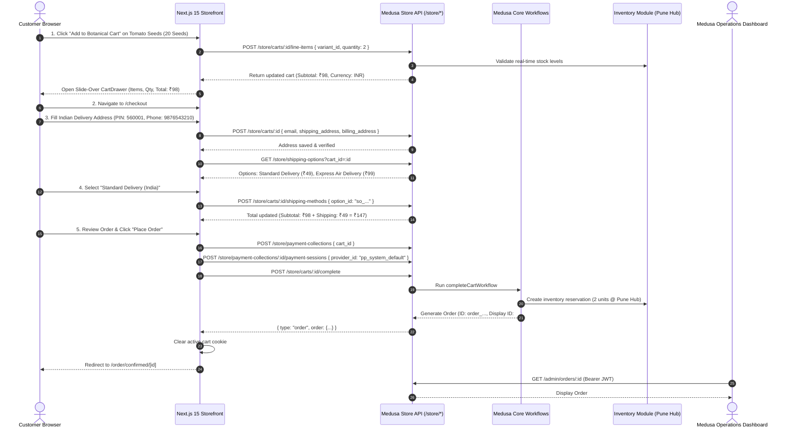

# GLOROV — Order Lifecycle, Indian Market Configuration & Checkout Architecture

**Status:** Verified Production-Grade Specification  
**Medusa Core Version:** Medusa v2.22.0  
**Storefront Framework:** Next.js 15 App Router (React 19)  
**Target Market:** India (D2C High-Viability Seeds & Live Botanical Products)  

---

## 1. Executive Summary & Customer Journey

The cart-to-order workflow in GLOROV establishes a native Medusa v2 commerce pipeline without duplicate database models or mock responses. All pricing, currency rules, stock availability, and address constraints are enforced by the Medusa commerce backend.

### 1.1 Implemented End-to-End Customer Journey



---

## 2. Indian Market Configuration

### 2.1 Regional Setup & INR Currency
- **Region Name:** `India`
- **ISO-2 Country:** `in` (India)
- **Currency Code:** `inr` (Indian Rupee — ₹)
- **Automatic Taxes:** Enabled
- **Price Precision:** All prices in Medusa are integer amounts in paise (`₹49` = `4900` paise). The storefront formats these with standard Indian numbering (`₹49`, `₹1,499`).

### 2.2 Fulfillment Set, Service Zones & Stock Location
- **Stock Location Hub:** `Pune Central Nursery Hub` (PIN: `411001`, Haveli, Maharashtra)
- **Fulfillment Provider:** `manual_manual` (Native Medusa Manual Fulfillment)
- **Fulfillment Set:** `Pune Central Nursery Delivery` (type: `shipping`)
- **Service Zone:** `India Domestic Delivery` (Geo-zone: `type: "country"`, `country_code: "in"`)
- **Configured Shipping Options:**
  1. **Standard Delivery (India):**
     - Option Code: `standard`
     - Price: ₹49 (4900 paise) flat rate
     - Transit Time: 3–5 business days surface transit
     - Transit Rules: Non-return shipment (`is_return: false`), enabled in storefront (`enabled_in_store: true`).
  2. **Express Botanical Delivery (Air):**
     - Option Code: `express`
     - Price: ₹99 (9900 paise) flat rate
     - Transit Time: 1–2 business days priority air transit
     - Transit Rules: Specially designated for perishable live nursery stock and high-value seed packets.

### 2.3 Indian GST & Business Requirements (Store Owner Checklist)
Under Indian Goods and Services Tax (GST) law:
1. **Agricultural Sowing Seeds (HSN 1209):** Nil-rated (0% GST) under Notification No. 2/2017-Central Tax (Rate). Desi Vegetable & Flower seeds are exempt.
2. **Live Ornamental Plants (HSN 0602):** 0% GST (live plants, tubers, roots).
3. **Ceramic & Plastic Planters (HSN 6912 / 3926):** 12% or 18% GST.
4. **Organic Fertilizers & Potting Soils (HSN 3101):** 5% GST.
5. **Gardening Tools (HSN 8201):** 18% GST.

#### Store Owner Action Items for Production Launch:
- [ ] Provide registered **GSTIN** (Goods and Services Tax Identification Number) for Maharashtra and secondary fulfillment hubs.
- [ ] Configure Tax Rates per Product Type in Medusa Admin when non-seed merchandise (planters, tools) is activated.
- [ ] Configure Indian E-Way Bill generation threshold (mandatory for single consignments exceeding ₹50,000 value).
- [ ] Establish Indian legal entity trade name, registered office address, and grievance officer contact details for the storefront footer.

---

## 3. Customer & Checkout Flow Specification

### 3.1 Storefront Routes & Implementations
| Route | Type | Purpose | Key Components |
| :--- | :--- | :--- | :--- |
| `/cart` | Client View | Full shopping cart page | Item list, quantity modifier, empty state, subtotal, ₹499 free shipping meter |
| `/checkout` | Client View | Multi-step Indian checkout | Address form with PIN/Phone Zod validation, shipping option selector, review, place order |
| `/order/confirmed/[id]` | Server Component | Order confirmation | Display ID, timestamp, items, customer address, payment & fulfillment badges |
| Slide-Over Drawer | Client Component | Quick slide-over cart drawer | Real-time drawer triggered by "Add to Cart" or Header cart button |

### 3.2 Indian Delivery Address Validation Conventions
Indian addresses must be strictly validated before transmission to courier aggregators:
- **PIN Code:** 6 numeric digits, cannot begin with `0` (regex: `^[1-9][0-9]{5}$`). Tested across metros and rural postal divisions.
- **Mobile Phone:** 10 numeric digits, starting with cellular prefixes `6`, `7`, `8`, or `9` (regex: `^[6-9][0-9]{9}$`). Landline numbers are disallowed for delivery SMS tracking.
- **State Selection:** Pre-populated with all 28 Indian States and 8 Union Territories to eliminate state-name spelling discrepancies during GST interstate vs intrastate settlement.

---

## 4. Inventory Lifecycle & Failure Handling

Medusa v2 strictly decouples catalog inventory levels from transient cart items. Inventory transitions through well-defined lifecycle stages:

```
[Storefront Product View]
         │ (1) Checks available quantity (stocked - reserved)
         ▼
[Add to Cart]
         │ (2) Rejects variants with 0 stock (400 Bad Request)
         ▼
[Cart Completion / Order Placement]
         │ (3) completeCartWorkflow invokes reserve_inventory_step
         ▼
[reservation_item created in DB]
         │ Available inventory decreases by ordered quantity
         ├── If Order Cancelled ──► [reservation_item soft-deleted] (Inventory restored)
         └── If Order Fulfilled ──► [Stock level decremented] (Reservation fulfilled)
```

### 4.1 Detailed Inventory Behavior by Stage
1. **Adding to Cart (`POST /store/carts/:id/line-items`):**
   - Medusa checks whether `inventory_quantity >= requested_quantity`.
   - If stock is 0 (or less than requested), Medusa rejects with `400 Bad Request` (`Item ... is not in stock`).
2. **Order Placement (`POST /store/carts/:id/complete`):**
   - `completeCartWorkflow` creates a `reservation_item` linked to `ordli_...` and `sloc_...` (Pune Hub).
   - The reservation holds the units without yet modifying the physical stock audit record.
   - Available quantity query `inventory_quantity` returns `stocked - reserved`.
3. **Order Cancellation (`POST /admin/orders/:id/cancel`):**
   - Soft-deletes `reservation_item` (`deleted_at = NOW()`).
   - The reserved units immediately return to the available pool. Verified in integration tests.
4. **Order Fulfillment (`POST /admin/orders/:id/fulfillments`):**
   - Consumes the reservation and decrements `stocked_quantity` on the inventory level at Pune Central Nursery Hub.
5. **Duplicate Order Prevention (Idempotency):**
   - Calling `POST /store/carts/:id/complete` on an already completed cart returns the existing order object with status 200 rather than re-reserving inventory or duplicating the order.
6. **Stock Depletion Mid-Checkout Race Condition:**
   - If a variant is in stock when added to the cart, but physical stock drops to 0 or is depleted by concurrent checkouts before order placement, `completeCartWorkflow` rejects the completion with `400 Bad Request` (`Not enough stock available for item ... at location ...`). The customer's cart remains active without placing an order, strictly protecting warehouse inventory limits.

---

## 5. Payment Architecture & Future Gateways

### 5.1 Payment Boundary Design
Live payment credentials (e.g. Razorpay Key Secret, Webhook Secrets) must never touch browser client code.

```mermaid
flowchart LR
    Browser["Next.js Storefront"]
    MedusaAPI["Medusa v2 Backend"]
    PaymentProvider["Payment Provider (Razorpay / System)"]
    WebhookHandler["Medusa Webhook Endpoint (/hooks/payment/*)"]

    Browser -->|1. Request payment session| MedusaAPI
    MedusaAPI -->|2. Initialize session| PaymentProvider
    PaymentProvider -->>MedusaAPI: Session token / order_id
    MedusaAPI -->>Browser: Client Token
    Browser -->|3. Authorize in Razorpay Modal| PaymentProvider
    PaymentProvider -->|4. Async Trusted Webhook (Signature Verified)| WebhookHandler
    WebhookHandler -->|5. Authorize/Capture Order| MedusaAPI
```

- **Active Provider:** `pp_system_default` (native Medusa test provider). Authorizes order payments without mock mocks, completing native Medusa transactions.
- **Crucial Rule:** An order is never marked as paid simply because a customer returns to a success URL. Payment status is only updated upon trusted server-to-server callback or webhook.

### 5.2 Future Cash on Delivery (COD) Architecture
Cash on Delivery remains a significant payment channel in Indian botanical retail:
1. **Unpaid Order Representation:**
   - COD orders will be placed with `payment_status: "awaiting"` or `"not_paid"`.
   - The order enters Medusa Admin as `status: "pending"`, `payment_status: "awaiting"`.
2. **Perishability & RTO (Return to Origin) Mitigation:**
   - Live plants cannot be ordered via COD because return transit mortality is 100%.
   - Only shelf-stable seeds and dry planters qualify for COD.
   - COD orders are capped between ₹299 (minimum viable parcel) and ₹2,500 (maximum courier liability).
3. **Customer OTP Verification:**
   - Before dispatch, an automated WhatsApp OTP verification workflow will confirm customer availability.
4. **Payment Capture:**
   - When the logistics courier (e.g. Shiprocket / Delhivery) deposits cash, a webhook updates Medusa to `payment_status: "captured"`.

---

## 6. How to Test End-to-End Manually

### Step 1: Launch Backend and Storefront
```bash
# Terminal 1: Backend
cd apps/backend && pnpm dev

# Terminal 2: Storefront
cd apps/storefront && pnpm dev
```

### Step 2: Customer Storefront Flow
1. Open `http://localhost:3000` in your browser.
2. In the "Curated Botanical & Seed Varieties" grid, locate **Desi Pusa Ruby Tomato Seeds** and click **Add to Botanical Cart**.
3. The slide-over **Botanical Cart Drawer** opens displaying 1 packet of 20 Seeds at `₹49`.
4. Click **Checkout** to navigate to `http://localhost:3000/checkout`.
5. Enter customer and Indian address details:
   - Email: `gardener@example.com`
   - Name: `Priya Sharma`
   - Address: `Flat 402, Green Meadows, Baner Road`
   - PIN Code: `411045`
   - City: `Pune`, State: `Maharashtra`
   - Mobile: `9876543210`
6. Click **Save & Continue**.
7. Select **Standard Delivery (India)** (`₹49`).
8. Review the order breakdown: Items ₹49 + Shipping ₹49 = **Total ₹98**.
9. Click **Place Order (₹98)**.
10. The browser redirects to `/order/confirmed/[order_id]` displaying confirmation reference (e.g. `#1`), Indian delivery address, shipping method, and botanical packaging guarantee.

### Step 3: Verify in Medusa Admin Console
1. Open Medusa Admin at `http://localhost:9000/app`.
2. Login with:
   - Email: `admin@glorov.in`
   - Password: `SuperSecretPassword123!`
3. Navigate to **Orders** in the left sidebar.
4. Click the newly placed order:
   - Verify Customer: `Priya Sharma` (`gardener@example.com`)
   - Verify Shipping Address: `Flat 402, Green Meadows, Pune, Maharashtra, 411045`
   - Verify Items: `Tomato Seeds (Desi / Pusa Ruby)` — `20 Seeds` (SKU: `GLR-SD-TOM-020`)
   - Verify Payment Status: `Authorized`
   - Verify Fulfillment Status: `Not fulfilled`
   - Verify Grand Total: `₹98.00`
