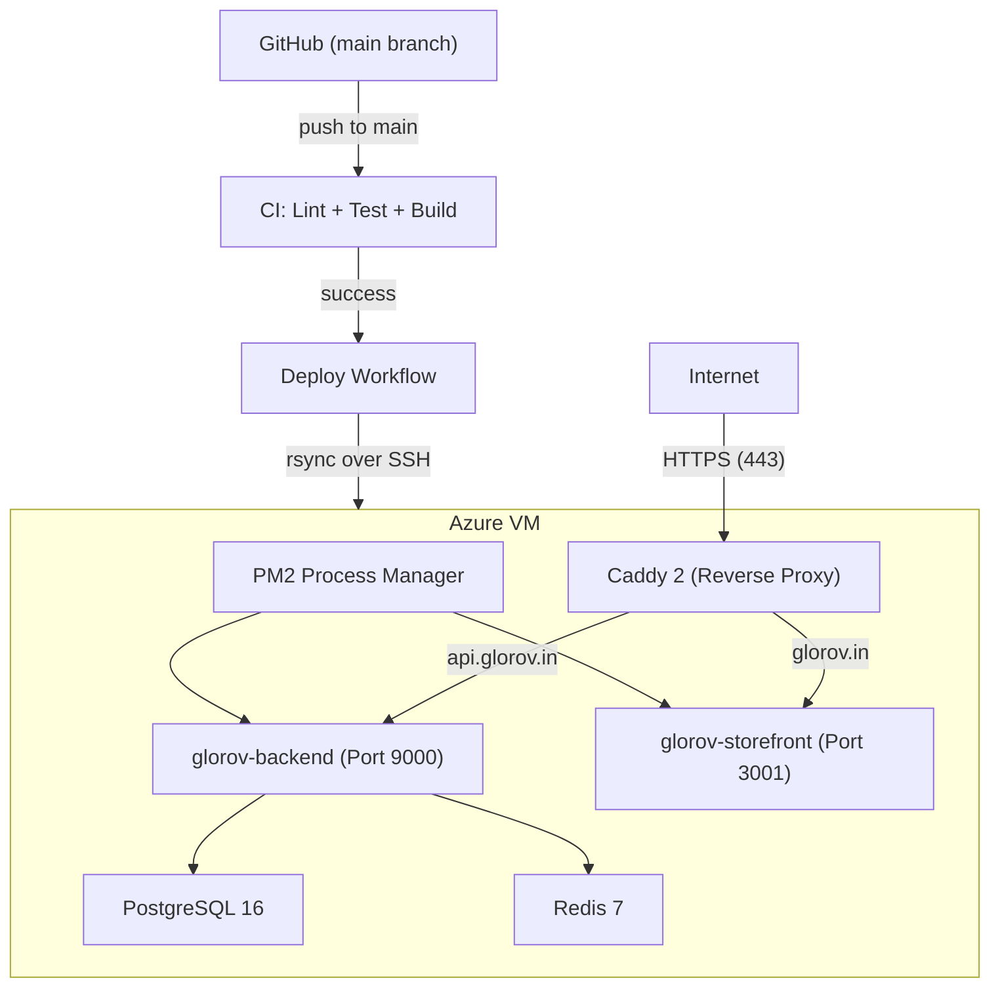

# GLOROV — Deployment Audit

> **Audit Date:** November 6, 2026

---

## 1. Production Deployment Architecture

---

## 2. Deployment Pipeline Assessment

### CI Workflow (`ci.yml` — 183 lines)
**File**: [`.github/workflows/ci.yml`](file:///Users/sourav/Developer/WEB/top-projects/glorov/.github/workflows/ci.yml)

| Step | Status | Evidence |
|---|---|---|
| Frozen lockfile install | ✅ PASS | `pnpm install --frozen-lockfile` |
| Type checking | ✅ PASS | `pnpm turbo typecheck` |
| Linting | ✅ PASS | `pnpm turbo lint` |
| Unit tests | ✅ PASS | `pnpm turbo test` |
| Integration tests (Postgres + Redis) | ✅ PASS | 9 HTTP integration suites |
| Production build verification | ✅ PASS | `pnpm turbo build` |
| Concurrency control | ✅ PASS | `cancel-in-progress: true` |
| pnpm store caching | ✅ PASS | `actions/cache@v4` |
| Secret management in CI | ✅ PASS | Mock secrets for test env, not real credentials |

### Deploy Workflow (`deploy.yml` — 143 lines)
**File**: [`.github/workflows/deploy.yml`](file:///Users/sourav/Developer/WEB/top-projects/glorov/.github/workflows/deploy.yml)

| Step | Status | Evidence |
|---|---|---|
| Triggers on push to main | ✅ PASS | L5 |
| Manual dispatch supported | ✅ PASS | L7: `workflow_dispatch` |
| Concurrency lock (no cancel) | ✅ PASS | L10: `cancel-in-progress: false` |
| Backend build with production env | ✅ PASS | L49-58 |
| Storefront standalone build | ✅ PASS | L60-74 |
| SSH key from secrets | ✅ PASS | L78-86 — Fails if not configured |
| rsync deployment (not Docker) | ✅ PASS | L100-123 — Compiled artifacts only |
| Admin dashboard deployment | ✅ PASS | L113-118 |
| Deploy scripts deployment | ✅ PASS | L120-123 |
| PM2 safe reload | ✅ PASS | L126 — `reload-services.sh` |
| Post-deploy smoke test | ✅ PASS | L128-143 — 3 health checks |

---

## 3. Server-Side Scripts Assessment

### reload-services.sh (84 lines)
**File**: [`deploy/reload-services.sh`](file:///Users/sourav/Developer/WEB/top-projects/glorov/deploy/reload-services.sh)

| Feature | Status | Evidence |
|---|---|---|
| Admin symlink for /app path | ✅ PASS | L13 |
| Nginx config sync (if present) | ✅ PASS | L16-20 |
| PM2 restart with `--update-env` | ✅ PASS | L27 |
| Standalone pnpm dependency linking | ✅ PASS | L36-43 |
| Backend health check (15 retries × 2s) | ✅ PASS | L58-75 |
| Storefront health check | ✅ PASS | L77-81 |
| **Protects other PM2 processes** | ✅ PASS | L7 comment — "PM2 process 0 (elsesourav-web) is never touched!" |
| PM2 save after changes | ✅ PASS | L56 |

### deploy-server.sh (91 lines)
**File**: [`deploy/deploy-server.sh`](file:///Users/sourav/Developer/WEB/top-projects/glorov/deploy/deploy-server.sh)

| Feature | Status | Evidence |
|---|---|---|
| Optional `--pull` from git | ✅ PASS | L17-29 |
| Dependency installation | ✅ PASS | L37 — `--prefer-offline` with fallback |
| Database migrations | ✅ PASS | L49-52 — `db:migrate --skip-search --execute-safe-links` |
| Build only if needed | ✅ PASS | L40-45 — Checks if `.medusa/server` exists |
| PM2 restart or start | ✅ PASS | L56-60 |
| Health verification (20 retries × 2s) | ✅ PASS | L64-86 |
| Failure exit with logs | ✅ PASS | L83-86 — Shows last 25 PM2 log lines |

---

## 4. Docker Compose Assessment

### docker-compose.prod.yml (143 lines)
**File**: [`docker-compose.prod.yml`](file:///Users/sourav/Developer/WEB/top-projects/glorov/docker-compose.prod.yml)

| Feature | Status | Evidence |
|---|---|---|
| Required env var validation | ✅ PASS | `${DB_PASSWORD:?Database password is required}` — fail-fast |
| PostgreSQL healthcheck | ✅ PASS | `pg_isready` every 10s |
| Redis healthcheck | ✅ PASS | `redis-cli ping` every 10s |
| Backend healthcheck | ✅ PASS | `curl -f http://localhost:9000/health` every 30s |
| Persistent volumes (pgdata, redisdata) | ✅ PASS | Named volumes |
| Redis password requirement | ✅ PASS | `--requirepass ${REDIS_PASSWORD:?}` |
| Internal network isolation | ✅ PASS | `glorov-internal` (internal: true) — DB/Redis not exposed |
| Public network for backend+caddy | ✅ PASS | `glorov-public` |
| Resource limits | ✅ PASS | Memory and CPU limits defined |
| Mock modes disabled | ✅ PASS | `RAZORPAY_MOCK_MODE: "false"`, `SHIPROCKET_MOCK_MODE: "false"` |
| Auto-migrate | ⚠️ WARNING | `AUTO_MIGRATE: "true"` — auto-runs migrations on startup |

---

## 5. Reverse Proxy (Caddy) Assessment

### Caddyfile (66 lines)
**File**: [`deploy/Caddyfile`](file:///Users/sourav/Developer/WEB/top-projects/glorov/deploy/Caddyfile)

| Feature | Status | Evidence |
|---|---|---|
| Automated Let's Encrypt SSL | ✅ PASS | L8: `email care@glorov.in` |
| HSTS (2-year, includeSubDomains, preload) | ✅ PASS | L18 |
| X-Content-Type-Options: nosniff | ✅ PASS | L19 |
| X-Frame-Options | ✅ PASS | L20 (SAMEORIGIN for storefront, DENY for API) |
| Referrer-Policy | ✅ PASS | L21 |
| Permissions-Policy | ✅ PASS | L22 |
| Server header removal | ✅ PASS | L23: `-Server` |
| Gzip + Zstd compression | ✅ PASS | L14, L43 |
| www → apex redirect | ✅ PASS | L27-30 |
| X-Real-IP forwarding | ✅ PASS | L35 |
| Request body size limit (25MB) | ✅ PASS | L56 |
| Admin disabled | ✅ PASS | L9: `admin off` |

---

## 6. Issues Identified

| ID | Issue | Severity | Detail |
|---|---|---|---|
| **GLOROV-DEPLOY-001** | ~~**No rollback mechanism**~~ — **RESOLVED (FIX-009)**: Releases maintained in `/var/www/glorov/releases/` (last 2 retained), `/var/www/glorov/current` symlinked, `deploy/rollback.sh` swaps symlink & restarts PM2 with confirmation prompt. | RESOLVED | `deploy/rollback.sh`, `deploy/reload-services.sh` |
| **GLOROV-DEPLOY-002** | ~~**AUTO_MIGRATE in production**~~ — **RESOLVED (FIX-009)**: Set `AUTO_MIGRATE: "false"` in `docker-compose.prod.yml`, migrations run explicitly in CI/CD before PM2 reload. | RESOLVED | `docker-compose.prod.yml`, `deploy.yml` |
| **GLOROV-DEPLOY-003** | ~~**VM memory overcommit**~~ — **RESOLVED (FIX-010)**: Reduced Docker compose limits (Postgres 384MB, Redis 128MB with allkeys-lru, Backend 256MB, Storefront 128MB = ~896MB total). Fits in 1GB Azure VM. | RESOLVED | Same as GLOROV-PERF-001 |
| **GLOROV-DEPLOY-004** | ~~**No database backup automation**~~ — **RESOLVED (FIX-009)**: Created `deploy/backup-database.sh` with 7-day retention, PGPASSWORD env security, streaming gzip -1 (1GB RAM optimized), run pre-deploy and via cron. | RESOLVED | `deploy/backup-database.sh`, `deploy.yml` |
| **GLOROV-DEPLOY-005** | **SSH key in GitHub secret** — Single SSH key for deployment. No key rotation policy documented. | MEDIUM | `deploy.yml` L78 |
| **GLOROV-DEPLOY-006** | ~~**PM2 restart (not reload)**~~ — **RESOLVED (FIX-010)**: `reload-services.sh` and `deploy-server.sh` updated to use `pm2 reload` for zero-downtime reloads. | RESOLVED | `reload-services.sh`, `deploy-server.sh` |
| **GLOROV-DEPLOY-007** | **Admin symlink workaround** — `ln -sfn /var/www/glorov/admin /var/www/glorov/admin/app` is a fragile path hack. | LOW | `reload-services.sh` L13 |
| **GLOROV-DEPLOY-008** | **Storefront standalone assets manual copy** — Deploy workflow manually copies `public/` and `.next/static/` into standalone output. If Next.js standalone behavior changes, this breaks silently. | LOW | `deploy.yml` L72-73 |
| **GLOROV-DEPLOY-009** | **No staging environment** — Deployment goes directly from CI to production. No staging/preview for manual validation. | MEDIUM | `.github/workflows/` |
| **GLOROV-DEPLOY-010** | **Cloudinary credentials in docker-compose.prod.yml** — API key `179253354861549` and cloud name defaults removed; strictly env-var driven. | RESOLVED (FIX-004) | `docker-compose.prod.yml` L96-99 |

---

## 7. Deployment Readiness Verdict

> [!IMPORTANT]
> The deployment pipeline is **functional and well-structured** with CI quality gates, health checks, and safe PM2 management. Critical gaps are: no rollback mechanism, no database backup automation, memory overcommit on the target VM, and auto-migration in production. These must be addressed before production launch.
