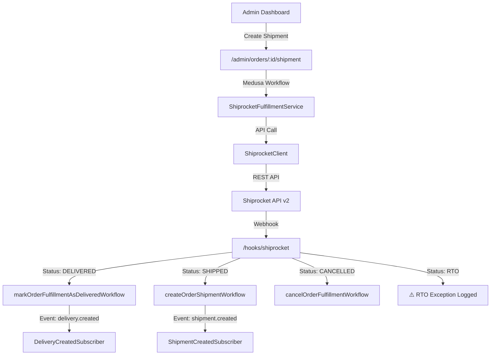

# GLOROV — Logistics & Fulfillment Audit

> **Audit Date:** November 6, 2026  
> **Provider:** Shiprocket (Indian logistics aggregator)

---

## 1. Architecture Overview

---

## 2. Fulfillment Provider Assessment

### ShiprocketFulfillmentService (476 lines)
**File**: [`service.ts`](file:///Users/sourav/Developer/WEB/top-projects/glorov/apps/backend/src/modules/fulfillment-shiprocket/service.ts)

| Capability | Status | Evidence |
|---|---|---|
| Shipping options (Standard/Express/Return) | ✅ PASS | L44-59 — 3 options including reverse pickup |
| Rate calculation with live API | ✅ PASS | L94-147 — Dynamic via serviceability API with fallback rates |
| Indian PIN code validation (6-digit) | ✅ PASS | L194-199 — Regex `[1-9][0-9]{5}` |
| Idempotent shipment creation | ✅ PASS | L161-184 — Checks existing `shiprocket_order_id` + `awb_code` |
| COD vs Prepaid detection | ✅ PASS | L259-275 — Multi-source COD flag detection |
| HSN code for seeds | ✅ PASS | L229 — HSN 1209 (Agricultural seeds) |
| AWB assignment | ✅ PASS | L320-337 — Auto-assign with fallback |
| Label generation | ✅ PASS | L343-351 — PDF label URL |
| Cancellation with provider sync | ✅ PASS | L384-418 — Propagates errors, never swallows failures |
| Mock mode for dev/test | ✅ PASS | L51-58 — Auto-mock when credentials absent |

### ShiprocketClient (600 lines)
**File**: [`client.ts`](file:///Users/sourav/Developer/WEB/top-projects/glorov/apps/backend/src/modules/fulfillment-shiprocket/client.ts)

| Capability | Status | Evidence |
|---|---|---|
| JWT auth with 24h cache | ✅ PASS | L77-148 — Cached token with 60s buffer |
| Auto-retry on 401 (token expired) | ✅ PASS | L177-180 — Single retry with cache invalidation |
| Request timeout (5s default) | ✅ PASS | L49, L160 — AbortController |
| Serviceability cache (10-min TTL, max 1000 entries) | ✅ PASS | L244-264 |
| Deterministic mock behavior | ✅ PASS | L267-352 — PINs starting with 999/000 are unserviceable |
| Webhook token verification | ✅ PASS | L593-599 |
| PIN code format validation | ✅ PASS | L231 |

---

## 3. Webhook Handler Assessment

### Shiprocket Webhook (326 lines)
**File**: [`hooks/shiprocket/route.ts`](file:///Users/sourav/Developer/WEB/top-projects/glorov/apps/backend/src/api/hooks/shiprocket/route.ts)

| Control | Status | Evidence |
|---|---|---|
| Fail-closed in production (no token = reject) | ✅ PASS | L93-98 |
| Constant-time token comparison | ✅ PASS | L14-19 — `crypto.timingSafeEqual()` |
| Query param tokens blocked in production | ✅ PASS | L104 — Only header tokens in production |
| Status normalization (8 raw statuses → 5 normalized) | ✅ PASS | L25-74 |
| Idempotent processing (skip already delivered/shipped/cancelled) | ✅ PASS | L231-298 |
| Medusa workflow integration | ✅ PASS | L235-297 — `markOrderFulfillmentAsDeliveredWorkflow`, `createOrderShipmentWorkflow`, `cancelOrderFulfillmentWorkflow` |
| RTO exception logging | ✅ PASS | L299-303 — Logged as warning |
| Fulfillment resolution by AWB/SR Order/Shipment ID | ✅ PASS | L161-173 — Multi-field matching |

---

## 4. Event Subscriber Assessment

### Shipment & Delivery Notifications

| Subscriber | Event | Template | Status |
|---|---|---|---|
| [`shipment-created.ts`](file:///Users/sourav/Developer/WEB/top-projects/glorov/apps/backend/src/subscribers/shipment-created.ts) | `shipment.created` | `shipment-created` | ✅ PASS — Includes AWB, tracking URL, carrier, items, idempotency key |
| [`tracking-updated.ts`](file:///Users/sourav/Developer/WEB/top-projects/glorov/apps/backend/src/subscribers/tracking-updated.ts) | `tracking.updated` | `tracking-updated` | ✅ PASS — Direct tracking data, safe tracking URL construction |
| [`delivery-created.ts`](file:///Users/sourav/Developer/WEB/top-projects/glorov/apps/backend/src/subscribers/delivery-created.ts) | `delivery.created` | `delivery-completed` | ✅ PASS — Delivery confirmation with unboxing guide |

### Common Patterns (All subscribers)
- ✅ `withBoundedRetry()` wrapper for transient failure resilience
- ✅ Idempotency keys prevent duplicate notifications
- ✅ `no_notification` flag respected
- ✅ `maskEmail()` for log privacy
- ✅ Graceful degradation when notification module unavailable

---

## 5. Issues Identified

| ID | Issue | Severity | Detail |
|---|---|---|---|
| **GLOROV-SHIP-001** | **Fallback AWB generation** — When live AWB assignment fails, service generates a random `SR${9-digit}` AWB (L340). This fake AWB will not track in Shiprocket. | MEDIUM | [`service.ts` L339-341](file:///Users/sourav/Developer/WEB/top-projects/glorov/apps/backend/src/modules/fulfillment-shiprocket/service.ts#L339-L341) |
| **GLOROV-SHIP-002** | **Fallback label URL** — When label generation fails, a mock URL is generated (L349). This will 404 in production. | LOW | [`service.ts` L349](file:///Users/sourav/Developer/WEB/top-projects/glorov/apps/backend/src/modules/fulfillment-shiprocket/service.ts#L349) |
| **GLOROV-SHIP-003** | **RTO orders have no automated handling** — When Shiprocket reports RTO (Return to Origin), the webhook only logs a warning. No inventory restoration, refund initiation, or admin notification is triggered. | HIGH | [`hooks/shiprocket/route.ts` L299-303](file:///Users/sourav/Developer/WEB/top-projects/glorov/apps/backend/src/api/hooks/shiprocket/route.ts#L299-L303) |
| **GLOROV-SHIP-004** | **Hardcoded default phone** — If shipping address phone is missing/invalid, service defaults to `9876543210` (L202). This dummy phone will be submitted to Shiprocket. | MEDIUM | [`service.ts` L202](file:///Users/sourav/Developer/WEB/top-projects/glorov/apps/backend/src/modules/fulfillment-shiprocket/service.ts#L202) |
| **GLOROV-SHIP-005** | **Hardcoded package dimensions** — Length 15cm, breadth 12cm, height 8cm, weight 0.5kg for all items (L310-313). Large plants or multi-item orders may have incorrect dimensions, affecting shipping costs. | MEDIUM | [`service.ts` L310-313](file:///Users/sourav/Developer/WEB/top-projects/glorov/apps/backend/src/modules/fulfillment-shiprocket/service.ts#L310-L313) |
| **GLOROV-SHIP-006** | **Fulfillment search scans all fulfillments** — Webhook handler queries ALL fulfillments (L145-156) to find matching AWB/order. No pagination limit. At scale, this will be a performance bottleneck. | MEDIUM | [`hooks/shiprocket/route.ts` L145-156](file:///Users/sourav/Developer/WEB/top-projects/glorov/apps/backend/src/api/hooks/shiprocket/route.ts#L145-L156) |

---

## 6. Overall Logistics Verdict

> [!IMPORTANT]
> The Shiprocket integration is **production-capable** with proper security (constant-time token comparison, fail-closed auth, idempotent processing) and comprehensive workflow integration. The main gaps are operational: RTO handling automation, package dimension accuracy, and fulfillment search optimization.
