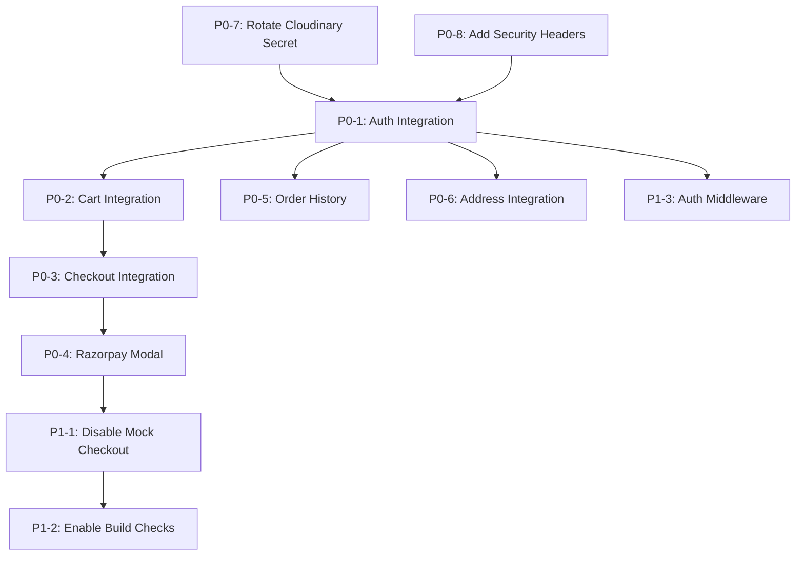

# GLOROV — Production Roadmap (Prioritized)

> **Created:** November 6, 2026  
> **Based On:** Production Audit PRODUCTION_AUDIT.md  
> **Priority Scale:** P0 (Critical Blocker) → P1 (Essential) → P2 (Important) → P3 (Enhancement)

---

## P0 — Critical Production Blockers

These must be resolved before any real customer transaction.

| Task ID | Issue Ref | Description | Affected Modules | Complexity | Status |
|---|---|---|---|---|---|
| **P0-1** | GLOROV-AUTH-001, GLOROV-AUTH-002 | **Connect storefront auth to Medusa auth APIs.** Replace localStorage-simulated authentication with real Medusa v2 customer auth (`POST /auth/customer/emailpass/register`, `POST /auth/customer/emailpass`, `GET /store/customers/me`). Implement HttpOnly session cookies. Remove plaintext password storage. | `CustomerAuthContext.tsx`, auth pages, middleware | L | COMPLETED |
| **P0-2** | GLOROV-CART-001 | **Connect cart to Medusa cart APIs.** Replace localStorage cart with Medusa server-side cart (`POST /store/carts`, `POST /store/carts/:id/line-items`, etc.). Implement guest cart → logged-in cart migration. | `StorefrontContext.tsx`, cart components | L | COMPLETED |
| **P0-3** | GLOROV-ORD-001, GLOROV-ORD-002, GLOROV-INV-001 | **Connect checkout to Medusa cart completion.** Use `POST /store/carts/:id/complete` instead of fake order generation. Remove fallback mock checkout path. Ensure real inventory deduction. | `place-order/route.ts`, `validate/route.ts`, checkout page | L | COMPLETED |
| **P0-4** | GLOROV-PAY-001 | **Integrate Razorpay checkout modal.** Load Razorpay JS SDK, render checkout modal, collect `razorpay_payment_id` + `razorpay_signature`, submit to backend for verification. | checkout page, new Razorpay component | L | COMPLETED |
| **P0-5** | GLOROV-DATA-001 | **Connect order history to Medusa APIs.** Replace hardcoded demo orders with real `GET /store/orders` calls. Show actual order status, tracking, and items. | `CustomerAuthContext.tsx`, orders page | M | COMPLETED |
| **P0-6** | GLOROV-ADDR-001 | **Connect addresses to Medusa customer API.** Use `GET/POST/PUT/DELETE /store/customers/me/addresses`. Persist addresses server-side. | `CustomerAuthContext.tsx`, addresses page | M | COMPLETED |
| **P0-7** | GLOROV-SEC-001 | **Rotate and remove Cloudinary secret from code.** Remove hardcoded Cloudinary credentials from `medusa-config.ts` defaults and `.env.example`. Rotate the compromised API secret. Ensure env vars are required. | `medusa-config.ts`, `.env.example` | S | COMPLETED |
| **P0-8** | GLOROV-SEC-003 | **Add security headers to `next.config.ts`.** Implement `headers()` function with HSTS, X-Frame-Options, X-Content-Type-Options, CSP, Referrer-Policy, Permissions-Policy. These were documented as implemented but are absent. | `next.config.ts` | S | COMPLETED |

---

## P1 — Essential Functionality & Reliability

| Task ID | Issue Ref | Description | Complexity | Status |
|---|---|---|---|---|
| **P1-1** | GLOROV-ORD-001 | **Disable mock checkout fallback in production.** If the backend is unreachable, return a clear error instead of generating fake orders. | M | COMPLETED |
| **P1-2** | GLOROV-BUILD-001, GLOROV-BUILD-002 | **Enable TypeScript and ESLint checks in Next.js build.** Remove `ignoreBuildErrors` and `ignoreDuringBuilds`. Fix all resulting type/lint errors. | M | COMPLETED |
| **P1-3** | GLOROV-AUTH-003 | **Add Next.js middleware for auth-protected routes.** Redirect unauthenticated users from `/account/*` and `/checkout` to `/auth/login`. | M | COMPLETED |
| **P1-4** | GLOROV-PAY-002 | **Fix capturePayment silent error swallowing.** The catch block should not return `status: 'captured'`. Log the error and return accurate status. | S | COMPLETED |
| **P1-5** | GLOROV-PAY-003 | **Remove hardcoded 9800 paise fallback amount** in Razorpay capturePayment. The amount must always come from the payment session data. | S | COMPLETED |
| **P1-6** | GLOROV-PAY-004 | **Add refund idempotency check.** Before issuing a refund, check if a refund was already processed for this payment session. | M | COMPLETED |
| **P1-7** | GLOROV-SEC-002 | **Remove hardcoded publishable API key fallback.** Require `NEXT_PUBLIC_MEDUSA_PUBLISHABLE_KEY` env var; fail explicitly if unset. | S | COMPLETED |
| **P1-8** | GLOROV-COUPON-001 | **Use backend offer API for coupon validation.** Remove hardcoded coupon list from storefront. Use existing `/api/offers/validate` endpoint. | M | COMPLETED |
| **P1-9** | GLOROV-PROXY-001 | **Restrict `/medusa` proxy rewrite.** Only proxy `/medusa/store/*` paths. Block proxy access to `/medusa/admin/*`. | S | COMPLETED |

---

## P2 — Performance, Maintainability & Operations

| Task ID | Issue Ref | Description | Complexity | Status |
|---|---|---|---|---|
| **P2-1** | GLOROV-PERF-001 | **Split StorefrontContext into smaller contexts** (CartContext, ToastContext, WishlistContext). Prevent unnecessary re-renders. | M | COMPLETED |
| **P2-2** | GLOROV-MOCK-001 | **Remove `MOCK_PRODUCTS` from production bundle.** It adds 2059 lines of dead code to the client bundle. Use backend API exclusively. | S | COMPLETED |
| **P2-3** | GLOROV-NOTIF-001 | **Connect notifications to real data.** Connected to Medusa customer metadata and order events in `/api/customer/notifications`. | M | COMPLETED (FIX-017) |
| **P2-4** | GLOROV-WISH-001 | **Persist wishlist server-side.** Either via Medusa customer metadata or a custom module. | M | COMPLETED (FIX-013) |
| **P2-5** | GLOROV-DEV-001 | **Exclude `/dev/*` routes from production builds.** Use environment check or route group exclusion. | S | COMPLETED (FIX-004) |
| **P2-6** | GLOROV-RZP-001 | **Use integer arithmetic for paise conversion.** Replace `Math.round(num * 100)` with safe integer multiplication to avoid floating-point drift. | S | COMPLETED (FIX-013) |
| **P2-7** | — | **Configure automated database backup cron.** Set up daily `db-backup.sh` execution with S3 sync on production host. | M | COMPLETED (FIX-009) |
| **P2-8** | — | **Add storefront middleware for request correlation.** Propagate `x-correlation-id` from Next.js to Medusa for end-to-end tracing. | S | COMPLETED (FIX-004) |

---

## P3 — Optional Future Enhancements

| Task ID | Description | Complexity | Status |
|---|---|---|---|
| **P3-1** | Implement customer reviews via Medusa backend (review module exists). | M | NOT STARTED |
| **P3-2** | Add web analytics (Plausible/PostHog). | S | NOT STARTED |
| **P3-3** | Implement SMS/WhatsApp notifications for order updates. | L | NOT STARTED |
| **P3-4** | Add PWA support for mobile customers. | M | NOT STARTED |
| **P3-5** | Fix `compareSubtotal` fake 35% markup calculation (`GLOROV-UI-001`). | S | COMPLETED (FIX-017) |
| **P3-6** | Domain name alignment (glorov.in vs glorov.tech - `GLOROV-SEO-001`). | S | COMPLETED (FIX-013) |

---

## Implementation Dependency Graph

---

*This roadmap will be updated as tasks are approved and completed. See FIX_HISTORY.md for implemented changes.*
