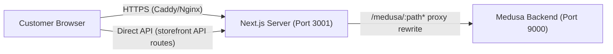

# GLOROV — Project Architecture Overview

> **Audit Date:** November 6, 2026  
> **Status:** Evidence-based assessment from source code inspection

---

## 1. Technology Stack

| Layer | Technology | Version | Evidence |
|---|---|---|---|
| **Monorepo** | Turborepo + pnpm workspaces | pnpm 9.15.9 | `turbo.json`, `pnpm-workspace.yaml` |
| **Backend** | Medusa v2 Commerce Engine | 2.22.0 | `apps/backend/package.json` |
| **Frontend** | Next.js (App Router) | 15.3.3 | `apps/storefront/package.json` |
| **React** | React 19 | 19.x | `apps/storefront/package.json` |
| **Database** | PostgreSQL | 16 (Alpine) | `docker-compose.prod.yml` |
| **Cache/Events** | Redis | 7 (Alpine) | `docker-compose.prod.yml` |
| **ORM** | MikroORM (via Medusa) | Built-in | `medusa-config.ts` |
| **Language** | TypeScript | 5.x | `packages/config/typescript/` |
| **Node.js** | ≥ 20 | 20.19.5 | `.nvmrc` |
| **Styling** | Tailwind CSS 4 | 4.x | `apps/storefront/package.json` |

---

## 2. Application Startup Flow

### Backend (Medusa v2)
1. **Entry**: `npx medusa start` → loads `medusa-config.ts`
2. **Config Validation**: `medusa-config.ts` L15-55 validates all required env vars (fail-closed in production)
3. **Database**: Connects to PostgreSQL via `DATABASE_URL` (session pooler in production)
4. **Redis**: Connects via `REDIS_URL` for event bus, workflow orchestration, and cache
5. **Module Loading**: Registers custom providers:
   - `payment-razorpay` (Razorpay payment provider)
   - `payment-cod` (Cash on Delivery with ₹5,000 cap)
   - `fulfillment-shiprocket` (Shiprocket logistics)
   - `file-cloudinary` (Cloudinary image storage)
   - `notification-email` (SMTP/mock email provider)
6. **Middleware**: Global `requestCorrelationMiddleware` → per-route `authenticate` + `validateOrderOwnership` + rate limiters
7. **Subscribers**: 8 event subscribers auto-register from `src/subscribers/`
8. **Health Check**: `/health` endpoint confirms startup

### Frontend (Next.js)
1. **Entry**: `next start` (standalone mode in production on port 3001)
2. **Config**: `next.config.ts` sets image domains, `/medusa/:path*` proxy rewrite
3. **Root Layout**: `app/layout.tsx` wraps in `StorefrontProvider` and `CustomerAuthProvider`
4. **Context Initialization**: `StorefrontContext.tsx` loads cart/wishlist from `localStorage`
5. **Auth Check**: `CustomerAuthContext.tsx` checks `localStorage` for existing auth state

---

## 3. Frontend ↔ Backend Communication

### Current State (Critical Finding)
The storefront has a **dual-mode architecture**:

| Mode | When Active | Behavior |
|---|---|---|
| **Backend-connected** | Medusa backend is reachable at `NEXT_PUBLIC_MEDUSA_BACKEND_URL` | Cart, auth, orders proxied to Medusa via `medusa-client.ts` |
| **Fallback/Simulated** | Backend unreachable OR `lib/api/client.ts` requests fail | Auth accepts any credentials, cart in `localStorage`, orders get fake IDs, checkout validation uses `MOCK_PRODUCTS` |

> [!CAUTION]
> The fallback mode is **silently activated** — there is no user-visible warning. The storefront appears fully functional with simulated data.

### Backend ↔ Database Communication
- **ORM**: MikroORM (embedded in Medusa v2 framework)
- **Connection**: Direct TCP to PostgreSQL (session pooler `?pgbouncer=true` in production)
- **Migrations**: Managed via `npx medusa db:migrate`
- **No custom models directory** — all data models are standard Medusa entities + metadata fields

---

## 4. Authentication Architecture

### Backend (Production-grade)
- Medusa v2 built-in auth module with JWT tokens
- Customer auth: session + bearer strategies
- Admin auth: session + bearer with role-based access
- Password hashing via Medusa's `@medusajs/auth` module (Argon2)
- Publishable API Key scoping for sales channel isolation

### Storefront (⚠️ Simulated)
- **File**: [`CustomerAuthContext.tsx`](file:///Users/sourav/Developer/WEB/top-projects/glorov/apps/storefront/src/context/CustomerAuthContext.tsx) (647 lines)
- Login: Accepts any email + any password (except `fail@test.com`)
- Registration: Stores raw password as `passwordHash` in `localStorage`
- Sessions: `localStorage` only — no server-side session tokens
- No JWT validation, no Medusa auth API calls

---

## 5. Payment Architecture

### Razorpay (Online Payments)
- **Provider**: [`payment-razorpay/service.ts`](file:///Users/sourav/Developer/WEB/top-projects/glorov/apps/backend/src/modules/payment-razorpay/service.ts) (455 lines)
- **Client**: [`payment-razorpay/client.ts`](file:///Users/sourav/Developer/WEB/top-projects/glorov/apps/backend/src/modules/payment-razorpay/client.ts) (321 lines)
- Order creation → `rzp.orders.create()` with amount in paise
- Signature verification: HMAC-SHA256 + `crypto.timingSafeEqual()`
- Auto-capture: `payment.authorized` → Medusa capture workflow
- **Webhook handler**: [`hooks/razorpay/route.ts`](file:///Users/sourav/Developer/WEB/top-projects/glorov/apps/backend/src/api/hooks/razorpay/route.ts) (227 lines) — idempotent event processing
- Mock mode for dev/test environments

### Cash on Delivery (COD)
- **Provider**: [`payment-cod/service.ts`](file:///Users/sourav/Developer/WEB/top-projects/glorov/apps/backend/src/modules/payment-cod/service.ts) (313 lines)
- ₹5,000 maximum order cap (configurable via `COD_MAX_AMOUNT_PAISE`)
- Refund requires bank UTR number for audit trail
- Admin reconciliation endpoint

---

## 6. Logistics Architecture

### Shiprocket Integration
- **Provider**: [`fulfillment-shiprocket/service.ts`](file:///Users/sourav/Developer/WEB/top-projects/glorov/apps/backend/src/modules/fulfillment-shiprocket/service.ts) (476 lines)
- **Client**: [`fulfillment-shiprocket/client.ts`](file:///Users/sourav/Developer/WEB/top-projects/glorov/apps/backend/src/modules/fulfillment-shiprocket/client.ts) (600 lines)
- Shipping options: Standard (Surface), Express (Air), Return (Reverse Pickup)
- Rate calculation: Live Shiprocket API with fallback baseline (₹49/₹99)
- PIN code serviceability check with 10-min TTL cache
- Shipment creation: Adhoc order → AWB assignment → Label generation
- Idempotency: Duplicate shipment creation guard
- **Webhook handler**: [`hooks/shiprocket/route.ts`](file:///Users/sourav/Developer/WEB/top-projects/glorov/apps/backend/src/api/hooks/shiprocket/route.ts) (326 lines)
  - Status normalization (DELIVERED/SHIPPED/OUT_FOR_DELIVERY/RTO/CANCELLED)
  - Medusa workflow execution for fulfillment state transitions
  - Constant-time token comparison for webhook authentication

---

## 7. Image & File Storage

- **Provider**: Cloudinary (via custom `file-cloudinary` module)
- **Cloud Name**: `naodmm8w`
- **Issue**: API key (179253354861549) and API secret hardcoded in `medusa-config.ts` L209-212

---

## 8. Background Task Execution

### Event-driven Subscriber System
8 subscribers in [`src/subscribers/`](file:///Users/sourav/Developer/WEB/top-projects/glorov/apps/backend/src/subscribers/):

| Subscriber | Event | Action |
|---|---|---|
| `order-placed.ts` | `order.placed` | Order confirmation email |
| `payment-captured.ts` | `payment.captured` | Payment receipt email |
| `payment-failed.ts` | `payment.failed` | Payment retry instructions email |
| `payment-refunded.ts` | `payment.refunded` | Refund status email with banking timelines |
| `order-canceled.ts` | `order.canceled` | Cancellation + refund timeline email |
| `shipment-created.ts` | `shipment.created` | Shipment dispatch + tracking email |
| `tracking-updated.ts` | `tracking.updated` | Active tracking link update email |
| `delivery-created.ts` | `delivery.created` | Delivery confirmation + unboxing guide email |

### Retry Infrastructure
- **`async-retry.ts`**: `withBoundedRetry()` — exponential backoff, max 3 retries in production
- Dead-letter queue (in-memory `DeadLetterRecord[]`) for permanently failed jobs
- Dead-letter metadata persisted to order's `metadata.failed_async_jobs`
- `NonRetryableError` class for fatal, non-retriable failures

### Metrics Collection
- **`metrics-collector.ts`**: In-memory operational metrics singleton
- Tracks: requests, errors, P95 latency, payment/shipment/webhook/notification failures
- Alert thresholds configurable via env vars
- Exposed via `GET /admin/health/metrics` (admin-authenticated)

---

## 9. Deployment Architecture

### Production Infrastructure
| Component | Where | Details |
|---|---|---|
| **Hosting** | Azure VM (1GB RAM) | Single VM with PM2 process manager |
| **Reverse Proxy** | Caddy 2 (Alpine) | Auto Let's Encrypt SSL, gzip/zstd, security headers |
| **Backend** | PM2 `glorov-backend` | Port 9000, `--max-old-space-size=256` |
| **Storefront** | PM2 `glorov-storefront` | Port 3001, standalone Next.js, `--max-old-space-size=160` |
| **Database** | PostgreSQL 16 (Docker or direct) | 1GB memory limit |
| **Cache** | Redis 7 (Docker or direct) | 512MB limit, AOF persistence |

### Domains
- `glorov.in` / `www.glorov.in` → Next.js storefront
- `api.glorov.in` → Medusa backend (also `glorov.tech` / `api.glorov.tech` in deploy script)
- `admin.glorov.in` → Medusa Admin Dashboard

### CI/CD Pipeline
- **CI**: `.github/workflows/ci.yml` — Lint → Typecheck → Unit Tests → Integration Tests → Production Build
- **Deploy**: `.github/workflows/deploy.yml` — Build → SSH rsync → PM2 reload → Smoke test
- Deployment via rsync of compiled artifacts (no Docker in production currently)
- Post-deploy smoke verification of all 3 services

---

## 10. External Service Dependencies

| Service | Purpose | Required for Production | Mock Available |
|---|---|---|---|
| PostgreSQL | Primary database | ✅ Yes | No |
| Redis | Event bus, cache, workflow state | ✅ Yes | No |
| Razorpay | Online payment processing | ✅ Yes | ✅ Yes (`RAZORPAY_MOCK_MODE`) |
| Shiprocket | Logistics/fulfillment | ✅ Yes | ✅ Yes (`SHIPROCKET_MOCK_MODE`) |
| Cloudinary | Product image CDN | ✅ Yes | No |
| SMTP Server | Transactional email | ✅ Yes | ✅ Yes (`NOTIFICATION_MOCK_MODE`) |
| Caddy/Nginx | Reverse proxy + SSL | ✅ Yes | N/A |
| GitHub Actions | CI/CD | Recommended | N/A |
