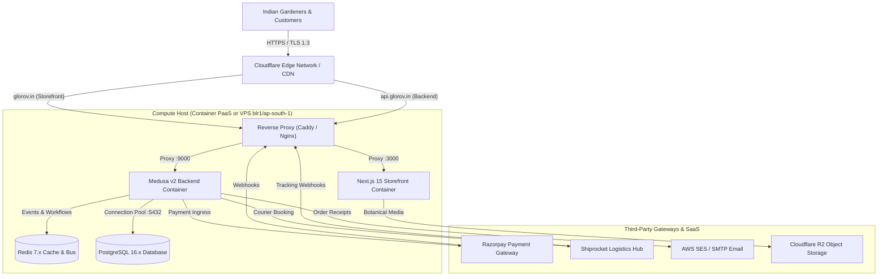
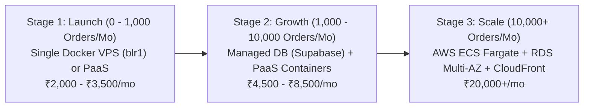

# GLOROV — Production Deployment & DevOps Engineering Specification

**Document Version:** 1.0.0  
**Target Architecture:** Next.js 15 Storefront + Medusa v2 Headless Backend + PostgreSQL 16 + Redis 7  
**Scope:** Architecture, Hosting Cost Comparison, Environment Separation, Database Provisioning, Zero-Downtime Deployment, CI/CD Pipeline, Webhooks, Rollback Runbooks, and Production Checklist  
**Market Context:** Indian Botanical D2C E-commerce (Seeds, Live Nursery Plants, Gardening Supplies)  

---

## 1. Executive Summary & Operational Invariants

GLOROV's production architecture delivers high availability, low latency across the Indian subcontinent, and strict financial/logistics correctness while maintaining affordable operational costs. Living seeds and plants require zero-latency checkout and uninterrupted webhook processing: a failure to capture a payment or process a dispatch event directly impacts living biological inventory.

### Core DevOps Invariants
1. **Zero Secret Disclosure:** No private secrets (`JWT_SECRET`, `COOKIE_SECRET`, `RAZORPAY_KEY_SECRET`, `SHIPROCKET_PASSWORD`, database passwords) are stored in git, baked into Docker images, or exposed via `NEXT_PUBLIC_*` client bundles.
2. **Persistent Runtimes for Backend:** Medusa v2 relies on an in-memory workflow orchestrator and persistent event subscribers. It **cannot** run on ephemeral serverless functions that sleep or terminate background processes.
3. **Fail-Closed Security in Production:** Production environments strictly prohibit mock payment modes (`RAZORPAY_MOCK_MODE=true`), mock courier dispatch (`SHIPROCKET_MOCK_MODE=true`), and wildcard CORS origins (`*`).
4. **Direct Database Access for Migrations:** Medusa v2 migrations utilize PostgreSQL advisory locks (`pg_advisory_lock`) and transactional DDL. Migrations **must** execute against direct PostgreSQL ports (5432), never transaction-mode poolers (6543).
5. **No Production Outage on Deployment:** Deployments utilize rolling container updates or blue-green container switches with pre-deployment smoke tests and automated database snapshots.

---

## 2. Deployment Architecture & Service Topology



### 2.1 Process Separation & Hosting Matrix

| Service | Runtime Type | CPU / RAM Minimum | Recommended Infrastructure | Notes |
| :--- | :--- | :--- | :--- | :--- |
| **Next.js Storefront** | Node.js 20 SSR | 0.5 vCPU / 512MB RAM | Container or Vercel Pro | SSR dynamic rendering, image optimization via `sharp`, Edge routing. |
| **Medusa Backend** | Node.js 20 Long-Running | 1.0 vCPU / 1.5GB RAM | Container PaaS or Cloud VPS | Persistent Node process (`medusa start`). Requires memory for Medusa v2 modules. |
| **PostgreSQL 16** | Relational Database | 1.0 vCPU / 1GB RAM | Supabase Pro / RDS Mumbai | Direct port 5432 for migrations; session pooler for runtime. |
| **Redis 7** | In-Memory Cache/Queue | 0.25 vCPU / 256MB RAM | Managed Redis (Upstash/Render) | Workflow engine state, event bus, distributed rate limiting. |
| **Object Storage** | S3-Compatible API | Unlimited Serverless | Cloudflare R2 / AWS S3 | Botanical photography, moisture certificates, CSV imports. Zero egress fees on R2. |
| **Background Workers** | In-Process (Shared) | Handled by Backend | Combined with Backend | Medusa v2 default `worker_mode: "shared"`. Separate worker container for >10k orders/mo. |

---

## 3. Hosting Cost Comparison & Suitability (Indian Market)

For an Indian botanical startup, cloud spend must be carefully calibrated against revenue. We evaluate four hosting options:

```
Hosting Architecture Cost Comparison (INR / Month)
┌─────────────────────────────────────────────────────────────┬─────────────┐
│ Architecture Option                                         │ Monthly Cost│
├─────────────────────────────────────────────────────────────┼─────────────┤
│ 1. Bootstrap VPS (DigitalOcean Bangalore blr1)              │ ₹2,000 - ₹2,500
│ 2. Managed Hybrid PaaS (Render + Supabase + Cloudflare R2)  │ ₹2,800 - ₹4,800
│ 3. Serverless Hybrid (Vercel + Railway + Neon + Upstash)    │ ₹3,500 - ₹5,500
│ 4. AWS Enterprise (ECS Fargate + RDS + ElastiCache Mumbai)  │ ₹12,500 - ₹25,000
└─────────────────────────────────────────────────────────────┴─────────────┘
```

### Detailed Evaluation of Practical Options

#### Option 0: Micro Azure VM (Standard_B1s 1GB RAM) — Low-Cost Bootstrap
- **Specification:** 1 vCPU, 1GB RAM, Ubuntu 22.04 LTS ($7.50/mo ≈ ₹620/mo).
- **Topology:** Single host running PostgreSQL 16 (384MB limit), Redis 7 (128MB limit with LRU), Medusa v2 (256MB heap), and Next.js 15 Standalone (128MB heap) behind Caddy/Nginx.
- **Total Memory Allocation:** ~896MB (fits in 1024MB RAM).
- **Mandatory Configuration:** At least 1GB (recommended 2GB) swap file configured to absorb transient build, migration, and PM2 reload spikes.
- **Zero-Downtime Reload:** Managed via `pm2 reload` (never `pm2 restart`).

#### Option 1: Bootstrap VPS with Docker Compose (Recommended for Launch)
- **Provider:** DigitalOcean (Bangalore `blr1` datacenter) or AWS Lightsail (Mumbai `ap-south-1`).
- **Specification:** 2 vCPUs, 4GB RAM, 80GB NVMe SSD, 4TB Bandwidth ($24/mo ≈ ₹2,000/mo).
- **Topology:** Single Docker host running PostgreSQL 16, Redis 7, Medusa v2, Next.js 15, and Caddy with automated Let's Encrypt TLS.
- **Latency:** <25ms in South India (Bangalore/Chennai/Hyderabad), <45ms North India (Delhi/NCR/Punjab).
- **Pros:** Lowest cost, zero cold starts, all services communicate over Docker internal network, zero cross-service egress charges.
- **Cons:** Single point of failure; requires automated backup scripts to Cloudflare R2.

#### Option 2: Managed Container PaaS + Managed Database (Recommended for Growth)
- **Providers:** Render / Railway (Compute) + Supabase (Database in `ap-south-1` Mumbai) + Upstash (Redis).
- **Cost:** Medusa Backend ($7/mo) + Storefront ($7/mo) + Supabase Pro ($25/mo) + Upstash ($0-$5/mo) = ~$39-$44/mo (₹3,200 - ₹3,700/mo).
- **Pros:** Fully managed database with automated daily snapshots and point-in-time recovery (PITR); zero Linux OS maintenance; zero Docker daemon upkeep.
- **Cons:** Multi-service latency if compute and database are in different geographic regions.

> [!WARNING]
> **Free Tiers Are Unsuitable for Production Commerce:** Free tiers on Render or Railway spin down after 15 minutes of inactivity. The resulting cold start (50–90 seconds) causes Razorpay payment webhook timeouts, cart abandonment during peak shopping hours, and missed Shiprocket tracking updates. Production deployments **must** use paid plans with always-on instances.

### Phased Migration Roadmap



---

## 4. Environment Separation & Configuration Inventory

GLOROV enforces strict environment separation across Development, Staging, and Production.

### 4.1 Master Environment Variable Inventory

| Variable Name | Required In | Sensitivity | Dev Default / Format | Production Format / Requirement |
| :--- | :---: | :---: | :--- | :--- |
| `NODE_ENV` | All | Public | `development` | `production` (strict fail-closed checks enabled) |
| `PORT` | Backend | Public | `9000` | `9000` |
| `DATABASE_URL` | Backend | **SECRET** | `postgresql://...localhost:5432/glorov_medusa` | `postgresql://...ap-south-1...:5432/...sslmode=require` |
| `REDIS_URL` | Backend | **SECRET** | `redis://localhost:6379` | `redis://:password@host:6379` |
| `JWT_SECRET` | Backend | **SECRET** | Dev placeholder (32 chars) | Random 64-char hex (`openssl rand -hex 32`) |
| `COOKIE_SECRET` | Backend | **SECRET** | Dev placeholder (32 chars) | Random 64-char hex (`openssl rand -hex 32`) |
| `STORE_CORS` | Backend | Restricted | `http://localhost:3000` | `https://glorov.in,https://www.glorov.in` (No wildcard `*`) |
| `ADMIN_CORS` | Backend | Restricted | `http://localhost:5173,http://localhost:9000` | `https://admin.glorov.in` |
| `AUTH_CORS` | Backend | Restricted | `http://localhost:3000,...` | `https://glorov.in,https://admin.glorov.in` |
| `RAZORPAY_KEY_ID` | Backend | Public API Key | `rzp_test_...` | `rzp_live_...` (Live Indian merchant key) |
| `RAZORPAY_KEY_SECRET` | Backend | **SECRET** | Test secret | Live secret (Never exposed to client) |
| `RAZORPAY_WEBHOOK_SECRET`| Backend | **SECRET** | Test webhook secret | Dedicated secret configured in Razorpay Dashboard |
| `RAZORPAY_MOCK_MODE` | Backend | Public | `true` or `false` | **MUST BE `false`** (Guarded at startup) |
| `SHIPROCKET_EMAIL` | Backend | Restricted | `operations@glorov.in` | Live account email |
| `SHIPROCKET_PASSWORD` | Backend | **SECRET** | Account password | Production account password |
| `SHIPROCKET_WEBHOOK_TOKEN`| Backend | **SECRET** | Secret token | High-entropy token shared with Shiprocket webhook |
| `SHIPROCKET_MOCK_MODE` | Backend | Public | `true` or `false` | **MUST BE `false`** (Guarded at startup) |
| `COD_MAX_AMOUNT_PAISE` | Backend | Public | `500000` (₹5,000) | Business cap (e.g., `500000` paise) |
| `SMTP_HOST` | Backend | Restricted | `smtp.mailtrap.io` | `email-smtp.ap-south-1.amazonaws.com` |
| `SMTP_USER` / `PASSWORD`| Backend | **SECRET** | Mailtrap credentials | AWS SES IAM SMTP credentials |
| `NOTIFICATION_MOCK_MODE`| Backend | Public | `false` | **MUST BE `false`** |
| `NEXT_PUBLIC_MEDUSA_BACKEND_URL` | Storefront | Public | `http://localhost:9000` | `https://api.glorov.in` (Must be HTTPS) |
| `NEXT_PUBLIC_MEDUSA_PUBLISHABLE_KEY` | Storefront | Public | `pk_test_...` | `pk_live_...` (Scoped to Web Sales Channel) |
| `NEXT_PUBLIC_BASE_URL` | Storefront | Public | `http://localhost:3000` | `https://glorov.in` |

---

## 5. Database Provisioning & Migration Procedures

### 5.1 Supabase & PostgreSQL Compatibility Rules
When using managed PostgreSQL (e.g., Supabase):
1. **Port 5432 (Direct / Session Pooler):** **Mandatory** for running Medusa v2 migrations.
2. **Port 6543 (Transaction Pooler):** **Incompatible** with Medusa v2 migrations because transactional poolers terminate advisory locks (`pg_advisory_lock`) across transaction boundaries, leading to migration deadlock.

```
                    ┌──────────────────────────────────────────────┐
                    │               PostgreSQL 16                  │
                    └──────────────────────▲───────────────────────┘
                                           │
                 ┌─────────────────────────┴─────────────────────────┐
                 │                                                   │
        Port 5432 (Direct / Session)                       Port 6543 (Transaction)
                 ▲                                                   ▲
                 │                                                   │
     [medusa db:migrate]                                   [Stateless Read Queries]
  (Supports DDL & Advisory Locks)                       (Breaks Advisory Locks & DDL)
```

### 5.2 Pre-Deployment Database Snapshot Command
Always take an immutable snapshot prior to executing migrations:
```bash
# Automated binary backup using pg_dump
pg_dump -Fc -h "$DB_HOST" -p 5432 -U "$DB_USER" -d "$DB_NAME" \
  -f "/backups/glorov_pre_deploy_$(date +%Y%m%d_%H%M%S).dump"
```

### 5.3 Executing Migrations
```bash
# In backend container or deployment pipeline
pnpm --filter @glorov/backend db:migrate
```

### 5.4 Migration Rollback & Recovery
Medusa v2 does not provide down migrations (`db:rollback`). If a migration fails:
1. Stop the application server immediately: `docker compose -f docker-compose.prod.yml stop backend`.
2. Inspect the migration error output.
3. If schema corruption occurred, restore from the pre-deployment snapshot:
   ```bash
   pg_restore --clean --if-exists -h "$DB_HOST" -p 5432 -U "$DB_USER" -d "$DB_NAME" \
     /backups/glorov_pre_deploy_[TIMESTAMP].dump
   ```
4. Restart the previous stable container version.

---

## 6. Domain, DNS, CDN & HTTPS Configuration

### 6.1 DNS Record Mapping

| Hostname | Type | Target / Value | Proxy Status | Purpose |
| :--- | :---: | :--- | :---: | :--- |
| `glorov.in` | `A` | Server Public IPv4 (or CNAME to PaaS) | Proxied (Orange Cloud) | Apex storefront |
| `www.glorov.in` | `CNAME` | `glorov.in` | Proxied | Redirect to apex |
| `api.glorov.in` | `A` | Server Public IPv4 (or CNAME to PaaS) | Proxied | Medusa backend & webhooks |
| `admin.glorov.in` | `CNAME` | `api.glorov.in` | Proxied | Medusa Admin dashboard |

### 6.2 Cloudflare & SSL/TLS Rules
- **SSL/TLS Mode:** `Full (Strict)` (Requires valid TLS certificate on the origin server).
- **HSTS Settings:** `Enable HSTS`, `Max-Age: 63072000` (2 years), `Include Subdomains`, `Preload`.
- **Minimum TLS Version:** `TLS 1.2` (TLS 1.3 preferred).
- **WAF Bypass Rules for Inbound Webhooks:**
  - Create a Cloudflare WAF Skip Rule for path `/hooks/razorpay` and `/hooks/shiprocket`.
  - Disable "Bot Fight Mode" and "Managed Challenge" on these specific webhook routes to ensure webhook deliveries from Razorpay and Shiprocket are never challenged with Captchas.

---

## 7. Webhook Configuration & Security Verification

### 7.1 Razorpay Webhook Configuration
- **Endpoint URL:** `https://api.glorov.in/hooks/razorpay`
- **Active Events:**
  - `payment.authorized`
  - `payment.captured`
  - `payment.failed`
  - `refund.processed`
- **Secret:** 32+ character high-entropy string set in both Razorpay Dashboard and `RAZORPAY_WEBHOOK_SECRET`.
- **Verification Test:**
  ```bash
  # Send test webhook with signature header
  curl -i -X POST https://api.glorov.in/hooks/razorpay \
    -H "Content-Type: application/json" \
    -H "X-Razorpay-Signature: [CALCULATED_HMAC_SHA256]" \
    -d '{"event":"payment.captured","payload":{...}}'
  ```

### 7.2 Shiprocket Webhook Configuration
- **Endpoint URL:** `https://api.glorov.in/hooks/shiprocket`
- **Active Events:** Tracking status updates, AWB assignment, Delivery exceptions (NDR / RTO).
- **Authentication Header:** `x-api-key: [SHIPROCKET_WEBHOOK_TOKEN]` (Verified using constant-time comparison).

---

## 8. Sandbox to Production Transition Checklist

### 8.1 Razorpay Payment Gateway
- [ ] Complete business KYC and Indian GSTIN verification on Razorpay Dashboard.
- [ ] Link active current bank account and verify penny-drop settlement.
- [ ] Generate Live API Keys (`rzp_live_...`).
- [ ] Configure live webhook URL (`https://api.glorov.in/hooks/razorpay`) and copy live webhook secret.
- [ ] Ensure `RAZORPAY_MOCK_MODE=false` in production environment.
- [ ] Perform live end-to-end payment test with a ₹1 or ₹10 test order.

### 8.2 Shiprocket Logistics Hub
- [ ] Complete KYC and mobile verification on Shiprocket account.
- [ ] Configure Pune Central Nursery pickup address with PIN code `411001`.
- [ ] Recharge Shiprocket prepaid freight wallet (minimum ₹2,000 balance).
- [ ] Configure courier selection rules (surface courier for plants, air courier for seeds).
- [ ] Set `SHIPROCKET_MOCK_MODE=false` and configure live `SHIPROCKET_EMAIL` and `SHIPROCKET_PASSWORD`.
- [ ] Confirm tracking webhook is subscribed and transmitting.

### 8.3 AWS SES / Transactional Email
- [ ] Verify domain identity `glorov.in` in AWS SES console.
- [ ] Add DKIM, SPF (`v=spf1 include:amazonses.com ~all`), and DMARC (`v=DMARC1; p=quarantine;`) DNS records.
- [ ] Submit production access request to remove AWS SES sandbox sending limits.
- [ ] Generate dedicated IAM user credentials with `AmazonSESFullAccess` or restricted sending policy.

---

## 9. SRE Observability & Alerting Thresholds

Production monitoring integrates the application metrics collector with alerting channels:

| Metric | Normal Range | Alert Warning Threshold | P0 Critical Threshold | Action Plan |
| :--- | :---: | :---: | :---: | :--- |
| **API P95 Latency** | < 400ms | > 1,500ms for 5m | > 3,000ms for 3m | Check DB connection pool & slow queries. |
| **HTTP 5xx Error Rate** | < 0.1% | > 2% for 5m | > 5% for 3m | Inspect structured error logs with correlation IDs. |
| **Payment Failures** | < 2% | > 3 consecutive failures | > 5 failures in 1h | Check Razorpay gateway status & webhook secret. |
| **Shiprocket API Errors** | < 1% | > 3 courier rate failures | Complete API outage | Switch to fallback shipping rates. |
| **Disk Storage (VPS)** | < 60% | > 80% | > 90% | Purge Docker cache; archive old log files. |

---

## 10. Zero-Downtime Deployment & Rollback Protocol

### 10.1 Deployment Steps (Automated via GitHub Actions)
1. Developer pushes version tag: `git tag v1.0.0 && git push origin v1.0.0`.
2. GitHub Actions executes `validate` job (typecheck, lint, unit tests, integration tests).
3. Pipeline deploys to Staging (`staging.glorov.in`) and runs automated smoke tests.
4. Deployment to Production pauses for explicit SRE manual approval via GitHub Environment Protection.
5. On approval, production containers update via rolling rollout:
   ```bash
   # Pull latest verified images
   docker compose -f docker-compose.prod.yml pull
   # Run database migrations
   docker compose -f docker-compose.prod.yml run --rm backend pnpm --filter @glorov/backend db:migrate
   # Update services with zero downtime
   docker compose -f docker-compose.prod.yml up -d --remove-orphans
   ```
6. Pipeline runs post-deployment smoke test suite: `node scripts/smoke-test.mjs`.

### 10.2 Emergency Rollback Runbook
If smoke tests fail or critical payment/order regressions are detected:
1. Revert to previous Docker image tag or git tag:
   ```bash
   # Point docker-compose to previous image
   export BACKEND_IMAGE=glorov-backend:v0.9.9
   export STOREFRONT_IMAGE=glorov-storefront:v0.9.9
   docker compose -f docker-compose.prod.yml up -d
   ```
2. If database schema was altered, restore pre-deploy snapshot (see Section 5.4).
3. Clear Redis cache to evict invalid session or pricing keys: `redis-cli -a "$REDIS_PASSWORD" flushdb`.
4. Verify system recovery: `node scripts/smoke-test.mjs https://api.glorov.in https://glorov.in`.

---

## 11. Final Production Launch Checklist

- [ ] All 16 storefront test files and 15 backend test suites pass with 0 errors.
- [ ] Multi-stage Dockerfiles (`apps/backend/Dockerfile`, `apps/storefront/Dockerfile`) build cleanly.
- [ ] Root `.env.example`, `apps/backend/.env.example`, and `apps/storefront/.env.example` verified with zero leaked secrets.
- [ ] Medusa `validateProductionConfig` verifies that mock modes and wildcard CORS are rejected.
- [ ] Database migrations executed against direct port 5432.
- [ ] Razorpay live keys active; webhook registered and tested.
- [ ] Shiprocket live account active with Pune PIN 411001 and freight wallet funded.
- [ ] Cloudflare SSL set to Full (Strict) with WAF bypass for webhook routes.
- [ ] Automated smoke test script (`scripts/smoke-test.mjs`) verified against running environment.
- [ ] SRE team on standby during launch window.
