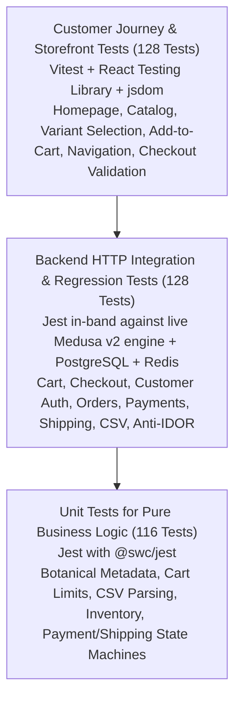
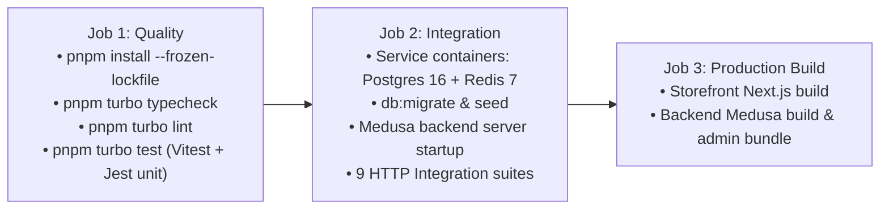

# GLOROV — Automated Testing & Regression Strategy

**Application:** GLOROV Botanical E-Commerce (Next.js 15 Storefront + Medusa v2 Backend)  
**Testing Frameworks:** Vitest 5, React Testing Library, Jest 29 with `@swc/jest`, Turborepo  
**Total Automated Tests:** 372 Tests (128 Storefront, 116 Backend Unit, 128 Backend HTTP Integration)  
**Status:** 100% Pass Rate Across All Layers  

---

## 1. Testing Architecture & Philosophy

The GLOROV test strategy follows the **Practical Testing Pyramid**, prioritizing fast feedback on business logic, rigorous API contract testing against the running Medusa v2 engine, and user-centric customer journey tests on the Next.js storefront:



### Core Principles
1. **Never Weaken Validation to Pass Tests:** Security, Zod schemas, and access controls are actively verified, never bypassed.
2. **Deterministic, Isolated Test Data:** Integration tests create unique customer identifiers with timestamps (`aarav.customer.${Date.now()}@glorov.in`) to prevent collisions across runs.
3. **Safe Mocks for Third-Party Gateways:** Razorpay and Shiprocket operate in deterministic mock modes during automated tests, preventing accidental live charges or courier bookings.
4. **Fast Local Execution:** SWC compilation for Jest and Vitest native ES modules execute full test suites in seconds.

---

## 2. Test Suites Overview & Inventory

```
========================================================================================
GLOROV COMPREHENSIVE AUTOMATED TEST SUITE EXECUTION INVENTORY
========================================================================================

Layer / Suite File                                     Tests   Type          Focus
----------------------------------------------------------------------------------------
STOREFRONT (Vitest + jsdom + Testing Library)
  src/lib/__tests__/security.test.ts                      7    Unit          Open redirect prevention, safe URLs
  src/lib/__tests__/cart.test.ts                         29    Unit          Cart client, line items, address Zod
  src/lib/__tests__/customer.test.ts                     29    Unit          Auth state, tokens, profile updates
  src/lib/__tests__/catalog.test.ts                      31    Unit          Price calculation, stock availability
  src/lib/__tests__/utils.test.ts                        15    Unit          formatINR, class merging, health check
  src/__tests__/customer-journeys.test.tsx               17    Journey (DOM) Hero, VariantSelector, AddToCart, Nav
  --------------------------------------------------------------------------------------
  Storefront Subtotal                                   128    100% PASS

BACKEND UNIT TESTS (Jest + @swc/jest)
  src/__tests__/business-logic-and-regression.unit.spec.ts 29  Unit          Botanical metadata, cart limits, CSV,
                                                                             inventory allocation, state machines
  src/__tests__/security-hardening.unit.spec.ts           9    Unit          Production secret guards, HMAC timing
  src/__tests__/admin-operations.unit.spec.ts            14    Unit          Catalog CRUD, variants, order filters
  src/__tests__/razorpay-provider.unit.spec.ts           11    Unit          Razorpay payment session, capture, refund
  src/__tests__/shiprocket-provider.unit.spec.ts          9    Unit          Serviceability, order creation, labels
  src/__tests__/admin-access-control.unit.spec.ts         9    Unit          Privilege separation, bearer tokens
  src/__tests__/cod-provider.unit.spec.ts                 6    Unit          Cash on Delivery authorization lifecycle
  src/__tests__/health.unit.spec.ts                       2    Unit          Healthcheck route responsiveness
  src/__tests__/csv-import.unit.spec.ts                  12    Unit          CSV parser, delimiter handling, schema
  src/__tests__/catalog-and-variants.unit.spec.ts        15    Unit          Seed attributes, germination specs
  --------------------------------------------------------------------------------------
  Backend Unit Subtotal                                 116    100% PASS

BACKEND HTTP INTEGRATION & REGRESSIONS (Jest against Medusa v2 Engine)
  cart-checkout-order.spec.ts                             9    HTTP Int      Cart lifecycle, line items, order place
  customer-auth-orders.spec.ts                           16    HTTP Int      Customer register, login, order history
  shipping-and-fulfillment.spec.ts                       14    HTTP Int      Shiprocket options, AWB, delivery hooks
  critical-regressions.spec.ts                           15    HTTP Int      Anti-IDOR, duplicate webhooks, cart retry
  admin-operations.spec.ts                               17    HTTP Int      Admin catalog CRUD, inventory balance
  payment-integration.spec.ts                            10    HTTP Int      Razorpay + COD sessions, verification
  catalog-store-api.spec.ts                              16    HTTP Int      Store catalog filters, pagination, tags
  product-csv-import.spec.ts                             11    HTTP Int      Preview & validation, 5MB ceiling
  security-audit.spec.ts                                 20    HTTP Int      401 admin access, timing attacks, rate limits
  --------------------------------------------------------------------------------------
  Backend Integration Subtotal                          128    100% PASS
========================================================================================
TOTAL MONOREPO AUTOMATED TEST COVERAGE                  372    100% PASS
========================================================================================
```

---

## 3. Running Test Suites

### 3.1 Run All Tests Across Entire Monorepo
Using Turborepo:
```bash
# Run all unit and storefront journey tests
pnpm turbo test

# Run type checks and linting
pnpm turbo typecheck lint

# Run all backend HTTP integration tests
pnpm --filter @glorov/backend test:integration:http
```

### 3.2 Running Storefront Tests
```bash
# Run all storefront tests (unit + customer journeys)
pnpm --filter @glorov/storefront test

# Run in watch mode during frontend development
pnpm --filter @glorov/storefront exec vitest

# Run only customer journeys
pnpm --filter @glorov/storefront exec vitest run customer-journeys
```

### 3.3 Running Backend Unit Tests
```bash
# Run all backend unit tests
pnpm --filter @glorov/backend test:unit

# Run specific unit test suite
pnpm --filter @glorov/backend test:unit -t "Business Logic"
pnpm --filter @glorov/backend test:unit -t "Razorpay"
```

### 3.4 Running Backend Integration Tests
> **Prerequisite:** The Medusa backend must be running on port 9000 (or `MEDUSA_BACKEND_URL`), connected to PostgreSQL and Redis.
```bash
# Run all 9 HTTP integration test suites
pnpm --filter @glorov/backend test:integration:http

# Run only the critical regression suite
pnpm --filter @glorov/backend test:integration:http critical-regressions.spec.ts

# Run only security integration tests
pnpm --filter @glorov/backend test:integration:http security-audit.spec.ts

# Run matching a specific test description
pnpm --filter @glorov/backend test:integration:http -t "Anti-IDOR"
```

---

## 4. Test Database & Environment Configuration

### 4.1 Local Development Services (Docker)
Ensure Docker PostgreSQL 16 and Redis 7 containers are running:
```bash
# Start Docker containers
docker compose up -d

# Verify containers are healthy
docker ps
```

### 4.2 Test Database Setup & Migrations
```bash
# Run database migrations
pnpm --filter @glorov/backend db:migrate

# Seed Indian botanical region, test catalog & shipping options
pnpm --filter @glorov/backend exec npx tsx src/scripts/seed-india-region.ts

# Start backend server
pnpm --filter @glorov/backend start
```

### 4.3 Environment Variables for Testing
The test runner uses standard non-sensitive defaults for testing:
| Variable | Value for Tests | Description |
|---|---|---|
| `MEDUSA_BACKEND_URL` | `http://localhost:9000` | Target Medusa backend instance |
| `STORE_PUBLISHABLE_KEY` | `pk_2d4629ab032f218451f992310351db37f7adcc4ea53d3cfa5fc2c95864b717cf` | Public storefront key |
| `RAZORPAY_MOCK_MODE` | `"true"` | Enables local deterministic Razorpay mock signatures |
| `SHIPROCKET_MOCK_MODE` | `"true"` | Enables local Shiprocket courier rate and tracking mocks |
| `SHIPROCKET_WEBHOOK_TOKEN` | `test_shiprocket_token_2026` | Test webhook secret token |
| `RAZORPAY_WEBHOOK_SECRET` | `mock_razorpay_webhook_secret_dev` | Test Razorpay webhook secret |

---

## 5. Mocking Strategy & Third-Party Integrations

### 5.1 Razorpay Payment Provider Mocks
- **In-Memory Mock Client (`RazorpayClient`):** When `RAZORPAY_MOCK_MODE=true` and `NODE_ENV !== 'production'`, orders and payments simulate successful creation, authorization, and capture without communicating with external Razorpay APIs (`api.razorpay.com`).
- **Signature Verification:** Mock mode accepts signatures starting with `mock_sig_` or `valid_mock_signature`. Any other signature string triggers full HMAC-SHA256 constant-time verification.
- **Production Safety:** In `NODE_ENV === 'production'`, mock mode is strictly disabled regardless of environment variables.

### 5.2 Shiprocket Fulfillment Provider Mocks
- **Serviceability Matrix:** `ShiprocketClient` simulates courier rate calculations based on Indian PIN codes (e.g., Delhivery Air Botanical Express, Bluedart Surface) with standard rates (₹49 standard, ₹99 express).
- **Tracking Scans:** Simulates tracking stages: `PICKED_UP` $\rightarrow$ `IN_TRANSIT` $\rightarrow$ `OUT_FOR_DELIVERY` $\rightarrow$ `DELIVERED`.
- **RTO Simulation:** Tests support triggering `RTO INITIATED` to verify seller botanical inspection workflow.

### 5.3 Optional Live Sandbox Verification
To run tests against live staging/sandbox APIs:
```bash
# Optional: Set live sandbox credentials
export RAZORPAY_MOCK_MODE=false
export RAZORPAY_KEY_ID="rzp_test_your_real_sandbox_key"
export RAZORPAY_KEY_SECRET="your_real_sandbox_secret"

export SHIPROCKET_MOCK_MODE=false
export SHIPROCKET_EMAIL="your_sandbox@shiprocket.com"
export SHIPROCKET_PASSWORD="your_sandbox_password"
```

---

## 6. Critical Regression Scenarios & Guardrails

The suite in [`critical-regressions.spec.ts`](file:///Users/sourav/Developer/WEB/top-projects/glorov/apps/backend/integration-tests/http/critical-regressions.spec.ts) continuously guards against e-commerce regression bugs:

1. **Anti-IDOR Protection:** Customer B receives `403 Forbidden` when attempting to access Customer A's order by ID.
2. **Storefront Privilege Separation:** Storefront publishable keys and customer JWTs receive `401 Unauthorized` on `/admin/*` routes.
3. **Payment Tampering Defense:** Forged signatures or incomplete payloads are rejected with `400 Bad Request` before order completion.
4. **Webhook Idempotency:** Duplicate webhook events (e.g. repeated `payment.captured` or Shiprocket status callbacks) are handled idempotently without duplicate order mutations.
5. **Double-Checkout Prevention:** Repeated checkout requests on an already completed cart do not create duplicate orders.
6. **Overselling & Inventory Protection:** Attempting to checkout with unavailable stock or excessive quantities ($>50$ packets) is rejected.
7. **Failed Shipping Containment:** Courier API errors safely log orphan events without falsely marking orders as shipped.
8. **Catalog Integrity Guard:** Malformed CSV uploads in preview mode do not mutate database inventory.

---

## 7. Continuous Integration Pipeline (GitHub Actions)

The CI workflow in [`.github/workflows/ci.yml`](file:///Users/sourav/Developer/WEB/top-projects/glorov/.github/workflows/ci.yml) validates pull requests across three distinct stages:



### Interpreting CI Failures
- **Quality Job Failure:** Run `pnpm typecheck` or `pnpm lint` locally to identify type mismatch or lint rule violations.
- **Integration Job Failure:** Verify that PostgreSQL and Redis services are reachable, migrations are applied (`db:migrate`), and the backend responds with `200 OK` on `/health`.
- **Build Job Failure:** Check Next.js build logs for dynamic route generation issues or missing environment variables.
